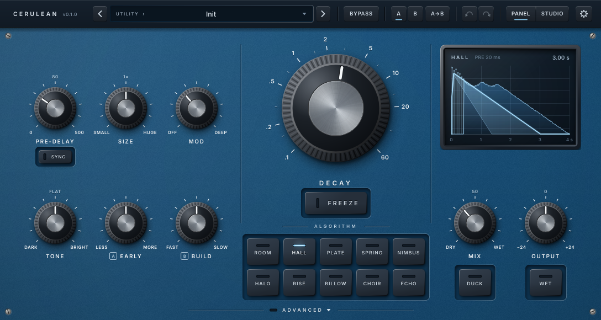
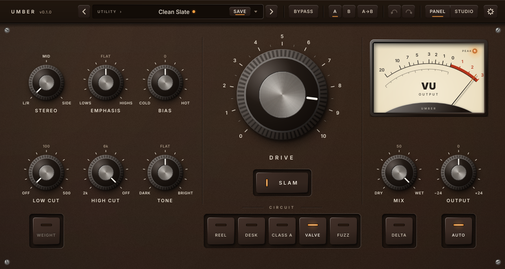
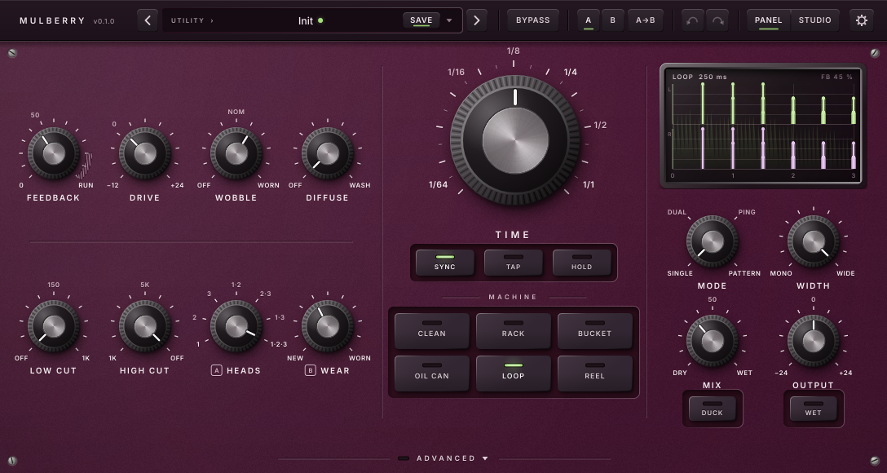
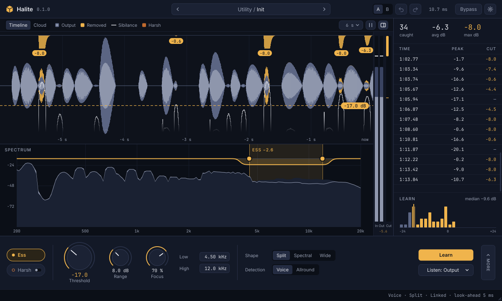

# Myzel Audio

Open-source audio plugins for Linux, Windows and macOS: VST3, CLAP, Standalone, plus LV2 on Linux
and AU on macOS. One installer per system, unsigned (see [Installing](#installing)).

| | |
|---|---|
| [](plugins/cerulean) | **[Cerulean](plugins/cerulean)**: a creative reverb. Ten algorithms, from honest rooms and plates to huge modulated clouds, shimmering halos, swells, blooms, voices and tape echoes. [Manual](plugins/cerulean/docs/MANUAL.md) |
| [](plugins/umber) | **[Umber](plugins/umber)**: an analog-modelled saturator. Five circuit-level models on one screen. [Manual](plugins/umber/docs/MANUAL.md) |
| [](plugins/mulberry) | **[Mulberry](plugins/mulberry)**: an echo. Seven delay machines modelled from their medium: clean memory, an early rack unit, a bucket-brigade chip, an oil-can drum, a magnetic drum, a tape loop and a studio deck. [Manual](plugins/mulberry/docs/MANUAL.md) |
| [](plugins/halite) | **[Halite](plugins/halite)**: a de-esser. It measures each ess against the voice around it and takes out only what sticks out, with an optional band for a harsh upper-mid edge. [Manual](plugins/halite/docs/MANUAL.md) |

## Installing

Download the installer for your system from the
[latest release](https://github.com/mtunix/myzel-audio/releases/latest). It lists every plugin
with what is already installed: tick what to install or update, tick what to remove. Your
presets and settings are never touched.

The installers are not signed: we have no paid Apple or Microsoft certificate. Each file comes
with a SHA-256 sum in `SHA256SUMS` and a build attestation, so you can check it was built by this
repository's CI: `gh attestation verify <file> --repo mtunix/myzel-audio`.

### Windows

1. Run `MyzelAudio-<version>-windows-x64-setup.exe`. Windows shows "Windows protected your PC":
   click **More info**, then **Run anyway**. Then allow the admin prompt ("Publisher: Unknown").
2. Tick the plugins and formats, then **Install**. Rescan plugins in your host.

| | Installed to |
|---|---|
| VST3 | `C:\Program Files\Common Files\VST3` |
| CLAP | `C:\Program Files\Common Files\CLAP` |
| Standalone | `C:\Program Files\Myzel Audio`, with a Start menu entry |

To remove one plugin: Settings → Apps → *Myzel Audio \<plugin>*, or run the installer again and
tick it under *Remove*. *Myzel Audio* in the same list removes everything.

### macOS

The macOS installer is in beta: it is tested on GitHub's macOS machines, not yet by hand. If you
try it, an [install report](https://github.com/mtunix/myzel-audio/issues/new?template=macos-install-report.yml)
helps a lot.

1. Open `MyzelAudio-<version>-macos-universal.pkg`. macOS says it can't verify the developer;
   click **Done**.
2. Open **System Settings → Privacy & Security**, scroll down to the message about the installer
   and click **Open Anyway**, then enter your password.

   Or, in Terminal, before step 1: `xattr -d com.apple.quarantine ~/Downloads/MyzelAudio-*.pkg`
3. Tick the plugins and formats in the list, then **Install**. Rescan plugins in your host.

You only do this once per download: the plugins themselves load without any warning.

| | Installed to |
|---|---|
| AU | `/Library/Audio/Plug-Ins/Components` |
| VST3 | `/Library/Audio/Plug-Ins/VST3` |
| CLAP | `/Library/Audio/Plug-Ins/CLAP` |
| Standalone | `/Applications/Myzel Audio` |

To remove plugins: run the installer again and tick them under *Remove*, or in Terminal
`sudo "/Library/Application Support/Myzel Audio/uninstall.sh" [plugin…]` (all if none named).

### Linux

Built on Ubuntu 24.04; it needs glibc 2.39 or newer (Ubuntu 24.04, Debian 13, current Fedora and
Arch). The installer tells you if your system is older.

```sh
chmod +x MyzelAudio-<version>-linux-x86_64.run
./MyzelAudio-<version>-linux-x86_64.run
```

It asks whether to install for you only (no root) or for everyone, then shows the list.

| | For you | For everyone |
|---|---|---|
| VST3 | `~/.vst3` | `/usr/local/lib/vst3` |
| CLAP | `~/.clap` | `/usr/lib/clap` |
| LV2 | `~/.lv2` | `/usr/local/lib/lv2` |
| Standalone | `~/.local/bin`, with a menu entry | `/usr/local/bin`, with a menu entry |

Without a desktop it asks in the terminal. For scripts:

```sh
./MyzelAudio-….run -- --list                                   # what is installed, changes nothing
./MyzelAudio-….run -- --plugins cerulean,umber --formats vst3,clap --yes
./MyzelAudio-….run -- --remove umber                           # add --system for the system-wide copy
~/.local/share/myzel-audio/setup.sh --remove umber              # the same, without the download
```

## Repository layout

```
CMakeLists.txt      builds every plugin; dependencies (CPM) and shared compile settings live here
plugins/<name>/     one directory per plugin: source, tests, tools, docs, presets
common/             code shared by every plugin: UI kit, two-view editor, presets, DSP blocks (see common/DESIGN.md)
installer/          the per-system installers: plan, plugin list, Linux/Windows/macOS sources (see installer/PLAN.md)
tools/              pluginval.sh, package.sh, stage.sh and installer.sh (installers), ui_diff.py (pixel comparison of UI snapshots)
cmake/              CPM and myzel_add_plugin() (MyzelPlugin.cmake)
```

## Building

Linux packages (Ubuntu/Debian names):

```sh
sudo apt install build-essential cmake ninja-build git pkg-config \
    libasound2-dev libjack-jackd2-dev libfreetype-dev libfontconfig1-dev \
    libx11-dev libxcomposite-dev libxcursor-dev libxext-dev libxi-dev \
    libxinerama-dev libxrandr-dev libxrender-dev
```

JUCE, the CLAP extensions, melatonin_blur, chowdsp_wdf and Catch2 are fetched by CPM:

```sh
export CPM_SOURCE_CACHE=~/.cache/CPM   # optional: share downloads between build dirs
cmake -S . -B build -G Ninja -DCMAKE_BUILD_TYPE=Release
cmake --build build
ctest --test-dir build --output-on-failure
```

| Option | Default | |
|---|---|---|
| `MYZEL_PLUGINS` | all | Plugins to build, e.g. `-DMYZEL_PLUGINS=cerulean` |
| `MYZEL_ENABLE_LTO` | ON | Link-time optimisation; turn off for faster development builds |
| `MYZEL_BUILD_TESTS` | ON | Catch2 test suites |
| `MYZEL_BUILD_TOOLS` | ON | Measurement, calibration and UI snapshot tools |
| `MYZEL_COPY_PLUGINS` | OFF | Install into `~/.vst3`, `~/.lv2` and `~/.clap` after each build |

Plugins land in `build/plugins/<name>/<Name>_artefacts/Release/`.

```sh
xvfb-run -a tools/pluginval.sh cerulean build   # pluginval at strictness 10
tools/package.sh cerulean                       # release tarball in dist/, with install.sh
```

The installers come from `.github/workflows/release.yml` on a `release-<version>` tag. Locally,
on the matching system:

```sh
for p in cerulean mulberry umber; do tools/stage.sh $p build stage; done
tools/installer.sh linux stage                  # dist/MyzelAudio-<version>-linux-x86_64.run
installer/linux/test.sh dist/MyzelAudio-*.run stage
```

Each plugin's README has its own test and tool commands.

## Licence

AGPLv3, see [LICENSE](LICENSE). Built with [JUCE](https://juce.com) under its AGPLv3 option. What
the licence covers, hardware names and how to raise a rights concern: [NOTICE](NOTICE).
