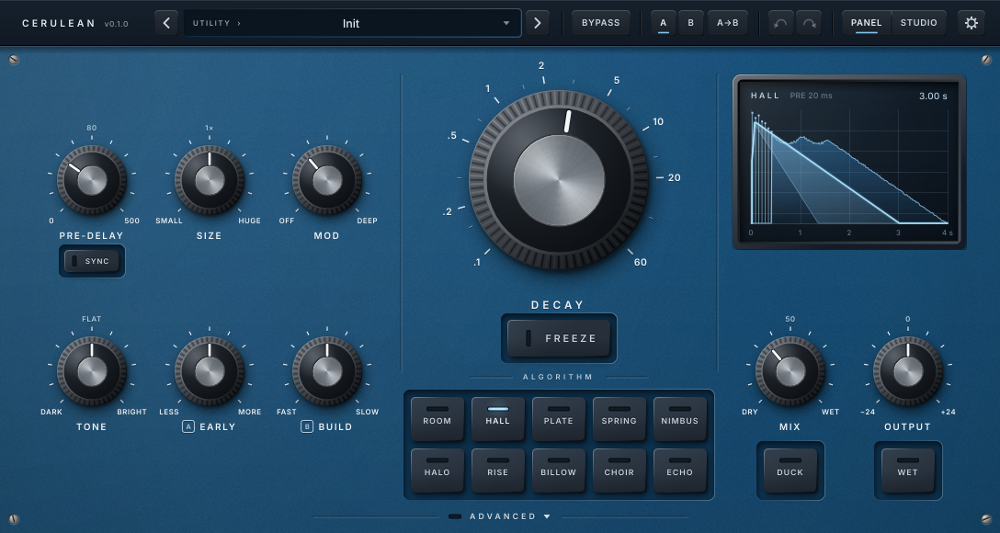
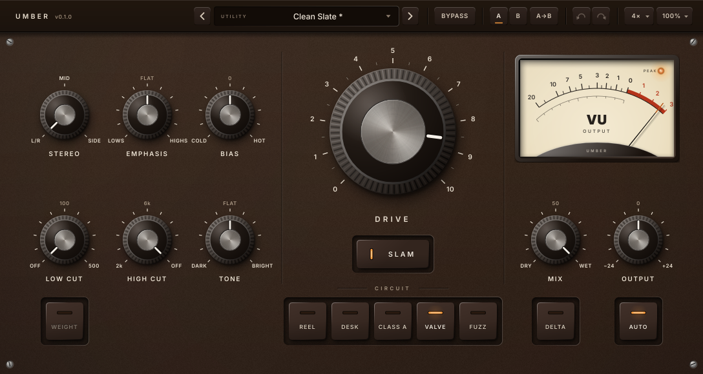

# Myzel Audio

Open-source audio plugins for Linux (VST3, CLAP, LV2 and Standalone). Windows and macOS builds come
from CI, unsigned.

| | |
|---|---|
| [](plugins/cerulean) | **[Cerulean](plugins/cerulean)**: a creative reverb. Ten algorithms, from honest rooms and plates to huge modulated clouds, shimmering halos, swells, blooms, voices and tape echoes. [Manual](plugins/cerulean/docs/MANUAL.md) |
| [](plugins/umber) | **[Umber](plugins/umber)**: an analog-modelled saturator. Five circuit-level models on one screen. [Manual](plugins/umber/docs/MANUAL.md) |

## Repository layout

```
CMakeLists.txt      builds every plugin; dependencies (CPM) and shared compile settings live here
plugins/<name>/     one directory per plugin: source, tests, tools, docs, presets
tools/              pluginval.sh and package.sh, shared by all plugins
cmake/CPM.cmake
```

## Building

Linux packages (Ubuntu/Debian names):

```sh
sudo apt install build-essential cmake ninja-build git pkg-config \
    libasound2-dev libjack-jackd2-dev libfreetype-dev libfontconfig1-dev \
    libx11-dev libxcomposite-dev libxcursor-dev libxext-dev libxi-dev \
    libxinerama-dev libxrandr-dev libxrender-dev
```

JUCE, the CLAP extensions, melatonin_blur, chowdsp_wdf and Catch2 are fetched by CPM:

```sh
export CPM_SOURCE_CACHE=~/.cache/CPM   # optional: share downloads between build dirs
cmake -S . -B build -G Ninja -DCMAKE_BUILD_TYPE=Release
cmake --build build
ctest --test-dir build --output-on-failure
```

| Option | Default | |
|---|---|---|
| `MYZEL_PLUGINS` | all | Plugins to build, e.g. `-DMYZEL_PLUGINS=cerulean` |
| `MYZEL_ENABLE_LTO` | ON | Link-time optimisation; turn off for faster development builds |
| `MYZEL_BUILD_TESTS` | ON | Catch2 test suites |
| `MYZEL_BUILD_TOOLS` | ON | Measurement, calibration and UI snapshot tools |
| `MYZEL_COPY_PLUGINS` | OFF | Install into `~/.vst3`, `~/.lv2` and `~/.clap` after each build |

Plugins land in `build/plugins/<name>/<Name>_artefacts/Release/`.

```sh
xvfb-run -a tools/pluginval.sh cerulean build   # pluginval at strictness 10
tools/package.sh cerulean                       # release tarball in dist/, with install.sh
```

Each plugin's README has its own test and tool commands.

## Licence

AGPLv3, see [LICENSE](LICENSE). Built with [JUCE](https://juce.com) under its AGPLv3 option.
