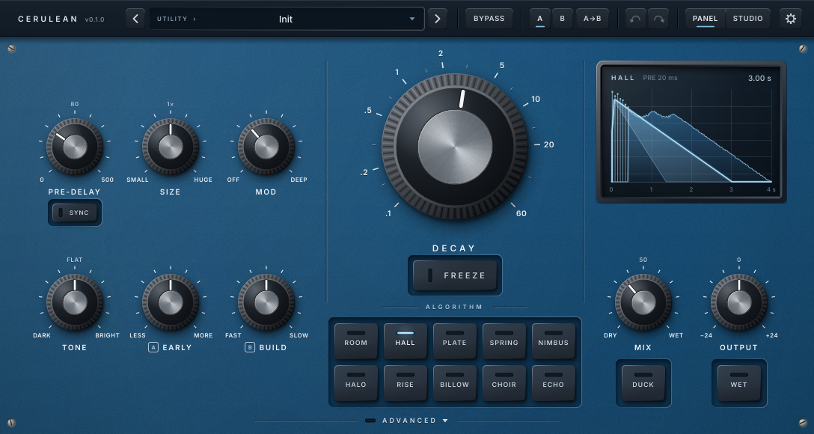
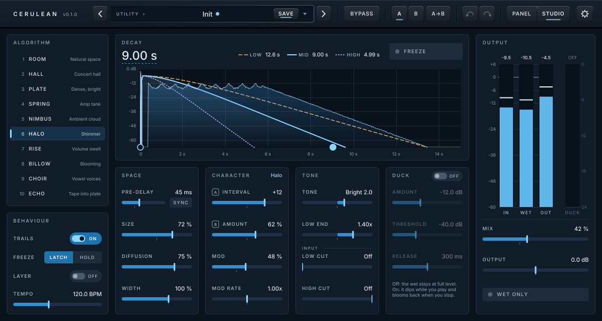

# Cerulean

A creative reverb plugin by **Myzel Audio**: ten algorithms, from honest rooms and plates to huge
modulated clouds, shimmering halos, swells, blooms, voices and tape echoes. One screen, a few
knobs, built to be played through.



Formats: VST3, CLAP, LV2, Standalone (Linux first; Windows/macOS build unsigned in CI).
Licence: AGPLv3. Sibling of [Umber](../umber).

**How to use it:** see the [manual](docs/MANUAL.md).

## The algorithms

| | Algorithm | Character | Param A | Param B |
|---|---|---|---|---|
| 1 | **Room** | Small to medium rooms, early-reflection heavy, natural | Early/Late | Walls |
| 2 | **Hall** | Big, smooth, gently modulated concert hall | Early | Build |
| 3 | **Plate** | Bright, dense, instantly diffuse | Density | Metal |
| 4 | **Spring** | Drippy, boingy amp tank | Springs | Drip |
| 5 | **Nimbus** | Huge, dark, endlessly diffuse ambient cloud | Density | Distance |
| 6 | **Halo** | Shimmer: intervals rising through the tail | Interval | Amount |
| 7 | **Rise** | Volume swell: notes fade in | Rise time | Blend |
| 8 | **Billow** | Keeps building after the note: blooms | Bloom | Feedback |
| 9 | **Choir** | Vowel-like voices in the tail | Vowel | Voices |
| 10 | **Echo** | Multi-head tape echo melting into a reverb | Echo time | Repeats |

## Controls

**Decay** (with **Freeze**) · **Algorithm** keys · **Pre-delay** · **Size** · **Mod** · **Tone** ·
**Param A / Param B** (relabelled per algorithm) · **Mix** (pedal law: the dry stays at full level up
to 50 %) · **Output** · **Duck** · **Wet** (kill dry) · tail display · **Sync** keys under Pre-delay (and Echo
Time with Echo) · **ADVANCED** on the bottom edge: a lower deck with Low End, Diffusion, Mod Rate,
Width, input cuts, Duck settings, BPM, Freeze mode, **Freeze Layer** (play on top of a frozen pad)
and Trails (the window grows while it is open). Header: presets (with **SAVE** while there are
unsaved changes), Bypass (with trails; lights amber), A/B, undo/redo, the view switch and ⚙
(**mix lock**, so presets keep your Mix and Wet; window size).

**Hands-free:** the presets are host programs (factory first, then your own), so a MIDI program
change from a foot controller switches sounds, with trails.

**Two views.** **Panel** is the hardware-style face above. **Studio** shows every control at once on a
flat screen, with exact typed values, input/wet/output and duck meters and a per-band tail graph.
Both views edit the same parameters and presets, and you can switch between them at any time.



## How it's built

- **Zero latency, always.** Mono → stereo and stereo → stereo.
- **Trails everywhere.** Two pre-allocated instances of every algorithm: changing algorithm or
  preset moves the input to a fresh one while the old sound rings out with its old settings.
- **Measured, not guessed.** Every algorithm passes the same quality gates
  (`tests/support/EngineGates.h`): RT60 per band follows Decay, Low End and Tone; echo density
  builds up; the tail always decays; Freeze holds within ±1 dB over 60 s; the wet level matches
  across algorithms; the stereo image is wide but mono-compatible; the sound is the same from
  44.1 to 192 kHz; fast automation of any control is click-free; square waves at 0 dBFS can't
  break it; CPU stays inside its budget. `tools/measure` prints the numbers.
- **Golden-file regression tests** for every algorithm, so refactors can't change the sound
  silently.

## Building (Linux)

Dependencies (Ubuntu/Debian):

```sh
sudo apt install build-essential cmake ninja-build git pkg-config \
    libasound2-dev libjack-jackd2-dev libfreetype-dev libfontconfig1-dev \
    libx11-dev libxcomposite-dev libxcursor-dev libxext-dev libxi-dev \
    libxinerama-dev libxrandr-dev libxrender-dev
```

JUCE, the CLAP extensions, melatonin_blur and Catch2 are fetched by CPM. Build from the
repository root (`../..`); `-DMYZEL_PLUGINS=cerulean` builds only Cerulean, leave it out to build every plugin:

```sh
export CPM_SOURCE_CACHE=~/.cache/CPM   # optional: share downloads between build dirs
cmake -S . -B build -G Ninja -DCMAKE_BUILD_TYPE=Release -DMYZEL_PLUGINS=cerulean
cmake --build build
```

Plugins land in `build/plugins/cerulean/Cerulean_artefacts/Release/{VST3,CLAP,LV2,Standalone}`. Add
`-DMYZEL_COPY_PLUGINS=ON` to install them into `~/.vst3`, `~/.lv2` and `~/.clap` after each
build. For faster development builds add `-DMYZEL_ENABLE_LTO=OFF`.

`tools/package.sh cerulean` builds a release tarball (`dist/Cerulean-<version>-linux-<arch>.tar.gz`) with
an `install.sh` that installs everything for the current user.

## Testing

```sh
ctest --test-dir build --output-on-failure                           # everything
build/plugins/cerulean/tests/CeruleanTests                          # chain, processor, parameters, presets, golden files
build/plugins/cerulean/tests/CeruleanTests_hall                     # one algorithm's quality gates (likewise _room, _plate, ...)
build/plugins/cerulean/tests/CeruleanTests_hall "[.perf]"           # its CPU report
xvfb-run -a tools/pluginval.sh cerulean build                       # pluginval, strictness 10
build/plugins/cerulean/tools/CeruleanMeasure                        # RT60 per band, echo density, level, width, CPU of every algorithm
build/plugins/cerulean/tools/CeruleanMeasure hall --wav /tmp        # ... and write the impulse responses
CERULEAN_UPDATE_GOLDEN=1 build/plugins/cerulean/tests/CeruleanTests "[golden]"   # re-record after an intended sound change
```

## Licence

AGPLv3. See [LICENSE](../../LICENSE). Built with [JUCE](https://juce.com) under its AGPLv3 option. The
bundled Inter font is under the SIL Open Font License (see `src/ui/assets/`).
