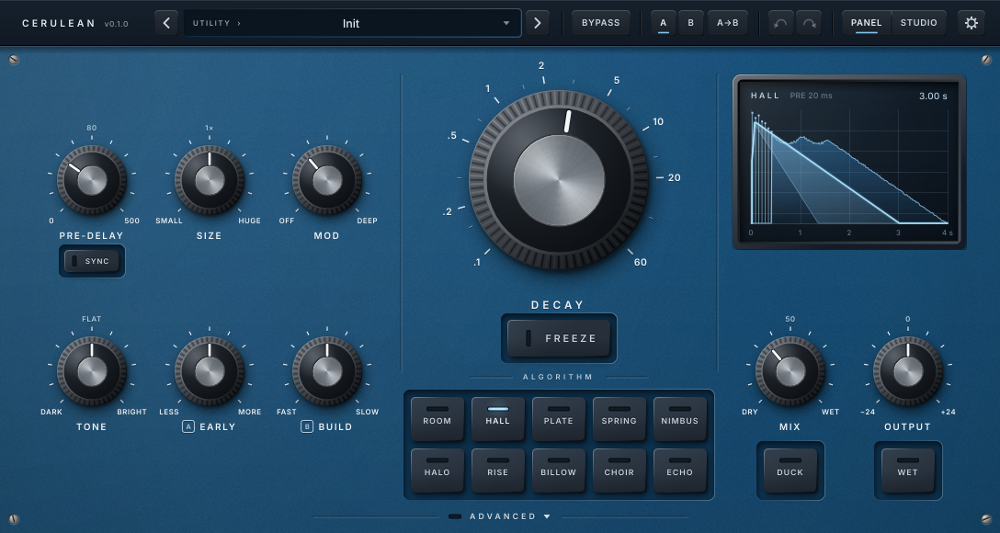
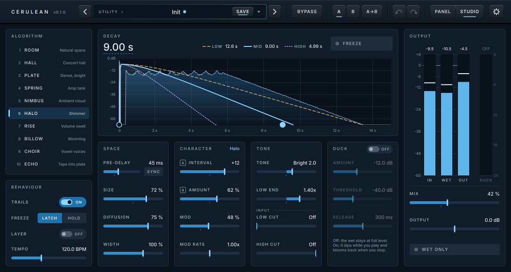

# Cerulean manual

Cerulean is a reverb you play through. Pick one of ten algorithms, set how long it rings with
**Decay**, and shape it with a handful of knobs. Everything sounds musical at any setting, nothing
clicks while you move it, and when you change sounds the old one rings out, like on a good pedal.

## Quick start

1. Insert Cerulean on your guitar, synth or vocal track (mono or stereo; the output is always
   stereo).
2. Pick an **algorithm**, then set **Decay**: around 1–2 s for a room or plate, 3–6 s for a hall,
   10 s and more for the ambient ones (Nimbus, Halo, Billow).
3. Set **Mix**. Up to 50 % only the reverb gets louder and your dry sound stays at full level, so
   the first half of the knob is all you need on an insert. Past 50 % the dry fades away.
4. Turn on **Duck** if the reverb crowds your playing: it steps back while you play and blooms
   when you stop.
5. Hit **Freeze** to hold the current tail forever and play over it.

On a send/return bus, press **Wet**: Cerulean then outputs only the reverb whatever Mix says.

## The algorithms

| Algorithm | What it is | Param A | Param B | Good for |
|---|---|---|---|---|
| **Room** | Small to medium rooms, dominated by early reflections | **Early/Late**: early reflections ↔ late field | **Walls**: soft (dark, absorbent) ↔ hard (bright, lively) | Drums, vocals, making a DI sound recorded in a room |
| **Hall** | A big, smooth, gently moving concert hall | **Early**: level of the first reflections | **Build**: an instant dense wall ↔ a hall that swells in | Everything; the classic |
| **Plate** | A steel plate: bright, dense from the first millisecond | **Density**: grainy ↔ smooth | **Metal**: the plate's bright ring and sheen | Vocals, snares, clean guitar |
| **Spring** | An amp's spring tank: drips, chirps, splash | **Springs**: 1, 2 or 3 springs | **Drip**: subtle ↔ full surf drip | Surf, twang, dub, lo-fi |
| **Nimbus** | A huge, dark, endlessly diffuse cloud | **Density**: a sparse cloud of echoes ↔ thick fog | **Distance**: close ↔ far away (slower, softer onset) | Pads, drones, ambient guitar |
| **Halo** | Shimmer: an interval rises through the tail on every pass | **Interval**: −12, +5, +7, +12, +12/+19 | **Amount**: plain reverb ↔ full shimmer | Swells, pads, "heavenly" leads |
| **Rise** | Volume swell: every new note fades in, then rings in a hall | **Rise time**: 50 ms – 4 s | **Blend**: only the reverb swells ↔ your dry note swells too | Violin-like guitar, ambient textures |
| **Billow** | A reverb that keeps growing after the note, then fades | **Bloom**: how long it keeps growing (150 ms – 4 s) | **Feedback**: a subtle swell ↔ a huge build | Post-rock, cinematic swells |
| **Choir** | Vowel-like voices emerge from the tail | **Vowel**: A – E – I – O – U (morphs) | **Voices**: one voice ↔ a choir of four | Eerie pads, sound design |
| **Echo** | A wobbly multi-head tape echo melting into a plate | **Echo time**: 20 ms – 1.5 s, or a note value | **Repeats**: one echo ↔ near-endless | Lead lines, dub, rhythmic ambience |

**Changing algorithm** never cuts the sound: the old algorithm rings out with its old settings
while the new one takes over (see **Trails** below). Switching while frozen lets the frozen sound
decay naturally.

**Param A / Param B** keep their knob positions when you change algorithm, like on hardware; the
legends and readouts change to say what they do now.

## Controls

### Decay and Freeze (centre)

- **Decay** (0.1 s – 60 s): how long the reverb takes to die away by 60 dB, measured in the mids.
  The low and high frequencies follow **Low End** and **Tone**.
- **Freeze**: holds the current tail indefinitely; new input no longer enters the reverb (your dry
  signal still passes, so you can play over the pad). Freeze fades in and out over 50 ms. In the
  Advanced deck, **Freeze Mode** sets the key to latch (click on, click off) or momentary
  (frozen only while held).
- **Freeze Layer** (Advanced deck, or LAYER in the studio view's Behaviour card): while frozen,
  what you play is added onto the held pad instead of being shut out, so you can build a chord
  note by note, or a drone layer by layer. The pad never runs away: it settles at about the level
  of a normal reverb of your playing, and older layers make room as you add new ones. When you
  stop playing it holds exactly, like a plain freeze. The tail display shows FREEZE + LAYER.

### Shaping the space (left)

- **Pre-delay** (0 – 500 ms): a gap between your note and the reverb. 10–30 ms keeps the attack
  clear; longer values separate the reverb from the note. With **SYNC** (the key under it) on, the
  knob picks a note value at the host tempo instead (incl. dotted and triplets). With Echo
  selected, a second **SYNC** under Echo Time does the same for the echo repeats.
- **Size**: the dimensions of the space, independent of Decay: a small room with a long tail or a
  huge space with a short one. Size doesn't change the reverb's loudness. Moving Size while sound is ringing glides the pitch, like changing
  tape speed. That's intended; automate it for effect.
- **Mod**: how much the reverb moves. 0 is static and crystalline; the default is a gentle,
  expensive-sounding movement; high values chorus and detune the tail.
- **Tone** (Dark ↔ Flat ↔ Bright): how fast the highs die away inside the reverb, plus a gentle
  tilt of the reverb's output.
- **Param A / Param B**: the two character controls of the current algorithm (see the table).

### Output (right)

- **Tail display**: shows the shape of the reverb from your settings (pre-delay gap, early
  reflections, how the lows, mids and highs decay), with the live reverb level running across it.
  It draws a flat line while frozen, and an amber **BYPASSED** while Bypass is on. While you
  hover or turn a knob, its value appears just above the knob, so its name underneath stays
  readable.
- **Mix**: the pedal law. 0–50 %: the dry stays at full level and the reverb rises to full. 50 %:
  both at full level. 50–100 %: the reverb stays at full and the dry fades out.
- **Output** (±24 dB): final level.
- **Duck**: the reverb ducks under your playing (−12 dB by default) and blooms back when you stop.
  Amount, threshold and release are in the Advanced deck.
- **Wet**: kill dry. 100 % reverb whatever Mix says, for send/return use.

### Header

Presets (‹ › step through them; the field shows the category, and a blue dot after the name when
you have changed the sound), **SAVE** (appears while there are unsaved changes: saves a user
preset in place, or asks for a name for a factory preset), **Bypass** (lights amber, and the tail
display says BYPASSED), **A/B** compare (A→B copies the current setting to the other slot), undo
and redo, the view switch (**PANEL** | **STUDIO**, see [Studio view](#studio-view)) and ⚙ for the
mix lock and the window size (75–200 %; you can also resize the window in your host, which keeps the
proportions). The header is the same in both views: nothing moves when you switch.

Loading a preset or switching A/B behaves like changing algorithm: the old sound rings out.

**Lock Mix and Wet** (in the ⚙ menu): loading a preset or switching A/B then leaves **Mix** and
**Wet** where they are. Use it on a send (Wet on, Mix at 100 %), where a preset would otherwise
bring the dry back, or when you have set the balance for a song and only want to change the
sound. A small padlock next to MIX shows that it is on. The lock is saved with the session.

### Advanced deck

Click **ADVANCED** on the bottom edge of the panel to open a lower deck below it: the window grows
by a strip and nothing on the panel is covered, so you can watch the tail display while you adjust
these. Click **ADVANCED** again (now at the bottom of the deck) to close it.

| Control | What it does |
|---|---|
| **Low End** (0.5× – 2×) | How long the lows ring compared with the mids. Above 1× the reverb gets warmer and bigger; below, tighter and clearer |
| **Diffusion** | How quickly the reverb thickens from separate echoes into a smooth wash. Lower for more definition on percussive material |
| **Mod Rate** (0.25× – 4×) | Speed of the modulation, relative to each algorithm's own rate |
| **Width** (0 – 150 %) | Stereo width of the reverb. 0 % is mono, above 100 % is wider than natural |
| **Input Low Cut / High Cut** | Filters what goes *into* the reverb (the dry signal is untouched): keep bass mud and pick noise out of the tail |
| **Duck Amount / Threshold / Release** | How deep the duck goes (dB), from which input level it starts, and how quickly the reverb blooms back |
| **BPM** | The tempo used when the host gives none (e.g. the Standalone app) |
| **Freeze Mode** | Latch or momentary |
| **Freeze Layer** | Off (default): Freeze shuts the input out. On: what you play adds onto the frozen pad (see [Decay and Freeze](#decay-and-freeze-centre)) |
| **Trails** | On (default): Bypass, algorithm and preset changes let the old sound ring out. Off: they cut it within 30 ms |

## Studio view

Click **STUDIO** in the header to switch the editor to a flat, software-style view. It uses the same
parameters, presets, A/B slots and undo history as the panel, so you can switch at any time
without changing the sound, and the window keeps its size. The session remembers which view
it was saved in. New instances open in the view you chose last.

Everything is on one screen, and there is no Advanced tray:

- **Algorithm** (left): the ten algorithms as a list. Click one, or focus the list and use the
  arrow keys and Space.
- **Behaviour** (under the list): **Trails**, Freeze's mode (**Latch** / **Hold**), **Layer** (Freeze
  Layer) and **Tempo** (the
  BPM used when the host gives none. While the host provides a tempo it shows "Host 120.0 BPM"
  and is read-only).
- **Decay and the tail**: **Decay** is the large value at the top of the graph (drag it, or click it
  to type), with **Freeze** on the right. The graph shows the decay of the low, mid and high
  bands as set by Decay, Low End and Tone. Each band has its own colour and line style (low
  dashed, mid solid, high dotted), and its target RT60 is read out above the graph. It also shows
  the pre-delay, the early reflections (or Echo's repeats) and the live wet level running across
  it. Two handles sit on the floor of the graph: drag the solid one (where the mid line ends) to
  set Decay, and the open one (the pre-delay marker) to set Pre-delay. Shift drags finely,
  double-click resets. The time axis holds still while you drag and rescales when you let go.
  When Freeze is on, the graph shows **FROZEN**; when Bypass is on, it dims and shows
  **BYPASSED · DRY ONLY** and the wet meter turns grey.
- **Space**, **Character**, **Tone**, **Duck**: the remaining controls, grouped. The Character card
  names the current algorithm, and Param A/B show what they do on it, with a boxed A or B before
  the name. **SYNC** sits next to Pre-delay, and next to Param A when Echo is selected; a synced
  value shows the note, with its length at the current tempo under the bar. The input filters
  sit under **INPUT** in the Tone card; their bars fill with what is cut, so **Off** is always
  empty. The switch in the Duck card says **OFF** or **ON**. The Duck controls are greyed out while
  it is off, but you can still edit them.
- **Output** (right): meters for input, wet and output, and the ducker's gain reduction, then
  **Mix**, **Output** and **Wet only**. Each meter shows a bar (RMS), a line (peak hold) and the
  peak in dBFS above it. A peak over 0 dBFS turns that number red until you click the meters.

Each control shows its name and its exact value:

| Gesture | Does |
|---|---|
| Drag (anywhere on the control) | Up or right raises the value; Shift for fine control |
| Click the value, or press Return | Type a value with its unit: `4.2 s`, `800 ms`, `85 ms`, `6.5 kHz`, `-18 dB`, `1/8D`, or what Param A/B show (`+7`, `2 springs`, `O`, `Early 40`) |
| Double-click, or Delete | Back to the default |
| Mouse wheel, arrow keys | Small steps (one position on stepped controls); Page Up/Down for big steps, Home/End for min/max |

The small tick under each bar marks the default value. Tone, Output, Low End and Mod Rate fill
from the middle.

## Trails and bypass

With **Trails** on, Cerulean's own **Bypass** stops new sound from entering the reverb but lets the
tail ring out, so switching the effect off mid-song sounds natural. Most hosts' bypass buttons use
Cerulean's bypass parameter and get trails too; a host that instead stops calling the plugin
entirely cuts the sound. If your host does that, map your footswitch to the **Bypass** parameter.

## Footswitches and automation

**Switching presets.** Cerulean's presets are also *host programs*: the factory presets in the
order of the preset menu (program 0 is Init), followed by your own presets in alphabetical order,
shown as "User: …". Send a MIDI program change from your foot controller to the track and the
sound changes, with the old one ringing out. Hosts handle this differently: in Reaper, for
example, enable program changes for the plugin in the FX window; other hosts list the programs
in their own preset menu. Two things to know:

- The host reads the list when the plugin is loaded. A preset you save later becomes a program
  after you reload the project.
- Your presets sort alphabetically, so a new one can move the others along. Number them
  ("01 Verse", "02 Chorus") to keep their program numbers fixed.

The LV2 version lists the factory presets in the host's preset menu; your own are in Cerulean's
browser.

**Everything else.** Cerulean has no MIDI input. Every control, including Freeze, Freeze Layer,
Bypass and the algorithm, is an automatable parameter: map your foot controller to them in your
host (most hosts have MIDI learn for plugin parameters).

## CPU

Cerulean runs at your project's sample rate with zero latency. An instance uses 1–2.5 % of one core
at 48 kHz, whatever the algorithm. When an algorithm change leaves an old tail ringing,
both run until the old one is silent. When nothing is playing and the tail has died away, Cerulean
goes idle.
