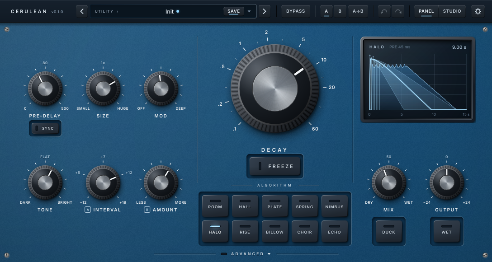
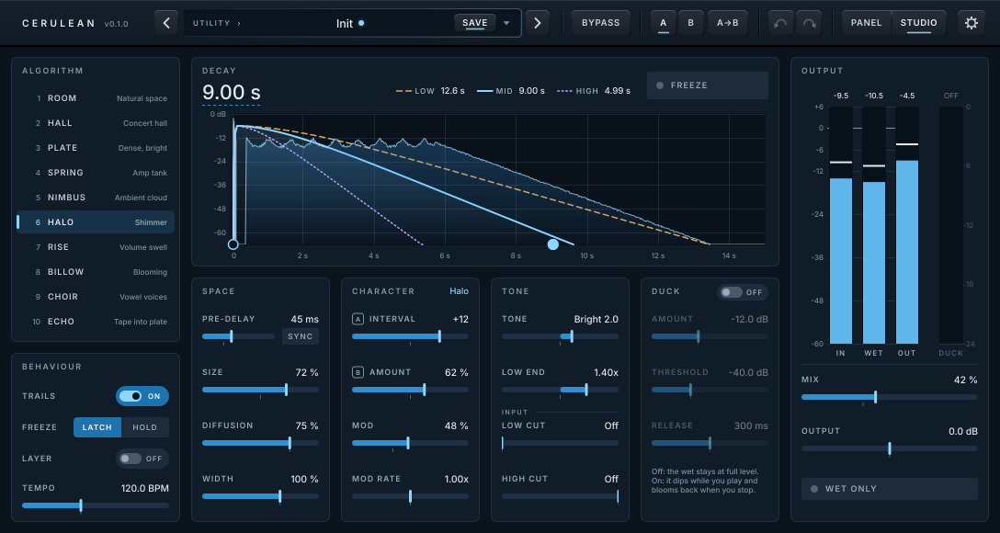

# Cerulean UI design

Everything on screen is drawn in code (`src/ui`). No bitmap art is used. The only bundled asset is
the Inter typeface (SIL OFL 1.1, `assets/fonts/OFL.txt`).



## Identity: same family as Umber, a different sky

Cerulean is Umber's sibling. It keeps the family grammar: one hardware-style screen, three
columns, a big hero knob in the centre with its key underneath, a key rail along the bottom, a
glass window top-right, the same knobs, keys, header rail, typography and lighting. What changes
is the sky:

- **Ground:** deep cerulean (a darkened, saturated sky blue) powder coat with a fine grain and a
  soft top-left light falloff. Umber is dark brown; Cerulean reads blue at a glance, as the
  name says.
- **Silkscreen:** pale Inter SemiBold caps with a soft drop shadow under the ink (`legendLight`,
  drawn below by `drawLegend`). Secondary legends are a paler blue.
- **Knobs:** graphite knurled grips with turned aluminium caps and an off-white pointer inlay,
  exactly Umber's construction. Decay is the same knob, larger.
- **Accent:** one **ice blue**, used only for things that are *on*: key LEDs, the selected A/B
  slot, the ADVANCED LED, the frozen line in the tail display, the unsaved-changes dot,
  keyboard focus and text selection. Everything else is neutral.
- **Caution:** one **amber** (`caution`), used only for Bypass: the lit BYPASS key and the
  BYPASSED stamp on the tail display. It never means "on", so a bypassed plugin can't be
  mistaken for a selected key.
- **Keys:** dark slate console keys in deep navy recessed wells, each with a thin LED bar. Off, the bar is a
  dark slot; on, it lights ice blue with a little light on the cap around it.
- **Header:** the family's dark rail, tinted navy. "CERULEAN" set plainly, small, tracked caps,
  with the version dimmed after it. No mark, no effects.
- **Tail display:** smoked glass over a deep night-blue screen, the darkest window on the blue
  panel (Umber's equivalent is its cream VU face).

The look is original. It does not copy the colours, artwork, layout or knob design of any
existing product.

### Contrast

On the blue panel, `legend` (#eef5fa) is at least 7.4:1 against the panel, `legendDim` (#b4cde0)
at least 4.9:1 (WCAG AA for small text). Deck legends are at least 5.5:1 and values at least
9.8:1 against the deck. Keyboard focus rings on the panel use a light ice (#9edcff, at least 5:1
against the panel); on dark surfaces (header, keys, dialogs) they use `focusOnDark`.

## Lighting

There is one light source, at the **top-left**, and every element follows it:

- Contact shadows fall down and to the right (`metrics::shadowDx/Dy` × elevation, via melatonin_blur).
- Raised edges (knob rims, key bevels, bezel) are lit on the upper-left and dark on the lower-right.
- Recessed things (key wells, the display window, the pointer inlay, screw slots) are the
  reverse: their upper-left wall is in shadow, their lower-right
  lip catches the light.
- Knob knurling is shaded by each ridge's *current* angle to the light. When a knob turns, the
  ridges rotate but the highlight stays put. Body, cap and specular highlight are cached and
  never rotate; only the ridges and the pointer are drawn per frame.
- Glass (tail display, preset window) always has its specular sheen on the upper-left.

## Tokens

All tokens live in `Theme.h` / `Theme.cpp`:

- `Palette`: every colour (panel, legends, grooves, wells, header, keys, knobs, ice accent,
  tail display screen and traces, drawer, feedback). Nothing outside `Theme.cpp` defines a
  colour except neutral black/white shading alphas.
- `metrics`: base size (1088 × 580), header height, scale limits, shadow direction, type sizes,
  knob sweep (±135°), LED fade (80 ms), legend crossfade (180 ms).
- `layout`: the position of every control (the grid below).
- `Fonts`: Inter Medium (values, menus), Inter SemiBold (name, legends, keys, numerals) and
  Inter Display Black, shared through `SharedResourcePointer`.

Type: legends are SemiBold caps, 12 px, +0.14 tracking. Scale numerals are 9.5 px (small knobs)
or 12.5 px (Decay). Key labels are 10.5 px. The Decay title is 14 px with +0.30 tracking. Drawer
titles are 11 px, deck values 11.5 px, deck group legends 10 px: at 75 % that is still at
least 7.5 device pixels.

## Layout grid (base 1088 × 580)

```
 0 ┌──────────────────────────────────────────────────────────────────────────────────────────┐
   │ CERULEAN v0.1  ‹ [CATEGORY ›  Preset name •  SAVE ▾] ›  BYPASS │ A B A→B │ ↶ ↷ │ PANEL|STUDIO ⚙ │
50 ├───────────────────────────────┬──────────────────────────┬───────────────────────────────┤
   │ PRE-DELAY  SIZE     MOD       │      DECAY (Ø196)        │  tail display 256×192         │
   │ 100,196    228,196  356,196   │      centre 608,196      │  at 796,80                    │
   │ [SYNC]                        │                          │                               │
   │ TONE      Ⓐ PARAM  Ⓑ PARAM    │       [ FREEZE ]         │  MIX         OUTPUT           │
   │ 100,404    228,404  356,404   │     552,348 112×40       │  860,404     988,404          │
   │                               │ ─────── ALGORITHM ────── │                               │
   │        [SYNC] (Echo only)     │ [ROOM][HALL][PLATE][SPRING][NIMBUS]                      │
   │                               │ [HALO][RISE][BILLOW][CHOIR][ECHO]  [DUCK]     [WET]      │
   │                               │  keys 58×48, gap 8, rows at y 432 / 488                  │
   │ ─────────────────────── ▭ ADVANCED ▾ ─────────────────────── (bottom edge)              │
580└───────────────────────────────┴──────────────────────────┴───────────────────────────────┘
     left block 28–428               centre 444–772             right column 788–1060
   ┌ deck (only while open, +132) ────────────────────────────────────────────────────────────┐
   │   TANK ×4  │  INPUT ×2  │  DUCK ×3  │  TEMPO  │  FREEZE ×2  │  TAILS                     │
712└──────────────────────── ▭ ADVANCED ▴ ────────────────────────────────────────────────────┘
```

- Three columns, separated by engraved grooves at x = 436 and 780. The left block is a 3 × 2
  grid of Ø76 knobs: the top row is the *space* (Pre-delay, Size, Mod) and sits on the Decay
  centre line; the bottom row is the *character* (Tone, Param A, Param B), next to the
  algorithm keys that change what A and B mean. The right column is the result: the tail
  display, Mix and Output, and the Duck and Wet keys.
- Each toggle key sits directly under what it modifies: Freeze under Decay, Duck under Mix,
  Wet under Output. The algorithm rail is 2 × 5 keys (5 × 58 + 4 × 8 = 322 wide); Duck and Wet
  share its lower row's baseline.
- Param A and B carry a small boxed **A** / **B** before their legend, so the manual's names
  ("Param A") stay findable while the legend says what it does on this algorithm.
- Component bounds are snapped to a 4-unit grid, so at every menu scale (75–200 %) they land on
  whole device pixels and the cached layers blit 1:1.

### Advanced deck

**ADVANCED** is engraved on the instrument's bottom edge (`AdvancedTab`, `layout::advancedTab()`):
a small LED, the legend and a chevron between engraved rules. Clicking it opens a lower section
of the instrument below the panel (`layout::deck()`, 132 high): the panel's own powder coat behind
an engraved seam, with the bottom screws. The editor grows by that strip (`EditorView::
getBaseHeight()`, `CeruleanEditor::applyBaseSize()`), so nothing on the panel is covered and every
change shows on the tail display as it is made. While it is open, ADVANCED sits on the deck's
bottom edge with its LED lit and the chevron pointing up.

One row of thirteen 76-wide cells of small (Ø36) knobs and keys in labelled groups, each with its
value printed underneath:

```
     TANK                 INPUT          DUCK            TEMPO     FREEZE      TAILS
 LOW END DIFFUSION      LOW CUT      AMOUNT THRESHOLD    BPM    MODE [LAYER]  [TRAILS]
 MOD RATE WIDTH         HIGH CUT     RELEASE
```

- Low End and Mod Rate have a centre detent at 1×; Mode is a two-position switch (Latch /
  Momentary).
- BPM is greyed out and read-only while the host provides a tempo (`MeterValues::hostHasTempo`);
  its value then reads "Host 128.0".
- Pre-delay Sync and Echo Sync are not on the deck: they are compact keys on the panel, under the
  Pre-delay legend and (only while Echo is selected, with its well drawn then) under Param A. The
  note values are picked with those knobs.
- The deck's open state is saved in the UI state (`advancedOpen`). The deck appears and disappears
  with the window size change (no slide: the host resizes the window in one step).
- Trade-off: the window changes height while the deck is open, and switching to the studio view
  then returns it to 580.

## Controls and interaction rules

| Gesture | Knobs | Keys / buttons |
|---|---|---|
| Drag | vertical. Full range is 260 px (Decay: 320 px, deck: 200 px, switches: 16 px per step). Unbounded: the cursor hides and returns. | — |
| Shift-drag / Shift-wheel / Shift-arrows | ×0.12 (fine) | — |
| Double-click / Delete | reset to the parameter default | — |
| Alt-, Ctrl-/Cmd- or right-click / Return | type a value (parsed by the parameter's own text function) | — |
| Wheel | ±6 % per notch, one step on switches. One host gesture per burst (closed after 350 ms). | — |
| Arrows / PgUp / PgDn / Home / End | step 2 % (or one switch step) / 10 % / min / max | Space/Return toggles |
| Hover | shows the value just above the knob (over the top scale mark; the legend stays), plus a faint ring | brighter key face |

- Tone, Output, Low End, Mod Rate and Room's Early/Late have a **centre detent**.
- **Relabelling:** Param A/B legends, scale marks and read-outs follow the algorithm
  (`params::characterLegends` / `characterText`), crossfading over 180 ms. Switching algorithm
  never moves a knob.
- **Sync:** with Pre-delay Sync on, the Pre-delay knob becomes a 14-position note switch bound to
  `preDelayNote` and reads e.g. "1/16  125 ms" at the current tempo. With Echo selected and Echo
  Sync on, Param A does the same for `echoNote`. The knob is re-bound (`Knob::rebind`); open
  gestures are closed first.
- **Freeze** latches by default. With Freeze Mode = Momentary it is held only while the mouse is
  down (one host gesture from press to release); keyboard and screen readers still toggle it.
- Bypass (header) lights amber (`HeaderButton::setCaution`), and both tail views dim and say
  BYPASSED (with Trails on: "the tail rings out"), from `TailShape::bypassed`.
- Bypass (header), Freeze and BPM are performance controls: not stored in presets or A/B and
  never in the undo history (`ParameterUndoRecorder` excludes them).
- Every other edit is wrapped in a host gesture and starts a new undo transaction through
  `ParameterAttachment`. Pending wheel gestures are closed before any other edit.
- Keyboard focus shows an ice focus ring, only when focus arrived by keyboard.
- Accessibility: knobs are sliders with a ranged value interface and read the same text as the
  read-out ("+12", "1/8D  375 ms", "3.00 s"); screen readers can type values. Keys are JUCE
  buttons with titles. The tail display describes itself ("Hall, decay 3.00 s, pre-delay 20 ms").
- Tooltips (0.9 s delay) explain each control and algorithm.

## Tail display

Where Umber has its VU meter, in the same glass bezel. It draws a picture of the settings
(`TailModel.h`, pure functions, no audio):

- the **pre-delay** gap (a dotted run along the floor, plus "PRE 20 ms" in the header line);
- the **early cluster**, spaced by Size (Room's Early/Late moves its level; Spring drips; Echo
  shows its repeats at the echo time, decaying with Repeats). Spikes keep a readable minimum
  spacing on long time axes: it is a picture, not a measurement;
- a **fan** between the low and high band decays (Decay × Low End, Decay × Tone's high ratio),
  with the **mid band** (Decay) as the bright line; Rise fades in, Billow blooms, Halo climbs;
- **frozen**: one flat ice line, "FREEZE" lit in the header ("FREEZE + LAYER" with Freeze Layer on);
- **bypassed**: the envelope drawn at 28 % opacity under an amber BYPASSED stamp;
- the **live wet level** (`MeterValues::wetRms`, +3 dB) as a scrolling area, newest at the right
  edge, on the same time (0 … span) and dB (0 … −66) axes, so a real tail can be compared with
  the drawn slope.

The time span is chosen from 0.25 s … 60 s so the mid band reaches the floor at about 85 % of
the width. History is a 64 s ring at 60 entries/s. The live area is repainted only when it moves
by a whole pixel column, and not at all while it is silent.

## Animation

A single `VBlankAttachment` in `MainPanel` is the frame clock. Each frame (≈0.001 ms of logic):

1. Polls the parameters that change what a control means (algorithm, syncs, freeze mode) and
   re-binds / relabels when they change.
2. **Key LEDs** fade towards their state with τ = fade / 3 (about 95 % in 80 ms). Steady: no
   flicker and no level-dependent brightness.
3. **Legend crossfades** (Pre-delay, Param A, Param B) advance; each is two cached images.
4. **Tail display**: shape (cheap equality test) and live history.
5. **Drawer**: slide (ease-out cubic) and its value read-outs (repainted only when the text changes).
6. Every 6 frames the header refreshes: preset modified flag (dot and SAVE), undo/redo availability.

The audio thread is only ever touched through atomics (`MeterValues`, raw parameter values,
`notifyPresetLoaded()`).

## Rendering and caching

`drawing::CachedLayer` renders static artwork at the **physical** pixel scale (editor scale ×
display scale) and re-renders only when that scale or the size changes. Cached: the whole panel
(ground and grain, scales, legends, wells, screws), knob bodies and caps, key faces, the dynamic
legends, the display's bezel, screen grid, envelope and glass, the Advanced deck, the header rail
and the preset window. Images are drawn with an explicit opacity.

Measured with the snapshot tool (Release): a full warm repaint takes about 3.5 ms at 1× and
11 ms at 2×; a cold one (building every cache, only on open or resize) about 33 ms and 115 ms.
A live tail-display repaint costs about 0.3 ms.

## Mix lock

The ⚙ menu's **Lock Mix and Wet** (`PresetManager::setMixLocked`, saved in the session's UI state)
makes preset loads and A/B leave Mix and Wet alone, and the unsaved-changes dot ignores them. A
`LockBadge` (a 9 × 11 padlock, `legendDim` on the panel, `textDim` in the studio) sits after the
MIX legend in both views while it is on, with a tooltip saying where to turn it off.

## Scaling

The editor holds one `MainPanel` at the base size and applies `AffineTransform::scale`. The
window is resizable with a fixed aspect ratio, from 75 % to 200 %; the ratio follows the view's
base height (1088 × 580, or 1088 × 712 with the panel's Advanced deck open). The header's ⚙ menu
offers 75–200 % in 25 % steps. The scale is stored in `getUiState()` and restored on open.

## Presets, A/B, undo

- `FactoryPresets.cpp` compiles the factory presets into the binary. Each entry is a
  `FactoryPreset` with **every sound parameter defaulting to the parameter's own default**, so an
  entry lists only what it changes, with designated initialisers:

  ```cpp
  { .name = "Concert Hall", .category = "Halls & Plates", .algorithm = hall, .decay = 3.2f, .mix = 30.0f },
  ```

  Categories: Utility (Init), Rooms, Halls & Plates, Springs, Ambient, Shimmer, Swells &
  Blooms, Voices, Echoes. The current set is a placeholder (13 entries); the full ~40 are voiced
  once the algorithms are final. A test checks that Init equals the parameter defaults.
- User presets are XML files (`<CeruleanPreset name=… decay=… …/>`) in
  `~/.config/Myzel Audio/Cerulean/Presets` (`userApplicationDataDirectory`). The menu can save, save as,
  rename, delete, show the folder and rescan. Dialogs are drawn inside the editor
  (`InlineDialog`), so no OS windows are opened.
- A preset is `params::soundParameterIds()`. A preset that predates a parameter loads it at its
  default, so nothing from the previous sound leaks through.
- Loading a preset is one undo transaction with host gestures, then
  `processor.notifyPresetLoaded()`: the new sound starts in a fresh engine instance and the old
  one rings out (Trails), like a pedal. A/B switching goes through the same path.
- A/B keeps two snapshots in the UI state. The active slot is always the live sound. Switching is
  undoable. "A→B" copies the live sound to the other slot.

UI state keys (`UiState.h`, never rename): `scale`, `advancedOpen`, `presetName`,
`presetIsUser`, `abActive`, and the `SlotA` / `SlotB` children.

## Files

| File | Role |
|---|---|
| `Theme` | palette, metrics, layout grid, fonts |
| `Drawing` | cached layers, legends, screws, recesses, grooves, shadows, grain, glow |
| `PanelArtwork` | the static front panel, knob scales and titles |
| `Knob` | rotary control (re-bindable, custom read-out) and its accessibility |
| `KnobScale` | crossfading legend for knobs whose meaning changes (Pre-delay, Param A/B) |
| `LampButton` | LED keys (algorithms, Freeze incl. momentary, Duck, Wet, Sync, Trails) |
| `TailModel`, `TailDisplay` | the decay picture and the live wet level |
| `AdvancedDrawer`, `AdvancedTab` | the Advanced deck below the panel, and ADVANCED on the bottom edge |
| `ValueBubble` | in-place value read-out |
| `LockBadge` | the padlock after MIX while the mix lock is on (both views) |
| `HeaderBar`, `HeaderButton`, `PresetDisplay` | header rail |
| `PresetManager`, `FactoryPresets`, `AbCompare` | preset and compare logic |
| `InlineDialog` | in-editor save/rename/delete prompts |
| `CeruleanLookAndFeel` | popup menus, tooltips, text fields |
| `PanelController` | the editor's model, shared by both views: presets, A/B, parameter meanings (`Meanings`), value texts, tail shape, the stored view |
| `ViewMode` | `panel` / `studio`, and the default-view preference (`Cerulean.settings`) |
| `EditorView` | base of both views: header wiring, frame hook |
| `MainPanel` | the panel view: composition, frame clock, meaning changes |
| `StudioTheme` | studio palette tokens (defined in `Theme.cpp`) and the studio layout grid |
| `StudioControls` | `StudioSlider` (row control with typed entry), `StudioToggle` (chip / block / segment), `AlgorithmRow` |
| `StudioTail` | the studio tail graph (per-band curves, RT60 read-outs, live level) |
| `StudioMeters` | input / wet / output meters and duck gain reduction |
| `StudioPanel` | the studio view: composition, frame clock, meaning changes |
| `CeruleanEditor` | scaling host; owns the `PanelController` and swaps the views |

## Two views

The editor has two faces: the **panel** (everything above) and the **studio** view. Both are
`EditorView`s laid out at the same base size (1088 × 580) and scaled by `CeruleanEditor`, so a switch
never resizes the host window. Everything they share lives in `PanelController`, which the editor
owns and which outlives the views. That covers presets, A/B, the meaning-changing parameters,
value texts (`preDelayText`, `characterText`, `noteText`) and the tail shape. Each view keeps
only its own presentation: knob styles and scale marks on the panel, slider steps and labels in
the studio.

- **Switching:** PANEL | STUDIO in the header. Both views use the same `HeaderBar` with the same
  layout, so no key moves when the view changes (view-specific keys, like ADVANCED, live in the
  view). Switching keeps the window size, except that the panel is taller while its Advanced
  deck is open. The view being replaced owns the clicked button, so the editor swaps views
  asynchronously, after the click handler has returned. Only one view exists at a time, with one
  frame clock.
- **Persistence:** the session stores its view (`uistate::view`). A session without one opens in
  the user's default view: the last one chosen in any instance, kept in
  `userApplicationDataDirectory/Myzel Audio/Cerulean/Cerulean.settings` (`viewPreference`). The editor
  writes the resolved view into the session when it opens. A host restoring a session while the
  editor is open switches to that session's view.
- **No studio-only parameters.** Both views edit exactly the same parameters, with the same
  undo, gesture and preset behaviour.

## Studio view



Workstation software, not a pedal: flat deep-navy cards on a darker ground, light text, hairline
edges, no lighting, texture or bevels. Every control is visible (no drawer) and shows its exact
value. The ice blue stays the one accent for things that are on: selected algorithm, lit toggles,
slider fills and value lines, focus. Data colours appear only in the graph and the meters.

### Tokens

`StudioPalette` (in `StudioTheme.h`, defined in `Theme.cpp` with the panel's palette):
surfaces (`background`, `card`, `cardEdge`, `inset`, `hover`), text (`text`, `textDim`, `title`,
`textFaint`), controls (`track`, `trackFill`, `trackFillEdge`, `marker`, `chipOff`), accent
(`accent`, `accentDeep`, `accentSoft`), graph (`grid`, `gridText`, `bandLow`, `bandMid`, `bandHigh`,
`early`, `liveFill`, `liveLine`) and meters (`meterBack`, `meterFill`, `meterHot`, `meterClip`,
`meterPeak`, `reduction`) and caution (`caution`, `cautionDeep`: Bypass only).

Contrast on a card: `text` 13.6:1, `textDim` 6.7:1, `title` 5.4:1, `textFaint` 4.8:1, `gridText`
4.7:1. White on a lit chip (`accentDeep`) 5.1:1. Focus rings (`accent`) 10:1. Type is Inter:
titles and labels SemiBold caps 10.5 px (+0.16 / +0.10 tracking), values Medium 12.5 px, small
text 10 px.

### Layout grid (base 1088 × 580)

```
 0 ┌──────────────────────────────────────────────────────────────────────────────────────────┐
   │ header (shared, same layout as the panel's): presets · SAVE · BYPASS · A B A→B · ↶ ↷ · ⚙  │
50 ├──────────────┬──────────────────────────────────────────────────────┬────────────────────┤
62 │ ALGORITHM    │ DECAY        ── LOW  ── MID  ··· HIGH   [● FREEZE ]  │ OUTPUT             │
   │  1 ROOM      │ 3.00 s  ┌──────────────────────────────────────────┐ │  IN  WET  OUT  DUCK│
   │  2 HALL  ◀   │         │ per-band decay, early spikes, live level │ │  ▮   ▮    ▮    ▮   │
   │  …           │ −60     └─○────────────────────●─────────────────── │  meters 192×296    │
   │ 10 ECHO      │          pre-delay handle    decay handle            │                    │
372├──────────────┤ 290 ────────────────────────────────────────────────┤                    │
384│ BEHAVIOUR    │ 302 SPACE      │ CHARACTER Hall │ TONE      │ DUCK ○OFF│────────────────────│
   │ TRAILS   ○ON │  PRE-DELAY …   │ [A] EARLY 50 % │ TONE Flat │ AMOUNT   │ MIX                │
   │ FREEZE L|HOLD│  SIZE          │ [B] BUILD …    │ LOW END   │ THRESHOLD│ OUTPUT             │
   │ LAYER    ○OFF│  DIFFUSION     │ MOD            │ ─INPUT─── │ RELEASE  │ [● WET ONLY]       │
   │ TEMPO        │  WIDTH         │ MOD RATE       │ LOW/HIGH  │ (note)   │                    │
568└──────────────┴────────────────┴────────────────┴───────────┴──────────┴────────────────────┘
     12–196          208–848: display 640×228, four cards 151 wide, 12 gutters       860–1076
```

All positions are in `studio::` (`StudioTheme.h`). The parameter cards hold four 44-px rows at a
58-px pitch. Duck's free row carries a note that explains both states.

Decay is the tail card's headline (`studio::decayHero()`, a `StudioSlider` in the hero look) and
Freeze sits at the right of the same head (`studio::freezeButton()`), as on the panel where Freeze
sits under Decay. The Behaviour card holds the set-once settings (Trails, Freeze mode, Freeze Layer, Tempo).

### Controls

`StudioSlider`, one row per parameter: the name (caps, left) and the exact value (right) on
top, a 6-px bar below. The value always fits; the name is ellipsised if the two collide (the
tooltip and accessible title keep the full name). Param A/B carry the panel's boxed **A** / **B**
badge instead of a text prefix, and synced values show only the note, with its length under the
bar ("= 375 ms at 120 BPM"), so Room's EARLY/LATE and a synced ECHO TIME fit.

The **hero** look (Decay) draws the name over a 26-px value with a dashed ice rule under it and no
bar; it takes the same gestures.

| Gesture | Does |
|---|---|
| Drag anywhere on the row | right/up raises: 300 px full range (stepped: 16 px per step), Shift ×0.1 |
| Click the value (no drag), Return, Alt/Ctrl/Cmd/right-click | text field over the value; Return or focus loss commits, Escape cancels |
| Double-click (bar or name), Delete | parameter default |
| Wheel | ±3 % per notch, one step on stepped controls; one host gesture per burst (350 ms) |
| Arrows / PgUp / PgDn / Home / End | 1 % (Shift 0.2 %) or one step / 10 % / min / max |

- **Fill:** from the left, or from the middle for Tone, Output, Low End, Mod Rate and Room's
  Early/Late, or from the right for High Cut (the fill is what is cut, so Off is empty on both
  cuts). A 3-px value line (ice) marks the value; a small tick under the bar marks the default.
- **Steps:** note values (14), Spring count (3), Halo interval (5), Choir vowel (5) and voices (4)
  draw notches and snap.
- **Typed values** are read with units. Each parameter's own text function handles most of them;
  the studio adds ms/s for Pre-delay and Duck Release, a magnitude for Duck Amount ("-18" =
  18 dB of ducking), note names ("1/8D", also the full read-out "1/8D  375 ms"), and
  `params::characterPercentFromText` for Param A/B. That accepts a displayed value ("+7", "2
  springs", "O", "Early 40", "Wet only"), a time for Rise/Billow/Echo ("350 ms", "1.2 s") or a
  percentage. Text with no number (other than "Off"/"Flat") is rejected and the value is left
  alone.
- **Relabelling:** Param A/B read "[A] INTERVAL" etc. The Character card's title names the
  algorithm (right-aligned, ice). SYNC chips sit at the right end of Pre-delay's bar, and of Param
  A's while Echo is selected. With sync on, the slider is re-bound to the note parameter
  (`StudioSlider::rebind`, open gestures closed first).
- **Dimmed, still editable:** the Duck controls while Duck is off. **Read-only:** Tempo while the
  host gives a tempo ("Host 97.0 BPM").
- **Toggles** (`StudioToggle`): a chip (SYNC: filled `accentDeep` when on), a switch with a
  sliding thumb that reads OFF or ON (Duck, Trails), a block with an indicator dot (FREEZE,
  WET ONLY: `accentSoft` with an ice edge when on), or a segmented pair (LATCH | HOLD). Freeze is momentary with Freeze Mode = Momentary and then reads
  "FREEZE (HOLD)", with the same press/release logic as the panel key.
- **Algorithm list** (`AlgorithmRow`): number, name, a short tagline. The selected row gets
  `accentSoft` and an ice bar; Up/Down select the neighbour and move focus with it.
- Focus rings (ice) on every control; sliders are accessible sliders with the same value texts.

### Tail graph

`StudioTail` draws the same `TailModel` as the panel's display, but as a graph with labelled axes
(0 to −60 dB in 12-dB steps; time in 0.05 s–15 s steps, at most 8 divisions):

- **low** (amber, dashed), **mid** (ice, solid 2 px, a soft fill below), **high** (violet, dotted). Each
  band differs in line style as well as colour. The head reads out each band's target RT60 with a
  matching swatch (plus the pre-delay when there is room), between the Decay value and Freeze;
- two **handles** on the floor: the decay handle (solid) one RT60 after the pre-delay, where the
  straight mid line meets the floor, and the pre-delay handle (open; hidden while Pre-delay is
  synced). Drag sideways (Shift ×0.1), double-click resets; one host gesture per drag. The time
  axis holds still during a drag and rescales on release;
- **bypassed:** the plot dims and an amber **BYPASSED · DRY ONLY** badge replaces the RT60s; the
  handles hide and the WET meter turns grey;
- the pre-delay as a dashed vertical line, early reflections (Echo: repeats) as thin spikes;
- **frozen:** flat lines and an ice **FROZEN** badge in place of the RT60s (**FROZEN + LAYER** with
  Freeze Layer on);
- the live wet level as on the panel (same history, +3 dB offset, repainted only when it moves).

### Meters

`StudioMeters` (`MeterValues`): IN, WET, OUT bars from +6 to −60 dBFS. Each has an RMS bar (instant
attack, 300 ms release; ice, amber above −6, red above 0), a 2-px peak-hold line (1.5 s hold,
then 15 dB/s fall) and the peak above it in dBFS. A peak over 0 dBFS turns the number red until the
meters are clicked. DUCK shows gain reduction (0 to 24 dB, amber, growing down), or "OFF". The
scale is cached; the bars repaint only when a value moves by 0.25 dB.

### Frame clock

`StudioPanel` has its own `VBlankAttachment` (≈0.001 ms of logic per frame): the meanings (via
`PanelController::readMeanings()`), tail shape and live level, and meters every frame. Tempo,
Duck dimming and the header refresh every 6 frames. Full repaint: about 2.8 ms at 1× and 7.9 ms
at 2× (the panel: 3.6 / 11.4 ms).

## Snapshot tool

```
cmake --build build-ui --target CeruleanUiSnapshot
xvfb-run -a -s "-screen 0 3000x2000x24" build-ui/plugins/cerulean/tools/CeruleanUiSnapshot_artefacts/Release/CeruleanUiSnapshot plugins/cerulean/docs/screenshots
… CeruleanUiSnapshot --selftest    # panel: drag/fine/reset/wheel/detent/a11y/relabel/sync/freeze/deck/undo/presets/A-B/scale;
                                 # studio: switching/persistence/default view, sliders, typed values, relabel/sync, freeze, tempo, meters
… CeruleanUiSnapshot --leakcheck   # open/close the editor 8× (use a Debug build for the leak detector)
```

Scenes 01–14 are the panel, 20–29 the studio view. The xvfb screen must be larger than the editor. On the default 640 × 480 screen, JUCE constrains
the window and the snapshots come out at 75 %. The self-test writes user presets to a scratch
folder, never to the real preset folder. The tools redirect the default-view setting to a scratch file too.
