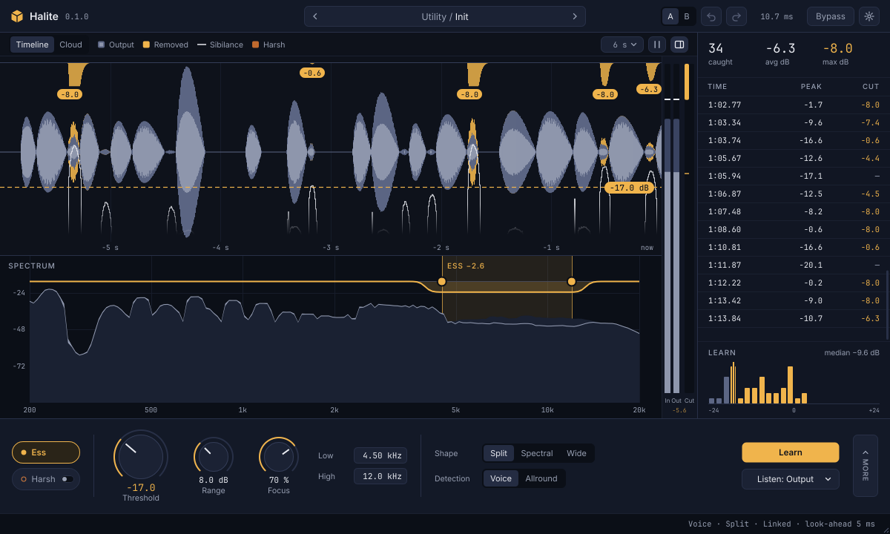

# Halite

A de-esser by **Myzel Audio** that finds esses, not treble. It measures each sibilant against the
voice around it, so a whisper and a belt get the same treatment, and it removes only the part of the
ess that sticks out. An optional second band tames harshness in the upper mids against the same
voice. One job, measured against the task, and bit-identical to its input when it has nothing to do.



Formats: VST3, CLAP, LV2, Standalone (Linux first; Windows/macOS from CI, unsigned).
Licence: AGPLv3. Sibling of [Umber](../umber), [Cerulean](../cerulean), [Mulberry](../mulberry)
and [Viridian](../viridian).

**How to use it:** see the [manual](docs/MANUAL.md). What is in this version and what is not yet
verified: [release notes](docs/RELEASE_NOTES.md).

## The shapes

| Shape | What it removes |
|---|---|
| **Split** (default) | A steep dynamic cut over the sibilance band: the full depth from Detect Low to Detect High, back within 0.1 dB a third of an octave past either edge (to 16 dB of cut); a high shelf when Detect High reaches 0.4 · fs |
| **Spectral** | Per bin, only what sticks out of the voice's own top end, learned from the last 2 s of the voice between esses, until the band's own bins have lost what the detector asks |
| **Wide** | The whole signal, for the length of the ess |

**Detection:** **Voice** (a relative threshold, dB of sibilance over the voice's body, with a
noise-likeness and a spectral-shape cue weighed by Focus) or **Allround** (the band's level in
dBFS, for instruments and buses). The **Harsh** band (1.5 … 6 kHz) follows the shape: a steep bell
in Split and Wide, a cut against a per-frame line across its band in Spectral.

## Controls

**Threshold** (Voice −36 … +24 dB, default −17.0; Allround −60 … 0 dBFS, default −16) · **Range**
(0 … 24 dB) · **Detect** Low and High (1.5 … 20 kHz) · **Focus** · **Shape** · **Detection** ·
**Learn** (a button: 8 s, then Threshold, and Harsh Threshold with Harsh on) · **Listen** (Output,
Removed, each band's removed part or trigger) · **Harsh**: Threshold, Range, Freq, Width, Speed ·
**More**: Ess speed (Auto or 5 … 200 ms), Look-ahead (0 … 10 ms), Stereo (Linked, Unlinked, Mid,
Side), Key (internal or side chain) with its high-pass, Output (±12 dB). Header: 25 factory presets
and your own, A/B, undo/redo, the latency read-out, Bypass (latency-aligned) and ⚙ (latency, theme,
window size, help). Every range and default: the manual's *Controls*.

**Latency** is a session setting, not a parameter: **Normal** (one Spectral frame: 512 samples at
44.1/48 kHz, 1024 at 88.2/96, 2048 at 176.4/192; every shape and look-ahead) or **Live** (0 samples;
Spectral runs as Split). Loading a preset never changes the latency the host sees.

The editor is one resizable view (from 720 × 420, no fixed aspect) in a dark and a light theme: a
Timeline and a Cloud of every ess with its cut, a spectrum with draggable bands, meters, the events
of the last minute and Learn's histogram (`src/ui/DESIGN.md`).

## How it's built

- **Idle is identity.** Every shape computes what to remove and subtracts it from the
  latency-aligned input; with nothing to remove the output is the delayed input bit for bit, in
  every shape, stereo mode and latency.
- **Measured against the task.** The detector and the shapes were tuned on phoneme-labelled public
  corpora (VCTK, VocalSet, LibriSpeech; CC BY 4.0), split by speaker into a tuning half and a held-out
  half that only reads the results. On held-out speakers, at the threshold that catches 95 % of /s/,
  0.35 % of vowel frames are cut; 0.9 % of vowel frames carry a release tail over 1 dB at the
  defaults; Split's band loses what the detector asks within ±0.5 dB on every ess, Spectral's on
  97 %. How each constant was chosen: `src/dsp/detector/NOTES.md`, `src/dsp/shapes/NOTES.md` and the
  shapes' own NOTES.
- **Two test tiers.** Twelve short CC BY excerpts with their phone labels are committed
  (`tests/corpus`) and run in CI with the golden renders; the full corpora stay local
  (`tools/corpus/fetch.sh`) and feed `HaliteMeasure`.
- **Analysis on the host's timeline.** The detector's hops and Spectral's frames sit on the
  timeline, so a bounce of one bar matches the same bar of a full bounce once Spectral has
  relearned (2 s of voice).
- **CPU budget**, at 48 kHz stereo on one core: Split or Wide 0.5 %, Spectral 1.5 %, the Harsh band
  0.3 % more, a Shape crossfade 2 %, Unlinked Spectral 2.5 %; twice that at 88.2/96 kHz and four times
  at 176.4/192. Measured within it in every case at every rate. The editor's budget is 5 % of a core
  at the full clock at 200 % on Linux (`src/ui/DESIGN.md`, *Performance*).
- **Golden-file regression tests** for every shape, detection and band, so refactors cannot change
  the sound silently.

## Status

Version 0.1.0, Halite's first. Verified on Linux: every test suite (204 cases), the editor self-test,
pluginval at strictness 10 on the VST3 and the LV2, clap-validator on the CLAP, the Standalone, the
release tarball and its `install.sh`, the measurements above. Not yet verified: listening (the
defaults and the 25 factory presets are set from measurements), a DAW by hand, Windows and macOS
(no CI run has built Halite yet; nobody has looked at the editor there), a real desktop's window and
high-refresh displays for the editor's CPU, a screen reader.
Known issues: the manual's *Limits and known issues*.

## Building

From the repository root (`../..`), see the root README for dependencies.
`-DMYZEL_PLUGINS=halite` builds only Halite:

```sh
cmake -S . -B build -G Ninja -DCMAKE_BUILD_TYPE=Release -DMYZEL_PLUGINS=halite
cmake --build build
```

Plugins land in `build/plugins/halite/Halite_artefacts/Release/{VST3,CLAP,LV2,Standalone}`.
`tools/package.sh halite build` builds a release tarball in `dist/` with an `install.sh`.

## Testing

```sh
ctest --test-dir build/plugins/halite --output-on-failure        # every Halite suite
build/plugins/halite/tests/HaliteTests                            # parameters, buses, state, chain, identity, allocation
build/plugins/halite/tests/HaliteTests "[parameters]"             # the frozen IDs, ranges, defaults, read-outs
build/plugins/halite/tests/HaliteTests "[buses]"                  # main mono/stereo, side-chain key off/mono/stereo
build/plugins/halite/tests/HaliteTests "[state]"                  # session round trips, latency mode, damaged and foreign state
build/plugins/halite/tests/HaliteTests "[realtime]"               # no allocation in processBlock while every parameter moves, Learn capturing; none in the display's readers per frame
build/plugins/halite/tests/HaliteTests "[learn]"                  # Learn through the processor: one gesture, one undo step, too few esses, Harsh, Allround, nothing stored, a host's prepare around a capture, the result until the next edit
build/plugins/halite/tests/HaliteTests "[presets]"                # the factory set: categories, every preset as written in one undo step, not Bypass, Listen or latency; a user preset's file round trip; each sane on a voice
build/plugins/halite/tests/HaliteTests "[chain]"                  # output = aligned input − Removed, events reach the ring
build/plugins/halite/tests/HaliteTests "[identity]"               # the path with nothing to remove: the input delayed, bit for bit
build/plugins/halite/tests/HaliteTests "[family]"                 # through the processor, reducing: every layout and key, 44.1–192 kHz latency, block sizes, state, bit-identical renders, every parameter heard
build/plugins/halite/tests/HaliteTests "[display]"                # the display's mappings: the dB, frequency and column scales, the spectrum's hit-testing
build/plugins/halite/tests/HaliteTests_reduction                  # the reduction (src/dsp/shapes, src/dsp/chain): every gate below
build/plugins/halite/tests/HaliteTests_reduction "[identity]"     # no esses: the aligned input bit for bit, every shape, stereo mode, latency
build/plugins/halite/tests/HaliteTests_reduction "[accuracy]"     # accuracy (Split and Spectral on the band's own power, Wide on the landing, Harsh on its band's power) and collateral; [rates]: 44.1–192 kHz, the landing on B across rates as [!mayfail]
build/plugins/halite/tests/HaliteTests_reduction "[golden]"       # every shape × detection × band against its recorded render of the committed excerpts
build/plugins/halite/tests/HaliteTests_reduction "[clicks]"       # 3rd-difference crest through changes and fast automation
build/plugins/halite/tests/HaliteTests_reduction "[stereo]"       # stereo modes; a Stereo change crossfades, each lane on its own mode's reductions
build/plugins/halite/tests/HaliteTests_reduction "[input]"        # NaN and Inf act as 0 on the shapes; a hot signal is cut as any other
build/plugins/halite/tests/HaliteTests_reduction "[warmup]"       # a render started mid-clip matches the full render: Split, Wide and Spectral
build/plugins/halite/tests/HaliteTests_reduction "[latency]"      # reported = measured, the frame rule, hop timing, switching Normal/Live
build/plugins/halite/tests/HaliteTests_reduction "[split]"        # Split's steep cut: the near-Nyquist gate and the collateral reading at every depth, the design's vectors, the prototypes' roots, the design grid, modulation and its stability, the glide
build/plugins/halite/tests/HaliteTests_reduction "[spectral]"     # Spectral: the Stft, the gains, the target, the Harsh line, side chain, Warm-up gate, timeline, frames per block
build/plugins/halite/tests/HaliteTests_reduction "[timeline]"     # the grids on the host's timeline; transport start and jump
build/plugins/halite/tests/HaliteTests_reduction "[feed]"         # the display feed (src/dsp/feed): sample streams, history, event time stamps and the transport log, Spectral's cut and target; the spectrum, meters and cut curves; a reader thread against the writer
build/plugins/halite/tests/HaliteTests_reduction "[.report]"      # accuracy (also across rates), collateral, click (also in the band) and near-Nyquist tables; the landing against Speed, the onset against the look-ahead; Split's ringing and modulation; Spectral's musical noise, gain smoothing and learning constants; what each golden removes
build/plugins/halite/tests/HaliteTests_reduction "[.corpus][spectral]"    # Spectral's learned target on the m1 corpus (HALITE_SPLIT=tune by default): the neutral curve
taskset -c 2 build/plugins/halite/tests/HaliteTests_reduction "[.perf]"   # chain CPU against the budget above, every case at 44.1–192 kHz, each case's costliest block, the block of every event that starts Spectral; the display feed's own share
build/plugins/halite/tests/HaliteTests_detector                   # the detectors alone (src/dsp/detector, src/dsp/common)
build/plugins/halite/tests/HaliteTests_detector "[noise]"         # the two noise-cue candidates
build/plugins/halite/tests/HaliteTests_detector "[shape]"         # the shape cue, a voiced /z/
build/plugins/halite/tests/HaliteTests_detector "[learn]"         # Learn's histograms, rule, ess candidates and captures on the detector's hops; a capture's edges; a prepare during and after one
build/plugins/halite/tests/HaliteTests_detector "[committed]"     # the committed corpus tier (CI): separability, regression bounds; the failing bright gate shows as [!mayfail]
build/plugins/halite/tests/HaliteTests_detector "[m1]"            # the m1 subset from the cache: the gates on both halves, regression bounds on tune (hidden; without it the case skips and Catch2 exits 4)
taskset -c 2 build/plugins/halite/tests/HaliteTests_detector "[.perf]"    # detector CPU at 48/96 kHz, every cue, with the load average
build/plugins/halite/tests/HaliteTests_detector "[.report]"       # raw noise-cue values on NOTES.md's signals
xvfb-run -a tools/pluginval.sh halite build 10 vst3,lv2          # pluginval on the VST3 and the LV2, strictness 10
xvfb-run -a clap-validator validate build/plugins/halite/Halite_artefacts/Release/CLAP/Halite.clap   # clap-validator 0.4.1 (a release binary from free-audio/clap-validator)
```

The editor (`src/ui/DESIGN.md`, *Snapshot tool and self-test*, *Performance*):

```sh
xvfb-run -a build/plugins/halite/tools/HaliteUiSnapshot_artefacts/Release/HaliteUiSnapshot <dir> --selftest   # the editor self-test
xvfb-run -a build/plugins/halite/tools/HaliteUiSnapshot_artefacts/Release/HaliteUiSnapshot <dir>              # the scenes as PNG, both themes, five sizes, Learn's states; then the display's CPU share at 200 % (budget 5 %)
HALITE_TIMING_ONLY=1 xvfb-run -a -s "-screen 0 2560x1600x24" build/plugins/halite/tools/HaliteUiSnapshot_artefacts/Release/HaliteUiSnapshot <dir>   # the timing alone, also in a real window at 200 % and 100 % with its clock and cycles (HALITE_TIMING_ONLY=window for that part alone; pin with taskset -c 2,4 on a hybrid CPU)
```

`docs/screenshots` keeps a small set of the snapshot tool's scenes at 1×; they show its synthetic
voice, not a recording.

### Golden renders

`tests/golden/<shape>-<detection>-<band>.f32` hold one second (two half-second windows, float32,
48 kHz mono) of the chain's output over two committed excerpts back to back, for every Shape,
Detection and band (Ess only, Ess and Harsh), at fixed settings (`tests/reduction/GoldenTests.cpp`).
The test compares the error against what the golden render removes, gate −60 dB; a missing file
fails. They are adaptations of CC BY 4.0 recordings (`tests/golden/ATTRIBUTION.md`). When each was
last re-recorded and why: `src/dsp/shapes/NOTES.md`, `src/dsp/shapes/split/NOTES.md`,
`src/dsp/shapes/spectral/NOTES.md` and `src/dsp/detector/NOTES.md` (*M3: Speed*). Re-record **only**
for an intended sound change, and say so in the commit; a failure after a refactor is a bug:

```sh
HALITE_UPDATE_GOLDEN=1 build/plugins/halite/tests/HaliteTests_reduction "[golden]"
build/plugins/halite/tests/HaliteTests_reduction "Golden: what each*"    # what each configuration removes, per 0.5 s
```

## Measuring

`HaliteMeasure` runs the plugin's own detector over the labelled corpora and prints the detection
gates (definitions and how the numbers were chosen: `src/dsp/detector/NOTES.md`, *Measured (M1)*,
*M1b*, *M3: Speed*, *M3: Learn*). For each speech corpus it searches the threshold where 95 % of /s/
produce an event and reports the vowel-frame decisions there (the separability gate: at most 2 %);
`--no-separability` skips the search. Per sibilant it also reports what happens inside the labels
(frames decided and reduced, when the first decision comes), which token recall cannot see, and it
marks a level reading with no event in its working range *not measured*. At the threshold set it
reads the release-tail gate (at most 2 % of vowel frames carrying more than 1 dB), the share of each
ess's label frames reduced and when the reduction starts, and how often Harsh's reduction dips on
sustained vowels (a pumping proxy, reported). The local tier comes from
`tools/corpus/fetch.sh --subset m1` (`tools/corpus/README.md`).

```sh
cmake --build build --target HaliteMeasure
build/plugins/halite/tools/HaliteMeasure --stream --level           # the gates on the m1 tune split: VCTK, VocalSet, synthetic (tune set)
build/plugins/halite/tools/HaliteMeasure --split holdout --stream --level --speakers --failures 8
build/plugins/halite/tools/HaliteMeasure --data committed --level   # the committed tier (tests/corpus)
build/plugins/halite/tools/HaliteMeasure --stream --vary noiseRangeDb=30,40,50 --vary presenceSlope=0,6   # one line per combination
build/plugins/halite/tools/HaliteMeasure --data vctk,vocalset --stream --no-separability --vary essAutoShare=0.25,0.5 --vary essAutoMaxMs=30,80   # Speed Auto (harshAutoShare, harshAutoMinMs, harshAutoMaxMs; speedAuto=0 with release=…)
build/plugins/halite/tools/HaliteMeasure --data vctk --stream --level-gains 0,-10,-20 --set bodyFloorDb=-80   # level independence, other range or floor
build/plugins/halite/tools/HaliteMeasure --ripple                   # B's ripple and rise (no corpus)
build/plugins/halite/tools/HaliteMeasure --data vctk --dump p230_001  # every hop of one recording, as TSV
build/plugins/halite/tools/HaliteMeasure --help                     # every option, setting and constant
```

`--learn` runs the plugin's own Learn instead: 8 s captures at every step of each speaker's stream,
Learn over the whole stream, and Learn's rule read from the labels, with what each capture's
threshold does to the labelled esses; `--vary` takes Learn's constants (`src/dsp/detector/NOTES.md`,
*M3: Learn*; the first configuration's Harsh share also sets the labelled vowels' reading, so
`--vary harshShare=0.1` prints their tenth). `--thresholds-out` writes Learn's threshold per speaker,
and `--thresholds` runs the detection gates or `--reduction` at them. Allround reads levels in dBFS,
so `--normalise -18` first scales each recording to −18 dBFS RMS over its speech; `--data cymbals`
adds synthetic hats and ride.

```sh
build/plugins/halite/tools/HaliteMeasure --learn --data vctk,vocalset --stream --speakers --thresholds-out learn.tsv
build/plugins/halite/tools/HaliteMeasure --learn --data vctk,vocalset --stream --vary floorDb=-27,-24,-21 --vary minLengthMs=15,25
build/plugins/halite/tools/HaliteMeasure --learn --data vctk,cymbals --stream --set detection=allround --normalise -18
build/plugins/halite/tools/HaliteMeasure --reduction --data vctk,vocalset --stream --jobs 2 --thresholds learn.tsv
```

`--reduction` runs every ess through the chain instead, in each shape, and prints the reduction
gates on real material (`src/dsp/shapes/NOTES.md`, *Measured (M2 gates)*, *M2b*): what the band's own
bins lost against what the detector's reduction takes off them (the accuracy gate for Split and
Spectral), what the band filter's energy (B) lost against the ask, where the ess lands on B, the third
octaves outside the band during it (with the level of the one that moved most), the same for the Harsh
band's episodes, how much of the band's energy no in-band cut reaches, what each labelled /s/ /z/
token's band energy lost, and Listen Removed's null test. One recording (or with `--stream` one
speaker) is in memory per job: the m1 tune split takes about 0.66 GB at `--jobs 2` (3 min).

```sh
build/plugins/halite/tools/HaliteMeasure --reduction --data committed --worst 5                 # the committed tier, the 5 worst readings of each kind
build/plugins/halite/tools/HaliteMeasure --reduction --data vctk,vocalset --stream --jobs 2      # the m1 tune split
build/plugins/halite/tools/HaliteMeasure --reduction --data committed --shapes split,wide --set latency=live
```

## References

The detector, the shapes and the measurements are our own implementation, built on published
research. `src/dsp/detector/NOTES.md` says what each source gives and how far it was read.

- A. Jongman, R. Wayland, S. Wong, *Acoustic Characteristics of English Fricatives: I. Static Cues*
  (Working Papers of the Cornell Phonetics Laboratory 12, 1998) and *Acoustic characteristics of
  English fricatives* (JASA 108(3), 2000): sibilant peaks, durations and levels against the vowel.
- L. L. Koenig, C. H. Shadle, J. L. Preston, C. R. Mooshammer, *Toward Improved Spectral Measures of
  /s/* (JSLHR 56(4), 2013): /s/ peaks by speaker.
- B. B. Monson, E. J. Hunter, A. J. Lotto, B. H. Story, *The perceptual significance of high-frequency
  energy in the human voice* (Frontiers in Psychology 5, 2014).
- A. H. Gray, J. D. Markel, *A spectral-flatness measure for studying the autocorrelation method of
  linear prediction of speech analysis* (IEEE Trans. ASSP 22(3), 1974): the flatness cue measured and
  not kept.
- D. Giannoulis, M. Massberg, J. D. Reiss, *Digital Dynamic Range Compressor Design: A Tutorial and
  Analysis* (JAES 60(6), 2012): the soft knee.
- J. B. Allen, *Short term spectral analysis, synthesis, and modification by discrete Fourier
  transform* (IEEE Trans. ASSP 25(3), 1977) and J. O. Smith III, *Spectral Audio Signal Processing*
  (W3K, 2011): Spectral's overlap-add.
- O. Cappé, *Elimination of the musical noise phenomenon with the Ephraim and Malah noise suppressor*
  (IEEE Trans. Speech and Audio Processing 2(2), 1994): smoothing against musical noise.
- B. R. Glasberg, B. C. J. Moore, *Derivation of auditory filter shapes from notched-noise data*
  (Hearing Research 47, 1990): the ERB scale of Spectral's target.
- M. Vicanek, *Matched Second Order Digital Filters* (2016), A. Simper, *Linear Trap Integrated SVF*
  (Cytomic, 2013) and V. Zavalishin, *The Art of VA Filter Design* (Native Instruments, 2018): Split's
  filters.
- Data: VCTK 0.92 (J. Yamagishi, C. Veaux, K. MacDonald, University of Edinburgh, 2019,
  doi:10.7488/ds/2645), LibriSpeech (V. Panayotov et al., ICASSP 2015) with L. Lugosch's alignments
  (doi:10.5281/zenodo.2619474), VocalSet (J. Wilkins et al., ISMIR 2018, doi:10.5281/zenodo.1193957)
  and Annotated-VocalSet (B. Faghih, J. Timoney, Applied Sciences 12(18), 2022), all CC BY 4.0;
  aligned with pocketsphinx 5 (BSD-style) and, for LibriSpeech, the Montreal Forced Aligner (MIT).

The open-source de-essers read for the survey in `src/dsp/detector/NOTES.md` (LSP, Calf, TAP, mda,
Airwindows, ZamDynamicEQ, ZL Equalizer) were read, never copied.

## Licence

AGPLv3. See [LICENSE](../../LICENSE). Built with [JUCE](https://juce.com) under its AGPLv3 option.
The editor's typefaces, Inter and JetBrains Mono, are under the SIL Open Font License 1.1
(`src/ui/assets/fonts/OFL.txt`; versions, sources and checksums in `src/ui/assets/fonts/ATTRIBUTION.md`).
The committed test excerpts and golden renders are CC BY 4.0 adaptations of VCTK and VocalSet
(`tests/corpus/ATTRIBUTION.md`, `tests/golden/ATTRIBUTION.md`); nothing from them is shipped in a
plugin.
