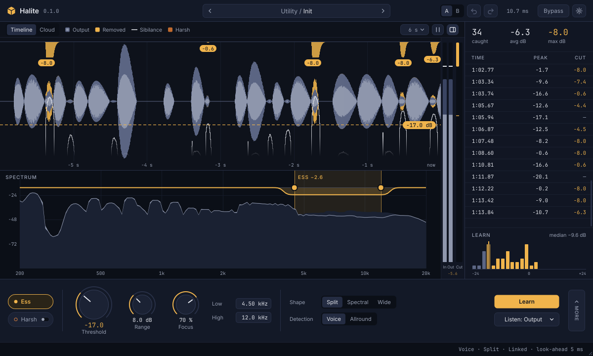
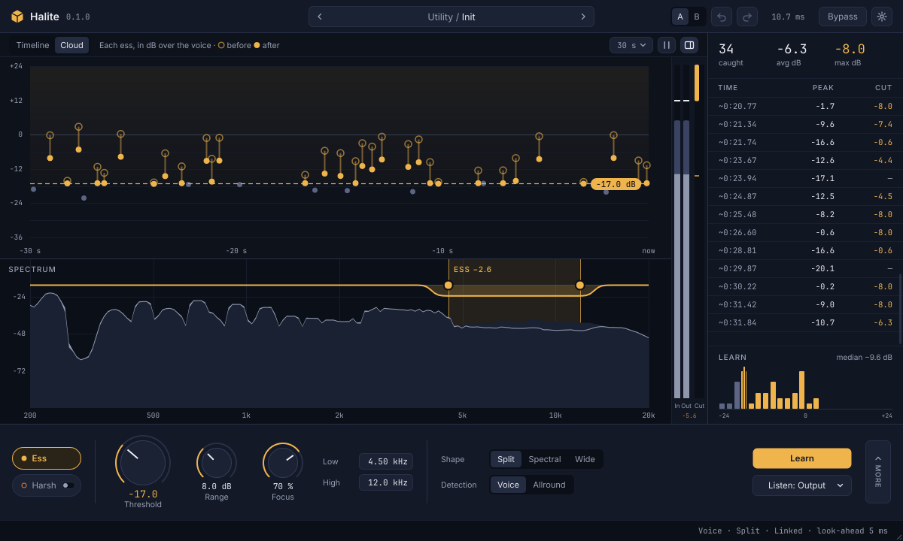
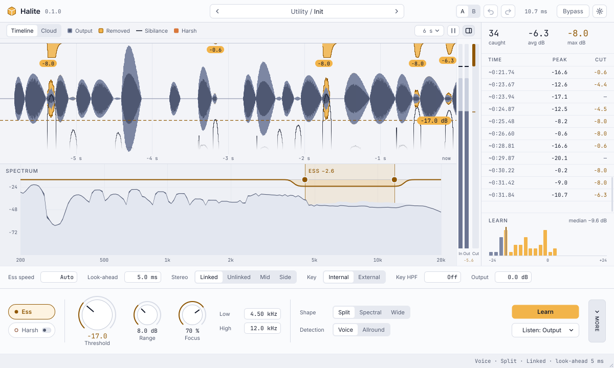
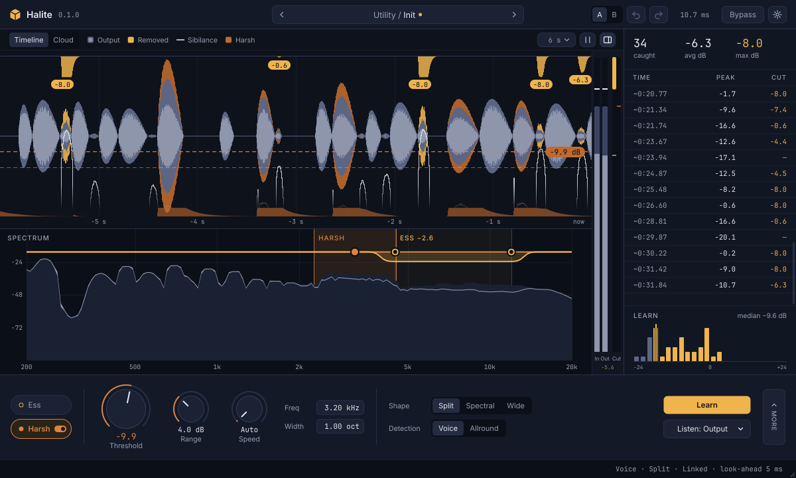
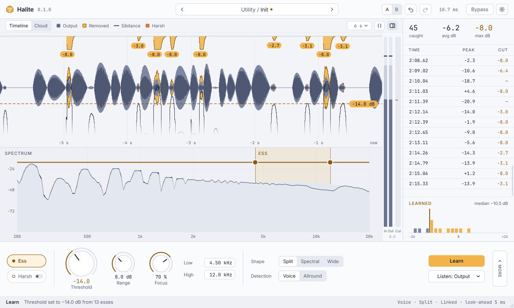

# Halite manual

Halite is a de-esser that finds esses, not treble. It measures each sibilant against the voice
around it, so a whisper and a belt get the same treatment, and it takes out only the part of the
ess that sticks out, so the voice keeps its air. An optional second band, **Harsh**, tames a voice
that pushes in its upper mids. When there is nothing to remove, the output is the input, delayed
by the plugin's latency, bit for bit (with Output at 0 dB).

The window is a display: you see every ess Halite caught, how far it rose, and how much it took
off.

*The screenshots in this manual show the test signal of Halite's snapshot tool, a synthetic voice
with esses of graded strength, not a recording.*

To install it, use the Myzel Audio installer for your system: [Installing](https://github.com/mtunix/myzel-audio#installing).

## Quick start

1. Insert Halite on a vocal track (mono or stereo). The defaults are a sound start for one voice:
   **Voice** detection, **Split** shape, Threshold −17 dB, Range 8 dB.
2. Play a passage with esses in it and press **Learn**. Halite listens for 8 seconds and then
   sets Threshold from the esses it heard. The status line says what it set.
3. Watch the **Timeline**: each ess Halite cut carries a tag with its cut in dB. Drag the dashed
   threshold line down to catch more esses, up to catch fewer. **Range** sets how deep a cut can
   go.
4. Choose **Listen › Removed** to hear exactly what Halite takes out. It should be esses and
   nothing else. Go back to **Listen › Output**.
5. Compare with **Bypass** (header). It keeps the latency, so the comparison is in time.

## How Halite hears an ess

**Sibilance over the voice.** Halite measures two levels on each channel: the **sibilance band**
(Detect Low to Detect High, 4.5 … 12 kHz by default) and the voice's **body** below it. Its
sibilance reading is the difference, in dB: how far the band rises over the voice around it. Esses
read below 0 dB, because a voice carries less energy up there than in its body; a typical /s/
peaks around −14 dB. While an ess lasts, the body reading holds the vowel before it, so the ess is
always judged against the voice that surrounds it, whether that voice is soft or loud.

**Is it noise?** A bright vowel or a sung "ee" can raise the band too. Two cues tell them apart:
esses are noise-like (a sung note is harmonic), and an ess rises towards the band (a vowel's top
end falls away). **Focus** sets how much the cues count. They only ever lower the reading, never
raise it, so the number on the display stays "dB of ess over the voice".

**The cut.** An ess that rises over Threshold is brought down to Threshold, never by more than
**Range**, with a 3 dB soft knee. Halite counts an ess as caught when its cut passes 0.5 dB; that
is what gets a tag, a cut in the events list and a filled dot in the Cloud, and what the totals
count.

**Allround** detection, for instruments and mixes, drops the comparison and the cues: the
threshold is the band's own level in dBFS.

## The workbench

### Header

From the left: the wordmark and version; the **preset field** in the centre (‹ › step through
the presets; click the name for the menu with Save, Save as…, Rename… and Delete…; a dot after the
name means you have changed the sound); then **A/B** (right-click copies the slot you hear to the
other one), undo and redo, the **latency** read-out (`10.7 ms` or `Live`; click it to switch),
**Bypass** (red while engaged) and **⚙** (Latency, Theme, Window size, Help).

### Display toolbar

**Timeline | Cloud** switch the main view. Then the legend, the **zoom** (Timeline 2, 4, 6, 8 or
10 s, default 6; Cloud 10, 20, 30, 45 or 60 s, default 30), **freeze** (holds the display while the
audio runs on; the button shows a play mark to return to live) and, at the right end, the events
sidebar's toggle.

### Timeline

The last seconds as they pass, newest at the right:

- the output waveform in two tones of grey-blue, the peak and inside it its average level (RMS), with
  the **removed** part around it in the colour of the band that took more (Ess amber, Harsh burnt
  orange);
- the **Ess cut** hanging from the top, and a tag on every caught ess with its cut in dB;
- the **sibilance** reading as a thin line, and **Threshold** as a dashed line with its value.
  Drag the line to set Threshold (Shift for fine steps), double-click it to type a value;
- with Harsh on, the **Harsh cut** as a band rising from the bottom, and Harsh Threshold as a
  second, fainter line;
- the time axis in seconds before now. While frozen, it says how far the picture lies behind.

Click a tag to mark its ess; click elsewhere to clear the mark.

### Cloud

Every ess of the zoom window as a dot, at the height of its sibilance reading. An ess Halite cut
has a hollow dot where it was, a stem, and a filled dot where Halite left it; an ess left alone is
a small grey dot. The shaded area over the threshold line shows what would be cut now; the dots
keep what happened when they passed. It is the quickest way to set Threshold and Range: the grey
dots under the line are the esses you keep, the stems show how far the others were pulled down.
Drag the threshold line here too.

### Spectrum

Under the main view, 200 Hz to 20 kHz: the input as a filled area, the output as a line, and each
band's live cut as a curve hanging under a 0 dB line, with the band's title and the cut it takes
now ("ESS −2.6").

- **Ess band:** a handle on each edge. Drag them to set Detect Low and Detect High.
- **Harsh band** (while Harsh is on): drag the centre handle sideways for Harsh Freq, an edge for
  Harsh Width.
- Click inside a band, or grab one of its handles, to select it: its controls appear in the
  control bar.
- In **Spectral**, a dashed line shows the voice's own top end that Halite cuts towards (in
  Allround, the signal's smoothed spectrum).

### Meters

At the display's right edge: **In** and **Out** (peak bar, RMS bar and a held peak line, 0 to
−60 dBFS) and **Cut**, hanging from the top, the Ess cut beside the Harsh cut. The number under
the labels is the Ess cut now. Click a meter to reset its hold.

### Events sidebar

- **Totals:** the esses caught in the last minute, their average cut and the largest.
- **The list:** every ess of the last minute, caught or left alone, newest at the bottom: its
  time, its peak reading and its cut (— for an ess left alone). While the host plays, the time is
  the song position (`1:12.34`); when it is stopped, and in the Standalone, it is the time since
  Halite started, in grey with a leading `~`.
- Click a row to mark its ess in the views. An ess older than the view's zoom freezes the display
  and scrolls back to it (the display keeps a minute of history); unfreeze to return to live. The
  arrow keys, Page Up/Down, Home and End move the mark, Escape clears it.
- **The Learn histogram** at the bottom: the peak readings of the last minute's esses as bars,
  those over the threshold in the accent, the threshold as a line and the median above it.

The toggle at the right of the toolbar hides and shows the sidebar; the session remembers it.

### Control bar

- **Band pills:** Ess and Harsh select which band's controls the bar shows. The switch in the
  Harsh pill turns the Harsh band on or off.
- **The band's controls:** Ess: Threshold (the large knob), Range, Focus, Detect Low and High.
  Harsh: Threshold, Range, Speed, Freq and Width.
- **Shape** and **Detection**, shared by both bands.
- **Learn** and the **Listen** menu (it turns to the accent when it is not on Output).
- **More** opens the Advanced row above the bar: Ess speed, Look-ahead, Stereo, Key, Key HPF and
  Output. The display gives up the height. The session remembers it.

### Status line

On the left, the name of the control under the pointer (or in keyboard focus) and one sentence on
what it does; also what Learn set, or that a preset was saved. On the right, the mode in short:
`Voice · Split · Linked · look-ahead 5 ms`, `Live, no look-ahead` in Live,
`Split (Spectral needs Normal latency)` when Live runs Split for a chosen Spectral, and
`· side-chain key` with an external key.

### Settings, themes and window size

**⚙ › Theme:** Dark (the default), Light, or System, which follows your desktop's dark mode where
the desktop publishes it (on a Linux desktop that does not, System shows Light). Every open Halite
window follows a theme change.

**Resizing:** drag the window's corner to any size from 720 × 420, in any proportion.
**⚙ › Window size** offers S (960 × 576), M (1200 × 720, the default), L (1440 × 864) and
XL (1680 × 1008). The text stays the same size; the layout makes room:

- narrower than 1000 px, the events sidebar no longer fits beside the display: the toolbar's
  toggle opens it over the display instead;
- narrower than about 870 px, the control bar wraps into two rows;
- lower than 600 px, the knobs and bars get more compact.

Theme and window size are yours, not the session's: they apply to every Halite window and are
stored in `~/.config/Myzel Audio/Halite/Halite.settings` (Linux). The session stores the view,
the selected band, the sidebar, the Advanced row and both zooms.

## Controls

| Control | Range | Default | What it does |
|---|---|---|---|
| **Threshold** (Voice) | −36 … +24 dB | −17.0 dB | How far an ess may rise over the voice before it is cut |
| **Threshold** (Allround) | −60 … 0 dBFS | −16.0 dBFS | The level the sibilance band may reach before it is cut |
| **Range** | 0 … 24 dB | 8 dB | The deepest cut: an ess comes down to the threshold, never further than this |
| **Detect Low**, **High** | 1.5 … 20 kHz | 4.5 kHz, 12 kHz | The sibilance band. Low also sets where the voice's body is measured: from 120 Hz up to half of Detect Low, at most about 2 kHz |
| **Focus** | 0 … 100 % | 70 % | How much the noise and shape cues count (Voice only). 0 is a plain relative band detector |
| **Shape** | Split, Spectral, Wide | Split | How an ess is cut (*The three shapes*) |
| **Detection** | Voice, Allround | Voice | What the threshold is measured against |
| **Learn** | button | | Listens 8 s, then sets Threshold (and Harsh Threshold with Harsh on) |
| **Listen** | Output, Removed, Ess removed, Harsh removed, Ess trigger, Harsh trigger | Output | What you hear (*Listen*) |
| **Harsh** | on, off | off | The second band |
| **Harsh Threshold** (Voice) | −36 … +12 dB | −9.9 dB | How far the upper mids may rise over the voice's body |
| **Harsh Threshold** (Allround) | −60 … 0 dBFS | −22.4 dBFS | The level the Harsh band may reach |
| **Harsh Range** | 0 … 12 dB | 4 dB | The Harsh band's deepest cut |
| **Harsh Freq** | 1.5 … 6 kHz | 3.2 kHz | The Harsh band's centre |
| **Harsh Width** | 0.3 … 2 octaves | 1.00 oct | The Harsh band's width |
| **Harsh Speed** | Auto, or 10 … 300 ms | Auto (fixed: 80 ms) | How fast the Harsh band lets go |
| **Ess speed** (Advanced) | Auto, or 5 … 200 ms | Auto (fixed: 20 ms) | How fast the Ess band lets go |
| **Look-ahead** (Advanced) | 0 … 10 ms | 5.0 ms | How early the detector hears an ess. Normal latency only |
| **Stereo** (Advanced) | Linked, Unlinked, Mid, Side | Linked | *Stereo and side chain* |
| **Key** (Advanced) | Internal, External | Internal | What the detectors listen to: the input, or the side-chain input |
| **Key HPF** (Advanced) | Off, 20 Hz … 2 kHz | Off | A high-pass on what the detectors hear. The lowest position is Off |
| **Output** (Advanced) | −12 … +12 dB | 0.0 dB | The level after Halite |
| **Bypass** | on, off | off | The input, latency-aligned, with a 20 ms crossfade |
| **Latency** (⚙) | Normal, Live | Normal | *Latency* |

- **Threshold follows Detection.** Voice and Allround keep a threshold each, so switching
  Detection never loses the other's setting; the knob and the line edit the one in use.
- **Detect Low above Detect High** swaps them: the band is between the two handles, whichever is
  lower. A band narrower than a third of an octave widens around its centre.
- **Speed** is one control: the first eighth of its travel is **Auto**, the rest a fixed release.
  Type `auto` or a time (`40 ms`).
- **Listen** and **Bypass** are for monitoring: the host can automate them, but they are not
  stored in presets and are not undo steps. Every other parameter is in presets, automatable and
  undoable; Learn's change is one undo step.

### Mouse and keyboard

| Action | Knobs | Fields (Detect, Freq, Width, Ess speed, …) |
|---|---|---|
| Drag up or right | Adjust; Shift for fine | Adjust; Shift for fine |
| Mouse wheel, arrow keys | Step (thresholds 0.5 dB); Shift for fine | The same |
| Double-click | Reset to default | Type a value |
| Alt-, Ctrl- or Cmd-click, Return or a digit | Type a value | Type a value |
| Right-click | Type a value… or Reset to default | The same |
| Delete | Reset to default | Reset to default |
| Page Up / Down, Home / End | Big step, minimum, maximum | The same |

Typed values take their unit or not: `-18`, `4.5k`, `4500 Hz`, `40 ms`, `auto`, `off` (Key HPF).
A burst of wheel or arrow steps is one undo step. **Ctrl/Cmd + Z** undoes, **Ctrl/Cmd + Shift + Z**
(or Ctrl + Y) redoes; Escape closes a dialog or the sidebar overlay. Tab moves through every
control, header to control bar. **⚙ › Help** sums this up.

## The three shapes

| Shape | What it does | Good for |
|---|---|---|
| **Split** (default) | A steep, dynamic cut over the sibilance band: the full depth from Detect Low to Detect High, back to within 0.1 dB a third of an octave past each edge. With Detect High near the top of the spectrum (above 0.4 of the sample rate, 17.6 kHz at 44.1 kHz), a high shelf from Detect Low up | Most voices: the band dips, the voice under it stays as it was |
| **Spectral** | Cuts only the frequencies of the band that stick out of the voice's own top end, which Halite learns from the last 2 seconds of the voice between esses. The ess keeps its shape at a lower level; in Voice nothing is cut below the voice's own top end | Bright, airy and pop vocals, choirs, dense sibilance: where Split dulls the air. Normal latency only |
| **Wide** | The whole signal dips for the length of the ess | The classic broadband de-esser; esses that spread over the whole top end; the simplest sound |

All three subtract what they remove from the delayed input: where nothing is cut, nothing changes,
to the bit. Changing Shape crossfades over 30 ms. Split's steep cut rings briefly on a sharp ess (about
3–4 ms on the default band, about 10 ms on a band as low as 1.5 … 3 kHz).

**Spectral's start.** Spectral learns the voice's top end from the audio it hears, so it needs
about 2 seconds of voice to settle after it starts, and it starts over when the host's transport
starts or jumps. Its analysis follows the host's timeline, so a bounce of one bar alone matches the
same bar in a full bounce once those 2 seconds have passed. Until then it uses a neutral curve.

**Spectral in Allround** has no voice to learn: it cuts what sticks out of the signal's own
spectrum, smoothed over about an octave and 300 ms (a cymbal's ring, a hi-hat's spit).

## Voice or Allround

- **Voice** (default) is for one voice: sung, spoken, rapped, whispered. The threshold is relative
  (dB over the voice), so it holds through soft and loud passages, and Focus keeps bright vowels
  from being cut.
- **Allround** is for anything else: cymbals, acoustic guitar, brass, a bus or a mix. The
  threshold is the band's level in dBFS, so it depends on how loud the source is, and Focus does
  nothing. Learn works here too.

## The Harsh band

Harshness is the other half of a bright voice: an edge in the upper mids (around 2–5 kHz) that
lasts through the vowels instead of coming in bursts. Turn it on with the switch in the Harsh
pill. It is a dynamic band at **Harsh Freq** and **Harsh Width**, measured against the voice's body
(from 150 Hz to half an octave under the band) in Voice, or in dBFS in Allround. Its threshold line
and its cut show in the Timeline in burnt orange.

The two bands never fight over one ess: during an ess the Harsh band holds its cut, and it also
holds while its own band is noise-like, since the default Harsh band contains the peak of a "sh".
In Split and Wide the Harsh band is a steep dynamic bell; in Spectral its frequencies are cut
against a straight line drawn across the band each moment, never against the learned voice
(harshness lives in the vowels the voice is learned from). Where the bands overlap, Spectral cuts
a frequency once, by the deeper of the two; in Split and Wide the Harsh bell works on what the Ess
band leaves, so there the two cuts add. The default bands do not overlap; a wide or high Harsh band
does (2 octaves at 6 kHz reach from 3 to 12 kHz).

**Harsh Speed Auto** lets go over half the time the band stayed over its threshold, within
30 … 150 ms.

## Speed

**Auto** (default) follows each ess: the Ess band lets go over a quarter of the time the ess stayed
over the threshold, within 15 … 30 ms, so a short "t-s" releases fast and a long "sss" smoothly,
and no cut runs on into the next vowel. A fixed release (5 … 200 ms) suits fast, dense syllables
(short) or a smooth, even sound (longer).

**Look-ahead** (Normal latency only) lets the detector hear an ess before you do, so its start is
cut too. 5 ms catches the onset; more ducks the vowel before it a little.

## Listen

| Mode | You hear |
|---|---|
| **Output** | Halite's output (default) |
| **Removed** | Exactly what both bands take out. Output plus Removed is the input |
| **Ess removed**, **Harsh removed** | What each band takes out |
| **Ess trigger**, **Harsh trigger** | What each detector hears: its band of the key signal |

Use the triggers to place Detect and the Harsh band, and Removed to check that only esses go.
Listen crossfades over 30 ms and is never saved in a preset.

## Stereo and side chain

**Stereo** (in the Advanced row):

- **Linked** (default): the louder channel's reading drives both, so the image stays put.
- **Unlinked**: each channel on its own (two different sources on one stereo track).
- **Mid**: detects and cuts only the centre, where a lead vocal sits in a mix.
- **Side**: only the sides: the sibilance of wide doubles or a stereo reverb.

On a mono track Stereo makes no difference.

**Key** (side chain): with **External**, the detectors listen to the side-chain input (mono or
stereo) and the cut applies to the main input. If the host leaves the side-chain input off,
Halite listens to the input; if the input is on but nothing is routed to it, the detectors hear
silence and nothing is cut. In Spectral the key decides when and how much, and the main signal
which frequencies.
**Key HPF** keeps low rumble and plosive thumps out of what the detectors hear (Off by default).
Ideas: de-ess a reverb return keyed from the dry vocal, or a backing stack keyed from the lead.

## Latency

- **Normal** (default): one Spectral frame, the same for every shape, so changing Shape never
  changes what the host sees: 512 samples at 44.1 and 48 kHz (11.6 and 10.7 ms), 1024 at 88.2 and
  96 kHz, 2048 at 176.4 and 192 kHz. Look-ahead uses part of it.
- **Live**: 0 samples, for tracking and monitoring. Spectral is not available (Halite runs Split,
  and the status line says so) and Look-ahead does nothing. The detector's reading comes within
  3 dB of an ess about 4 ms after it starts and within 1 dB after about 7 ms, so the first
  milliseconds of an ess pass.

Choose it in **⚙ › Latency** or by clicking the latency read-out. It belongs to the session, not
to presets: loading a preset never changes the latency the host sees. When you switch, the audio
fades out and back in (10 ms each way); many hosts take up the new latency at the next transport
stop.

## Presets

25 factory presets in five categories, plus your own (**Save as…** in the preset menu; user
presets are files in `~/.config/Myzel Audio/Halite/Presets` on Linux). A preset stores the sound;
Bypass, Listen and the latency stay as they are.

**The factory presets were set from measurements, not by ear.** Init is every default; each other
preset changes only what the table says, from what the controls do and what was measured on
labelled speech and singing (a typical /s/ peaks around −14 dB over the voice; about −22.5 dB
catches 95 % of them). Nobody has listened to them through all their sources yet, so they are kept on the safe
side. **Trust your ears**, and on real material start with **Learn**. The Allround presets assume a
source around −18 dBFS RMS; on a louder or quieter one, move Threshold by the difference.

| Category | Preset | Changes from Init | Idea |
|---|---|---|---|
| Utility | Init | — | the defaults |
| | Gentle | Threshold −14, Range 5 | only the esses above a typical /s/, by less |
| | Firm | Threshold −21, Range 12 | nearly every /s/, deeper |
| | Live tracking | Threshold −18, Look-ahead 0 | sounds as Live does; choose ⚙ › Latency › Live yourself |
| | Wide band | Wide, Threshold −16, Range 6 | the classic broadband dip, shallower |
| Vocals | Lead female | Detect 5.5 … 14 kHz | higher sibilant peaks, more energy above 11 kHz |
| | Lead male | Detect 4 … 11 kHz | lower sibilant peaks |
| | Rap | Spectral, Threshold −18, Range 10, release 15 ms | dense syllables: a short release never holds a cut into the next vowel |
| | Choir | Spectral, Threshold −19, Range 6, Detect 5 … 13 kHz, release 40 ms | many voices' smeared esses: only what sticks out, released smoothly |
| | Backing stack | Threshold −21, Range 12, release 30 ms | tucks the stack's esses under the lead's |
| | Whisper | Spectral, Threshold −15, Range 4, Focus 85 | a whisper is noise throughout: a light touch so it never lisps (not measured on whispers) |
| | Bright pop | Spectral, Threshold −19, Range 10, Detect 5 … 16 kHz, Focus 80 | airy vocals, bright vowels left alone |
| | Harsh lead | Harsh on, Harsh Threshold −11, Harsh Range 5 | the Harsh band a little firmer than its default |
| | Shouty rock | Threshold −18, Range 10; Harsh on, −12, Range 6, 2.8 kHz, 1.2 oct | a pushed voice: both bands firmer, Harsh lower and wider |
| Speech | Podcast | Threshold −18, Key HPF 80 Hz | close mics; plosive thumps kept out of the detector |
| | Voice-over | Spectral, Threshold −18, Range 9, Focus 75, Key HPF 80 Hz | a polished close voice |
| | Audiobook | Threshold −16, Range 6, release 40 ms | long listening: an even cut on the stronger esses |
| | Harsh room mic | Harsh on, −11, Range 5, 2.5 kHz, 1.5 oct | a room voice's broader upper-mid edge |
| Instruments | Acoustic guitar | Allround, −32 dBFS, Range 6, Detect 3 … 10 kHz, release 30 ms | string squeak and pick noise |
| | Hi-hat tamer | Allround, −18 dBFS, Range 6, Detect 6 … 16 kHz, release 40 ms | the louder hits of a soloed hi-hat |
| | Cymbal bus | Allround, Spectral, −22 dBFS, Range 5, Detect 4 … 16 kHz, release 60 ms | trims what sticks out of the cymbals' own spectrum |
| | Brass | Allround, −30 dBFS, Range 4, Detect 5 … 12 kHz; Harsh on, −24 dBFS, Range 4, 2.5 kHz, 1.2 oct | the blare in the upper mids, a little spit on top |
| Mix | Mastering air | Allround, Spectral, −30 dBFS, Range 3, Detect 6 … 16 kHz, release 60 ms | a light touch on a mix's air |
| | Bus | Allround, −28 dBFS, Range 4, Detect 5 … 12 kHz | a vocal or group bus |
| | Centre vocal | Allround, Stereo Mid, −30 dBFS, Range 4, Detect 5 … 11 kHz | only the centre of a stereo mix, where the lead sits |

## Learn

Press **Learn** while the part plays. For 8 seconds the histogram shows only what Learn hears
(LISTENING, the seconds left and the esses so far); then Halite sets Threshold so that the median
ess is cut by up to 4 dB and the quietest quarter of the esses not at all. The histogram stays, marked
**LEARNED**, with the new threshold across it, until your next edit or a click on it. With Harsh
on, Learn also sets Harsh Threshold, so the loudest 7 % of the voiced frames are cut. Learn
is one undo step; press it again to start over.

- Learn hears every ess, whatever the threshold was, so pressing it twice on the same passage sets
  the same value.
- With fewer than 3 esses in the 8 seconds, Threshold stays and the histogram says *too few
  esses*. Harsh Threshold may still be set from the same capture.
- An 8 second capture lands within about 3.5 dB of what Learn would set over the whole take in 9
  captures out of 10. Pick a passage with typical esses, not the loudest line.
- The result is a starting point: in practice the median ess ends up cut by about 2.5–3 dB at its
  peak. Move Threshold from there by ear.
- In Allround, Learn sets the dBFS threshold. It assumes the source is soloed: on a voice it cannot
  tell an ess from a vowel's top end and sets a lower threshold than a voice needs.

## Tips

- **Lead vocal:** Init, Learn, then listen to Removed. Esses still poking out: Threshold down
  2–3 dB, or Range up. A lisp: Threshold up, Range down, or try Spectral.
- **Bright or airy vocals:** Spectral keeps the air; raise Focus to 80 % if bright vowels get
  touched (watch for cuts with no ess in the Timeline).
- **Rap and fast speech:** a fixed release of 15–20 ms (Rap preset).
- **Podcast and voice-over:** Key HPF at 80 Hz keeps plosives out of the detector.
- **A harsh, pushed voice:** turn Harsh on, press Learn, listen to Harsh removed.
- **Live tracking or monitoring:** ⚙ › Latency › Live, Split or Wide.
- **Hi-hats, cymbals:** Allround; set Threshold from the Timeline's sibilance line, or Learn on the
  soloed track. Spectral trims a ring without dulling the rest.
- **A finished mix:** Allround with Spectral, a few dB of Range at most (Mastering air), or Mid to
  touch only the centre.
- **A reverb that hisses:** put Halite on the reverb return, Key External, and feed the dry vocal to
  the side chain.

## Measured, not claimed

Halite was tuned on labelled public speech and singing corpora (VCTK and VocalSet, with
LibriSpeech as a check; all CC BY 4.0), split by speaker: its constants were chosen on one half.
Unless noted, the figures below are read on the other half, speakers Halite was never tuned on.

- **Telling esses from vowels:** at the threshold that catches 95 % of /s/ (about −22.5 dB), 0.35 %
  of vowel frames are cut (1.2 % for the worst speaker).
- **At the default threshold** (−17 dB), 71 % of /s/ and 57 % of /z/ get a cut: by design, the
  quieter esses are left alone, as Learn's rule leaves the quietest quarter. Firm (−21 dB) sits
  near the threshold that catches 95 %.
- **No tails into the vowel:** 0.9 % of vowel frames carry more than 1 dB of cut.
- **The cut is what it says:** Split's band loses the asked reduction within ±0.5 dB on every ess
  measured, Spectral's on 97 % of them.
- **Nothing outside the band** (read on the tuning half): Spectral changes nothing outside it
  (0.000 dB); Split stays within 0.1 dB outside it on 99 % of esses.
- **Idle is identity:** with nothing to remove, the output is the delayed input, bit for bit, in
  every shape, stereo mode and latency.

## Limits and known issues

- **Set by measurement, not yet by ear.** The defaults, Auto speeds and presets come from the
  measurements above. A listening pass is still to come; if something sounds wrong to you, it
  probably is. Reports are welcome: [issues](https://github.com/mtunix/myzel-audio/issues).
- **Sung vowels:** on sustained singing Halite very rarely cuts a moment that is not an ess, such as
  a noise burst before a note in a quiet pause (in the singing corpus 0.03 % of frames, but up to
  8 dB). If you hear it, raise Threshold for that passage or automate Range.
- **"Sh", "zh", "ch", "j":** tuned for /s/ and /z/. At the threshold that catches 95 % of /s/, about
  89 % of "sh" and "ch" and 74 % of "zh" and "j" are caught.
- **Very quiet recordings:** the comparison with the voice has a floor at a body level of
  −60 dBFS. A voice whose body stays 20 dB or more above it reads the same when its level changes
  (measured: 10 dB quieter changes nothing); a quieter voice reads less sibilant, and Halite catches
  less. Raise the gain before Halite.
- **Live latency** lets the first milliseconds of an ess through, and has no Spectral.
- **Spectral** needs about 2 seconds of voice after a start or a jump (*The three shapes*).
- **Hosts:** pluginval passes at its strictest level on the VST3 and the LV2, clap-validator on the
  CLAP, and the Linux builds are tested here; Halite has not yet been tried by hand in a DAW, nor on
  Windows or macOS, whose builds come from CI unsigned. Nobody has looked at the editor there yet:
  Windows and macOS draw it with other renderers than Linux.
- **The editor's CPU** (next section) is higher than the audio's, and higher on high-refresh
  displays.
- **System theme** on a Linux desktop that does not publish its dark mode shows Light.

## CPU

**The audio**, measured at 48 kHz stereo on the development machine (an Intel i9-12900K), in % of
one core, detector included:

| Setting | CPU |
|---|---|
| Wide | about 0.25 % |
| Split | about 0.4 % |
| Spectral (Linked; Unlinked) | about 0.7 % (0.9 %) |
| Harsh band on | adds about 0.15–0.25 % |
| Heaviest: Spectral Unlinked, both bands cutting all the time | about 1.2 % |

At 88.2 and 96 kHz it is about twice that, at 176.4 and 192 kHz four times. A Shape change runs
two shapes for 30 ms.

**The editor** draws its display in software, the Timeline at your display's frame rate, and costs
more than the audio while it is open. At 200 % display scale on Linux the drawing takes about
4–5 % of one core running at its full clock. What a CPU meter shows for the open window can be
much higher: on the same machine under load, 9–12 % at 200 % and 4–6 % at 100 %; on a quiet machine
about 20 % at 200 % (one run of a pre-release build), because the power-saving governor then runs
the light load at under 1 GHz and the meter counts a share of a slowed-down core. Every window
figure here was taken on a virtual X display (Xvfb), not on a desktop. On a 120 or 144 Hz display
the main view repaints at that rate: expect about two to two and a half times the cost (estimated,
not measured). Windows, macOS and DAWs are not measured yet. Close the editor when you do not need
it: the audio, the events and Learn run without it.
