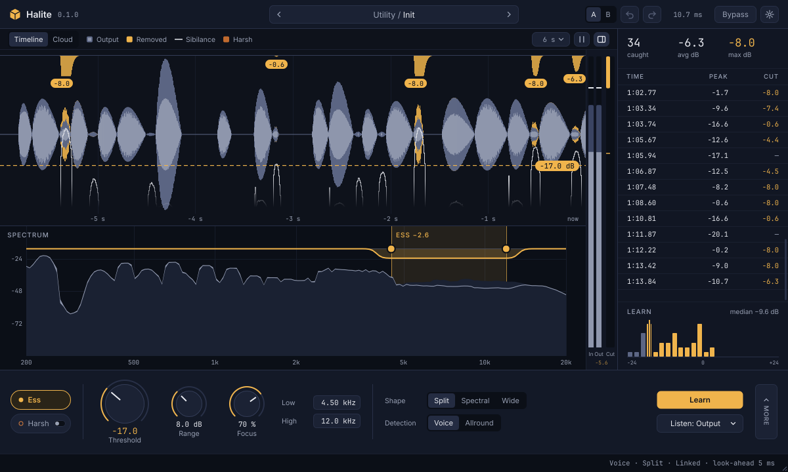

# Halite UI design: the workbench

Halite is the first plugin of the tools lane, and its face is the lane's **workbench**: a flat,
software-style display that is the whole window, freely resizable, in a dark and a light theme
(how it is used: `../../docs/MANUAL.md`). Everything is drawn in code in `src/ui`;
the bundled assets are Inter and JetBrains Mono (`assets/fonts`, SIL OFL 1.1, `ATTRIBUTION.md`).
Read `common/DESIGN.md` first: Halite borrows the shared `EditorController` (presets, A/B, undo,
parameter access) and the snapshot tool's helpers (`common/testing`), and changes nothing in
`common/`. The lane kit (`Widgets`, `Bindings`, `WorkbenchLook`, the dialog) moves to `common/` when
the second tool needs it.

The layout and hierarchy follow mock board **E · Combined** (1200 × 720); the style is **Navy** (PLAN.md,
*UI restyle: Navy*: board S3 · Ink and the two final boards, one per theme), not pixel for pixel. M4 was
built in parts: the editor frame (header, toolbar, the parts' areas and reflow, control bar, Advanced row,
status line, kit, themes), the display (Timeline, Cloud, spectrum, meters,
*Display* below), the events sidebar with Learn, the presets and the settings (*Events sidebar*), and a
last pass of polish, performance and these docs (*Rendering*, *Performance*).



## Identity

- **Canvas:** navy ink in Dark (`background` #0e121b), a cool paper in Light (#f3f4f8) with navy-ink text
  (#141a2b); rails a step lighter (`surface`), fields, knob discs and buttons a step more (`raised`).
  Navy-tinted hairlines (`line`), softer dividers inside a part (`lineSoft`). The tools lane's workbench
  (PLAN.md, N2): each later tool keeps this canvas and brings its own accent.
- **One accent: Ess**, amber (Halite grows amber to orange from its iron): the Ess band's cut and handles,
  the threshold, event tags, the Learn button, focus. **Harsh** is the same accent, deeper: burnt orange.
  A line, an arc, a handle or a read-out uses the accent's *ink* (`essText`, `harshText`); an area uses its
  *fill*. In Dark they are one amber; in Light the fill (#f2b44a) reads 1.7:1 on the paper, so an area of it
  carries navy text or an ink edge (`removedEdge`: the removed part, the hanging cut), and every mark is the dark
  amber ink #8f5600 (N7). The few fills left bare are areas read by eye, never marks (*Contrast*).
- **The waveform in two tones:** the peak in `signal`, its RMS core in `signalCore` (brighter in Dark, darker
  in Light).
- **Caution:** coral red (#ff7a6e dark, #b3261e light), only for Bypass engaged; never the accent.
- **Flat:** no gradients, no bevels, no shadows except the dialog's card and the overlay sidebar's
  edge. Corners 6 px on buttons, the preset field and segment wells, 4 px on a chosen segment, 5 px on fields;
  band pills, event tags and value chips fully round (PLAN.md, *UI restyle: Navy*, *Shapes and controls*).

## Tokens

`Theme.h` (`Tokens`, `theme::tokens (ThemeName)`); drawing code takes every colour from here.

| Token | Dark | Light | Used for |
|---|---|---|---|
| background | #0e121b | #f3f4f8 | the main view, the toolbar |
| surface | #131927 | #fafbfd | header, control bar, Advanced row, dialog card |
| raised | #1b2234 | #ffffff | fields, the preset field, menus, buttons, knob discs, unselected band pills |
| line | #283047 | #d8dce6 | borders, knob tracks, dividers between parts |
| lineSoft | #1a2030 | #e8ebf2 | dividers inside a part |
| canvas | #0b0f17 | #eef0f5 | spectrum, status line, the ring around a spectrum handle |
| panel | #111623 | #f7f8fb | meters, events sidebar |
| text | #e8eaf0 | #141a2b | names, values, the knob's notch |
| secondary | #99a1b4 | #525a6f | labels, axis read-outs, unselected segments, the Harsh switch's knob off |
| faint | #586078 | #a2a9ba | inactive only: disabled buttons, a dimmed value arc, a segment that does nothing now; never the label of a control that can still be edited |
| signal | #5c6684 | #7d87a3 | the waveform's peak, the histogram's bars under the threshold, an ess left alone in the Cloud |
| signalCore | #8f97ad | #4f5872 | the waveform's RMS core, inside the peak |
| signalFill | #1a2132 | #e3e7f0 | the spectrum's input fill |
| signalLine | #8f97ad | #4f5872 | the spectrum's output line |
| essFill / essText | #f0b44c / #f0b44c | #f2b44a / #8f5600 | the accent: areas (removed part, cut, chips, tags, Learn) / ink (lines, arcs, handles, dots, accent text) |
| harshFill / harshText | #c06a2e / #de8240 | #d9783c / #7a3212 | the deeper accent, burnt orange |
| removedEdge | transparent | #8f5600 | the Ess removed part's outer pixel and the hanging cut's lower outline (Timeline), the Removed legend swatch's rim, the header cube's outline |
| caution | #ff7a6e | #b3261e | Bypass engaged (text and border; its tint is 14 % of it over surface) |
| track / trackActive | #0b0f17 / #242c42 | #e6e9f0 / #ffffff | segment wells, tab wells, the Harsh switch off / the chosen segment, an "on" tool button (`track` in Light) |
| hover | #1f2639 | #eceff5 | pressed buttons, highlighted menu items, a hovered row |
| selectedTint | #2a2418 | #fdf3e1 | an amber wash: a selected band pill, the marked event row, freeze held |
| grid / zeroLine | #161c2a / #343d57 | #e5e8ef / #c2c8d6 | display grids / the 0 dB line, a hovered knob track, the knob disc's rim, a hovered button's border |
| onAccent | #0e121b | #141a2b | navy text on every accent fill (Learn, chips, tags) |
| meterPeak / meterRms | #3a4462 / #8f97ad | #c9cfdd / #6b7491 | the meters' peak and RMS bars |
| focus | #f0b44c | #8f5600 | keyboard focus rings |
| overlay | black 60 % | #141a2b 30 % | behind a dialog |

### Contrast

The self-test computes the WCAG ratio of every text and read-out pairing the editor draws, from the
table above (`theme::contrastPairs`): 49 pairs in Dark and 50 in Light (the removed part's edge on the
background, where `removedEdge` is opaque), text and values at 4.5:1 or more, focus rings, the accent's lines
and the display's lines and bars at 3:1 or more. Closest: Dark, the histogram's bars under the threshold on the
panel 3.17:1, the waveform on the background 3.29:1 and text on the Harsh fill (chips) 4.77:1; Light, the
waveform on the background 3.26:1, the RMS bar on its track 3.81:1, the accent's ink on a track 4.94:1 and
caution on its tint 5.01:1. The RMS core against the peak is printed, not gated (1.95:1 Dark, 1.97:1 Light):
the core is a tone inside the peak, not a mark on its own. `faint` makes no claim: only inactive things use it (a
disabled button, a dimmed value arc, the Spectral segment in Live, which the mode summary explains); a dimmed
control that can still be edited keeps its label in `secondary`; the Harsh threshold chip, dimmed while Harsh is off,
takes `text` (6.4:1 in Dark, where `onAccent` read 2.45:1; *Settled* 161). The accent's fill in Light (#f2b44a) reads
1.7:1 on the background and 1.6:1 on the canvas, so no mark relies on it: lines, arcs, handles, dots, the Harsh switch
and text use `essText` / `harshText`, and the Ess removed part and the hanging cut carry a `removedEdge` (*Display*,
Parts). Areas left as bare fill are judged on the PNGs, not gated (PLAN.md, *UI restyle: Navy*, Risks): the Learn
histogram's bars over the threshold, the spectrum's band tints, the selected ess's band, the Cloud's wash, and
Harsh's removed part (2.6:1 at its 90 %, *Settled* 155).

## Type

Inter (Regular, Medium, SemiBold, 4.1) for labels, JetBrains Mono (Regular, Medium, 2.304) for values,
both bundled (`HaliteAssets`). Sizes are logical px (`type::` in `Theme.h`): JUCE multiplies them by the
host's display scale, and resizing the window never does. Wordmark 14 SemiBold; preset 12.5; buttons
11.5; tabs, segments, fields, status 11; labels and legend 10.5; part titles 10 in tracked capitals;
axes 9.5 mono; meters 8; knob values 13 / 11 mono (11.5 / 10 on compact knobs); totals 17 mono.

## Layout

Base size 1200 × 720 (mock E), computed in code from the real window size (`HaliteEditor::computeLayout`,
no scaled image). Top to bottom:

| Area | Height | Notes |
|---|---|---|
| header | 44 (40 compact) | wordmark · preset field centred · A/B, undo, redo, latency, Bypass, ⚙ |
| display | the rest | toolbar 32 (30) over main view and spectrum; the meters (48 px) at its right; the events sidebar (260 px) beside it |
| Advanced row | 44 for one row, +36 per extra row (38 / +32 compact) | only while open (`advancedOpen`) |
| control bar | 128 one row, 152 wrapped (100 / 130 compact) | |
| status line | 28 (26) | |

Inside the display: spectrum = 45 % of what the main view and spectrum share, held between 120 and
320 px; the main view keeps the rest and never less than 72 px with the Advanced row closed. With the
row open in a window too low for both, the spectrum gives way down to 72 px and the main view to 48 px
(the self-test holds these at every size and state). At 1200 × 720: main view 268, spectrum 220, as the
mock.

### Grid and spacing

Sizes sit on a 2 px rhythm, the rails' heights on 4 (44, 32, 128, 28; rows of 24; the sidebar 260, the
meters 48). Edges: the header 14 px, the toolbar 12, the control bar 16 (12 in its medium and wrapped
arrangements), the sidebar and the status line 14. Gaps: header buttons 6 px apart, 26 px tall (the preset
field 28); the control bar's groups 18 px apart (12 in medium and wrapped), divided by hairlines. Knob
discs' centres share one line across the bar, so the large Threshold's read-out and label sit lower than the others'. Inside the
display, plots keep their axes outside the data: the spectrum's levels in a 40 px left margin, frequencies in
21 px under it, the Timeline's time axis in 18 px under the plot.

### Breakpoints and reflow

| Width or height | What happens |
|---|---|
| width < 1000 | the events sidebar no longer docks; the toolbar's toggle opens it as an **overlay** over the display's right side (below the toolbar). The overlay is a passing look, not stored; `eventsShown` comes back as it was when the window grows to 1000 again |
| width < the control bar's wide arrangement (1018 px at regular height) | the bar's **medium** arrangement: Shape and Detection labels above their wells, gaps 12 instead of 18, the Learn column 112 |
| width < the medium arrangement (872 px) | the bar **wraps** into two rows: the band group (pills, knobs, fields) above; Shape, Detection, Learn, Listen, More (as a word) below |
| width < about 1050 | the Advanced row's six items flow into a second row |
| width < 900 | the header drops the version number |
| height < 600 | **compact** rails: knobs 60 / 46 px instead of 76 / 56 (read-out line 14 instead of 16), header 40, toolbar 30, status 26 |

The control bar's breakpoints come from its content (`ControlBar::widthFor`), so a font or label change
moves them with it; the bar wraps at 872 px, not at a fixed 900. The toolbar's legend gives way before anything
else when the toolbar is narrow.

### Window sizes

Free resizing from **720 × 420** to 3840 × 2400, no fixed aspect (a corner resizer for hosts that do not
resize). ⚙ › Window size: **S** 960 × 576, **M** 1200 × 720 (the default), **L** 1440 × 864, **XL**
1680 × 1008, ticked when the window is exactly that size. The last size, chosen or dragged, is the user's
(`UserSettings`, saved 0.6 s after resizing settles) and opens every new editor; it is never in the
session.

## Parts

- **Header** (`Header`): the cube filled with `essFill`, its inner edges cut in `background` and its outline in
  `removedEdge` (Light only), "Halite" SemiBold, the version in mono (hidden under
  900 px). The preset field (raised, 28 px) is centred on the window where it fits, otherwise between the
  wordmark and the buttons, 260–380 px wide: ‹ · *Category /* Name · a 5 px dot in the accent's ink when modified · ›.
  Clicking the name opens the preset menu (categories as sections, the current one ticked; Save for a
  changed user preset, Save as…, Rename…, Delete…). On the right, from the edge in: ⚙, Bypass, the latency
  read-out (borderless mono, `10.7 ms` or `Live`; a click opens the latency choice), redo, undo (greyed
  with nothing to do), A/B (a right-click on it offers *Copy A to B*, or *B to A* with B active, and the
  status line confirms it; the slots are UI state as in the family's header, so a copy is no undo step).
- **Display toolbar** (`DisplayToolbar`): Timeline | Cloud tabs (`displayView`), the legend (Output,
  Removed, Sibilance, Harsh; in Cloud its sentence, with the before and after marks drawn as the plot's dots), zoom (`6 s ▾`: 2, 4, 6, 8, 10 s; Cloud 10, 20,
  30, 45, 60 s), freeze (not stored: every editor opens live; held, it takes the accent, a `selectedTint`
  fill with an `essText` border, and shows a play mark, since the plain "on" fill is 1.1:1 on Light's
  toolbar), the sidebar toggle at the right end, lit while the sidebar shows (its state is the sidebar itself).
- **Main view, spectrum, meters** (`MainView`, `SpectrumView`, `MeterStrip`): *Display* below.
- **Events sidebar** (`DisplayParts`): totals, the event list and the Learn histogram (*Events sidebar*
  below).
- **Control bar** (`ControlBar`): the band pills (Ess; Harsh with its switch, `harshOn`), the selected
  band's controls, Shape and Detection, Learn and Listen, More. Ess: Threshold (the large disc knob),
  Range, Focus, Detect Low / High as fields. Harsh: Threshold, Range, Speed, Freq / Width. The pills' tint
  and the band's controls follow `selectedBand`.
- **Advanced row** (`AdvancedRow`): Ess speed, Look-ahead, Stereo, Key, Key HPF, Output, flowing left to
  right.
- **Status line** (`StatusLine`): on the left the name (SemiBold, `text`) and one sentence (`secondary`) of
  the control under the pointer, else the one in keyboard focus, else a short message for 3 s (what Learn
  set, a preset saved); on the right the mode summary in mono: Detection · Shape · Stereo · `look-ahead
  5 ms` (`Live, no look-ahead` in Live; `Split (Spectral needs Normal latency)` when Live runs Split for a
  chosen Spectral; `· side-chain key` with an external key). The help texts are in `Help.cpp`.
- **Dialog** (`Dialog`, in `StatusLine.h`): a card over a dim (save, rename, delete, replace, help),
  360 px wide (less in a narrow window), as tall as its message needs (a `TextLayout` of the card's width,
  never taller than the window less 32 px); Return confirms, Escape or a click beside it cancels.

## Controls and interaction rules

| Control | Looks | Mouse | Keyboard |
|---|---|---|---|
| **Disc knob** (`RingKnob`, *Settled* 150–151) | a 2 px 270° track in `line` (`zeroLine` under the pointer), the value arc over it in the band's ink; inside, a disc in `raised` with a 1 px `zeroLine` rim (the band's ink while dragged) and a 2 px notch in `text` from 30 % of its radius to its edge; under the disc the read-out in mono (the large knob short, in the band's ink; the small ones with their unit where it fits, in `text`), the label under that. Ring 76 / 56 px (compact 60 / 46), the knob 100 / 80 px tall (81 / 67); typed entry opens over the read-out, centred like it | drag up or right (240 px is the whole travel; Shift a fifth); wheel one step a notch (Shift a fifth); **double-click resets**; Alt, Ctrl or Cmd-click types a value; right-click: Type a value…, Reset to default | arrows step (Shift a fifth), Page Up / Down ten steps, Home / End the ends, Delete or Backspace the default, Return or a digit opens typed entry |
| **Typed field** (`ValueField`) | label left, the value right-aligned in a raised box (5 px corners); dimmed, the value turns `secondary` and the label stays as it is | as the knob, but **double-click opens typed entry** | as the knob |
| **Segmented** (`Segmented`) | a `track` well, no outline, with the chosen segment in `trackActive` (4 px corners inside 2 px of well), its text `text`, the rest `secondary`; a segment that does nothing now (Spectral in Live) is faint, and if chosen its text is secondary | click; a right-click opens its menu where it has one (A/B) and chooses nothing | Left / Right move the choice; each segment is a button for Tab |
| **Band pill** (`BandPill`) | fully round, `raised`, a hollow dot in the band's ink; selected: `selectedTint`, a 1 px border, SemiBold text and a filled dot in the band's ink (*Settled* 153) | click selects the band | Space / Return |
| **Switch** (`Switch`) | 18 × 10; off: a `track` well with a `line` rim and a `secondary` knob; on: the band's ink with a `surface` knob | click toggles | Space / Return |
| **Tool button** (`ToolButton`) | bordered and `raised` (*Settled* 152), icon or word; "on" in `trackActive` (`track` in Light, where `trackActive` is the raised white); a latched one (freeze) on: the accent's border and ink on `selectedTint`, and its own icon; Bypass engaged in caution | click | Space / Return |
| **Menu button** (`MenuButton`) | bordered and `raised`, text and a caret; Listen's text turns to the accent when it is not Output | click opens the menu | Space / Return |
| **Filled button** (`FilledButton`) | the bar's only accent fill (Learn); while listening, "Listening" over a progress fill: `onAccent` over the part done, `text` over the part still to come (the fill at 45 %, where `onAccent` reads 3.09:1 in Dark) | click | Space / Return |

- **Steps** (`Bindings.cpp`): thresholds 0.5 dB, Range 0.5 dB (Harsh 0.25), Focus 1 %, Detect and Harsh
  Freq a twelfth of an octave, Harsh Width 0.05 oct, Look-ahead 0.1 ms, Output 0.1 dB, the rest a
  fortieth of the travel.
- **Gestures and undo:** a drag is one host gesture and one undo step from mouse-down to mouse-up, and
  starts only after 3 px (a click is no edit). A burst of wheel or arrow steps is one gesture and one undo
  step until 400 ms pass without one; any other edit inside it (Home, End, Delete, typed entry, a click, the
  accessibility interface) closes the burst first, so it is a step of its own and the arrows after it still
  count. A part closed mid-drag (the editor shut with the button held) ends the drag's gesture, or the host
  and the undo recorder would hold the parameter as touched for good. Typed entry, a reset, a segment, a
  switch: one step each. Bypass and
  Listen are host gestures but no undo steps (monitoring, not sound). UI state never is.
- **Threshold follows Detection:** the band's Threshold edits `threshold` / `harshThreshold` in Voice and
  `thresholdAbs` / `harshThresholdAbs` in Allround (the value in dBFS); a gesture stays on the parameter it
  began on.
- **Speed is one control** for two parameters (`SpeedBinding`): the first eighth of the travel is Auto,
  the rest the fixed release on its own log scale. Turning up from Auto with the wheel or keys goes to
  the release as it was left; a drag runs through from the shortest. Typed `auto` or a time (`40 ms`).
  Default Auto. Ess speed is a field in the Advanced row, Harsh speed a knob (mock E).
- **Dimmed, still editable:** Focus in Allround (it is Voice's), the Harsh band's controls while Harsh is
  off, Look-ahead in Live, Spectral's segment in Live.
- **Shortcuts** (anywhere in the editor): Ctrl / Cmd + Z undo, + Shift (or Ctrl + Y) redo, Escape closes
  a dialog or the overlay sidebar.
- **Learn:** a click starts an 8 s capture (`LearnControl::start`), again restarts it. When it ends the
  status line says what was set for 3 s and the histogram shows the capture marked *Learned* (or *too few
  esses*) until the next edit or a click on it. The processor opens Learn's undo transaction
  (`LearnControl::beforeApplying`), so Learn is one undo step with or without an editor.

## Settings (the user's, never the session's)

`UserSettings`: in the family's settings file, `userApplicationDataDirectory/Myzel Audio/Halite/Halite.settings`
(`viewPreference::getSettingsFile`, which the snapshot tool's scratch session redirects), keys `theme`
(`dark`, `light`, `system`) and `windowWidth`, `windowHeight`. Re-read on every use, so open instances
agree; a theme change in one editor restyles every open Halite editor (`ThemeEvents`). ⚙ › Theme ›
System follows `juce::Desktop::isDarkModeActive()` (macOS, Windows, and Linux desktops that publish it
through XSettings) and its change notifications; where JUCE reads nothing it is Light, since JUCE then
reports no dark mode. Frozen keys: never rename them.

## UI state keys

In `HaliteProcessor::getUiState()` beside the shared ones (preset name, A/B); `UiState.h`. Saved with
the session, never undoable, **frozen** since M4: never rename a key or change its
type or values.

| Key | Type | Default | Meaning |
|---|---|---|---|
| `displayView` | string | `"timeline"` | `"timeline"` or `"cloud"` |
| `selectedBand` | string | `"ess"` | `"ess"` or `"harsh"` |
| `eventsShown` | bool | true | the sidebar's stored choice (docked from 1000 px) |
| `advancedOpen` | bool | false | the Advanced row |
| `timelineZoom` | float s | 6 | 2 … 10 |
| `cloudZoom` | float s | 30 | 10 … 60 |

A session restored while the editor is open re-lays it out at once (`valueTreeRedirected`); restored off the
message thread (JUCE's LV2 wrapper calls `setStateInformation` from its `retrieve`), the editor follows on the
message thread through an `AsyncUpdater`, so no component or display-model code runs on the host's thread.

## Accessibility and focus

Every control is in the accessibility tree with a title naming its band where two would read alike
("Ess threshold", "Harsh threshold", "Shape: Spectral", "A/B: B", "Harsh on") and its help sentence as the
description. Knobs and fields are sliders with a value interface (their read-out, settable by text).
Tab order runs header (left to right), toolbar, events sidebar (list, histogram), Advanced row, control
bar (left to right, by explicit order: the default would run top to bottom across the bar's columns).
Focus rings (`focus`, 1.5 px) show only for keyboard focus: a click never takes focus. Every focusable
control carries its help as its accessible description; a segment carries its group's. The event list is
an accessible list whose value reads the marked row ("1:12.34, peak −9.8 dB, cut 7.2 dB"); the histogram
and the totals read as text and the histogram's press dismisses a Learn result.

## Rendering

The frame clock (`VBlankAttachment`) calls `animateFrame`: the display model reads the feed, then each
part compares what it shows with what it last drew and repaints only on a change, and only the area that
changed where it can tell (*Display*, Rendering); nothing repaints the whole window per frame. **Every `update()` the frame clock calls compares before it repaints**, the kit's
setters included (`setText`, `setOn`, `setDimmed`, `Segmented::update` with its dimmed segments): a
component with no window drops a repaint for free, so only a real window shows one asked for every frame
(the polish pass found the segments and the Harsh switch doing that: 5.3 % of a core with no audio at all,
now 1.5–1.6 %, of which JUCE's own window and clock are 0.9 %). A full repaint of the editor (the snapshot tool,
1200 × 720, Release, Linux, software renderer) takes about 1.8 ms warm at 1×, 3.0 ms at 2× (after the M4 review). The display's
own rules are in *Display*, Rendering; what it all costs is in *Performance*.

## Display

The parts that show the feed (`src/dsp/feed/NOTES.md`, *Using it*), all reading one
`DisplayModel` that the editor updates first in each frame.

### The display model (`DisplayModel`)

The editor's one reader of the display feed, shared by the Timeline, the Cloud, the spectrum, the meters
and the events sidebar. Allocated when the editor opens (about 4 MB) and when the sample rate changes;
nothing per frame.

- **History mirror:** 131072 records (83 s or more at any rate), filled from the feed's history every
  frame. An editor opens on the last minute the feed holds. A new rate (the feed's epoch) restarts it; a
  gap (a freeze longer than the feed holds) restarts it where the feed is.
- **Events:** the event ring read every frame, placed in the history (`recordOf`), kept for 60 s (at most
  512); each settles its peak record (where its cut was deepest) once its records are in.
- **The mark** (`select`, `reveal`) is a span of records (`Span`): an ess from its start to its hangover's
  end, caught or left alone, whichever view or row marked it; each view marks what overlaps it. `reveal`
  freezes the display and scrolls back to a span outside the current view's zoom window, centred where the
  mirror allows, at its deepest cut (or highest S when nothing was cut).
- **Rows and totals** (`rows`, `totals`): the events sidebar's, rebuilt when the events or the candidates
  change (*Events sidebar*).
- **Transport:** the feed's transport log mirrored (`timeOf`), so a candidate's time is stamped as an event's.
- **Ess candidates** (the Cloud's dots): Learn's own rule (`dsp::EssCandidates`; `src/dsp/detector/NOTES.md`, *M3: Learn*) run on
  the history's S, so a dot is an ess whether it was cut or not: a run of S over −24 dB (Allround: B over
  −60 dBFS, split at 6 dB falls) at least 25 ms long, ended 20 ms after; its peak S and the deepest Ess cut
  during it. Cleared when Detection changes (S changes scale).
- **Cut:** each frame's deepest record, released at 30 dB/s: the Cut meter, the band titles and Split's and
  Wide's curves read it.
- **Meters:** `LevelMeters` every frame; In and Out are the louder channel; the peak falls 20 dB in 1.5 s;
  the hold is the largest peak since a click reset it (also for the cut).
- **Spectrum:** `SpectrumAnalyser` at 30 fps (160 points, 24 an octave, four to each sixth-octave band);
  in Spectral the snapshot is read and acknowledged each update, its target put on the spectrum's scale.
  An update that brings nothing new (a stopped host) asks for no repaint.
- **Freeze** (the toolbar's button; not stored) stops the history, the events and the spectrum; the meters
  run on. Unfreezing catches up from the feed.

### Scales (`DisplayScales`, tested in `tests/DisplayTests.cpp`)

- **Sibilance axis:** the threshold parameter's whole range, Voice −36 … +24 dB over the voice, Allround
  −60 … 0 dBFS, shared by the Timeline's S line, the Cloud and both threshold lines, so a line can be
  dragged anywhere its parameter goes and sits at the same height in both views. The Harsh threshold's
  range lies inside it. Grid every 6 dB with labels every 12 (12 / 24 under 120 px, 24 under 60).
- **Columns:** records onto physical pixel columns in integer arithmetic (`ColumnMap`): a column holds the
  same records however it was reached, which is what lets a scrolled image equal a full redraw. A column
  narrower than a record (a short zoom on a wide window) shows the record under its centre.
- **Timeline:** the plot from 8 px under the top to 18 px over the bottom; the Ess cut hangs from the top,
  Range's whole 24 dB in 40 % of the plot; the Harsh cut rises from the bottom, its 12 dB in 16 %; the
  waveform is the sample peak, linear, 0 dBFS at half the plot's height either side of the centre; the S
  axis from 12 % under the top to 4 % over the bottom.
- **Spectrum:** 40 px in from the left, 30 from the right, 21 px of axis below; levels 0 dB at the top to
  −96 dB at the bottom (labels −24, −48, −72 in the left margin from 110 px of plot); the cut's 0 dB line 17 %
  down (20 … 34 px), Range's 24 dB over 80 % of what is under it.
- **Hit-testing on the spectrum:** handles within 9 px first (the selected band's before the other's), then
  edge lines within 4 px along their whole height, then the regions (where two overlap, the band whose
  centre is nearer); Harsh only while it is on.

### Parts

- **Timeline** (`TimelineView`, the default view): per column, the Ess cut hanging from the top (essFill
  85 %; in Light its lower outline 1 px of `removedEdge` where it is that deep, joined to the column before: *Settled*
  158), the output's peak in `signal` around its RMS core in `signalCore` (the column's largest record RMS,
  `outputRms`; none where the peak's half-height is under 4 px, where the two tones would merge), the input's
  peak behind them (the removed part shows around the output) in the
  colour of the band that took more in that column, essFill 90 % or harshFill 90 % (a
  vowel only Harsh cut must not read as the Ess band's work; the legend's Harsh swatch is the same fill). The Ess
  removed part takes a 1 px `removedEdge` where it is at least that thick, joined to the column before inside a run
  so a steep flank stays outlined (Light only, where the fill reads 1.7:1; Dark's edge is transparent; Harsh's
  burnt orange, 2.6:1 at its 90 %, reads as a broad saturated area with its cut under it: *Settled* 155). Then the
  Harsh cut rising from the bottom (harshFill 60 %), S as a 1.3 px line (`text` 85 %) through one value a
  column, the column's loudest record, joined to the column before (a span of every record's S drew solid
  mounds where S jitters hop to hop). The line fades out over the axis' bottom 12 dB (in Voice, under
  Learn's −24 dB ess floor), and where S rises from or falls under the floor it runs down into the fade
  rather than ending in a bare stroke; S under the axis is not drawn, so the line shows only what a
  threshold can reach. Over it: the top line, a light
  band over the selected event, the threshold lines, a tag on every ess with its cut (a round chip: essFill, onAccent,
  mono Medium 10), the time axis (seconds before now; frozen, how far the picture lies behind live). A tag that would
  overlap the one before it or a chip is left out; a plot under 56 px shows the cut alone. Clicking a tag
  selects its event; clicking elsewhere clears it.
- **Threshold lines** (`ThresholdLines`, Timeline and Cloud): dashed 6 / 4 in the band's ink, the selected band's
  1.2 px with a round value chip at the right (the band's fill, onAccent, mono Medium 11), the other's 1 px at half strength, Harsh's
  at half again while Harsh is off. The Timeline shows Harsh's line while Harsh is on or selected; the Cloud shows the Ess line alone, since its dots are esses. Drag a line (the gesture starts
  after 3 px; Shift a fifth), double-click the line or its chip to type; grabbing a line selects its band;
  the edit goes to the threshold Detection picks. Hover: the status line explains it.
- **Cloud** (`CloudView`): each ess candidate of the zoom window at its peak S; one cut by 0.5 dB or more
  (the event rule's start level) has a hollow dot at its S (essText 60 %), a 2 px stem (essText 45 %) and a
  filled dot where Halite left it, S less the cut (essText: a mark, so the ink, N7); one left alone is a small dot in `signal` (*Settled* 159). A
  wash over the Ess threshold (essFill 8 % → 2 %) shows what would be cut now: the dots keep what happened
  when they were cut. Clicking a dot marks its ess, caught or left alone.
- **Spectrum** (`SpectrumView`): the static layer (grid, the bands' tints and edges, axes) cached; a tint is the
  band's fill at 11 % selected, 5 % not (Harsh 16 / 6 %), 1.3 times that in Light (*Settled* 160); per
  update the input fill (`signalFill`), the output line (`signalLine`, 1.1 px), in Spectral the target over
  the Ess band (`text` 70 %, dashed: a reference, not a signal), the 0 dB line, Harsh's curve (harshText,
  2 px) and Ess's (essText, 2 px, over a 20 % essFill area), the handles (5 px discs in the band's ink
  inside a 2 px ring of `canvas` that parts them from the band's tint and the curve; the selected band's filled, the
  other's hollow, 1.5 px larger under the pointer or while dragged) and the band titles with the cut they take
  now. Ess: a handle on each edge (Detect Low and High; the lower handle edits whichever is lower). Harsh:
  the centre handle drags Freq; an edge drags Width around the centre. Grabbing a handle selects its band;
  a click inside a band selects it. Hover: cursor and status-line help.
- **Meters** (`MeterStrip`, 48 px): In at x 4 and Out at 16 (8 px tracks), Cut at 31 (13 px: Ess and Harsh
  6 px each). In and Out over 0 … −60 dBFS: the peak bar (`meterPeak`), the RMS bar (`meterRms`) over it,
  the hold as a 2 px line (`text`). Cut hangs from the top over Range's 24 dB (essText, harshText), its hold
  a line at 70 %. Under the labels the Ess cut now, updated ten times a second. Repainted at most 30 times
  a second; a click on a meter resets its hold.

### Rendering

- **Opaque images** (`opaque` in `DrawCache.h`): the large cached images (the Timeline's ring and axis, the
  Cloud's image and axes, the spectrum's static layer, the meters') are opaque ARGB at whole display scales and
  drawn with the source blend mode, a row copy into JUCE's ARGB window image (a quarter of the cycles of an RGB
  image converted pixel by pixel); at a fractional scale they are RGB and blended, since a part's edge pixels
  are partly its neighbour's. Only the part inside the clip is drawn (*Performance*). The copy happens only in
  JUCE's software renderer (Linux, and Windows where JUCE falls back to it): Direct2D, Windows' default, turns
  the source mode into `D2D1_COMPOSITE_MODE_SOURCE_COPY`, which clears the rest of the clip to transparent, so
  the second piece of the Timeline's ring would wipe out the first; CoreGraphics was never tried. Other
  renderers blend the opaque image, which gives the same pixels.
- **Timeline:** an opaque ring image of the plot at the display's physical scale, background and grid
  included. Column c lives at c mod width, so scrolling moves no pixels; each column is whole in itself
  (ground, grid, data: the waveform's peak above and below its core, then the core, so only the core's two edge
pixels blend twice), drawn straight into the pixels (`Raster.h`, for RGB and opaque ARGB), so a scroll draws
  the new columns and the few under the static grid lines, and the ring is blitted in two pieces. A frame that
  only scrolled repaints the plot alone (the data, the tags and the selection lie in it; the time axis stays).
  The self-test checks that a scrolled image equals a full redraw pixel for pixel, and that a Timeline repainted
  only where it asked equals a whole repaint.
- **Cloud:** an opaque image of the plot and an 8 px pad, its backdrop (background, wash, dB grid) baked
  in; scrolling shifts it, fills the new strip's backdrop and draws the new dots, and repaints the plot with 9 px
  around it (the selection's ring reaches 8.75 px from a dot's centre). A threshold change redraws it (the wash
  moves).
- **Spectrum:** a new frame repaints the rows its curves moved in, before and after, across the width (a ribbon
  reaches 9 px past its points), and the titles' row when a title changed; anything else (a band, the
  selection, the size, the theme, a hover, a rebuilt static layer) repaints the whole view. What a frame moves is
  its trace (the curves' points, the titles), taken in the frame clock with the cut the titles show, so it
  changes nowhere else. One band of rows measured cheaper than strips of 8 to 80 points (0.41 ms a repaint at
  200 % against 0.44–0.70): the renderer's cost follows the clip's bounds and its rectangles. The self-test checks
  that a spectrum repainted only where it asked equals a whole repaint.
- **Cached text and lines:** chips and tags (`ChipCache`), the dashed lines (`DashCache`), the time axes
  and the Cloud's labels are images, blitted on whole physical pixels: anything else takes the software
  renderer's resampling path, several times slower; text is the costliest thing a frame draws. An opaque
  chip (a tag, a threshold chip) is drawn as opaque pieces copied and its corners blended: three pieces and four
  corners, or for a round chip (corner = height / 2, the tags and threshold chips) the middle and its two ends whole;
  blending every pixel of an ARGB chip took a tenth of a Timeline repaint.
- **Meter bars** are a rectangle with short rounded ends, not one tall rounded rectangle: a tall path
  costs the renderer an edge table over its whole height (two thirds of the strip's repaint).
- **Low spectra:** the band titles start past the edge handles when the 0 dB line rises to their row, and
  under 64 px of plot the titles and the caption give way; the caption is drawn over the input fill, which
  rises into its row in a low spectrum.
- **Measured:** *Performance* below.

## Events sidebar

The sidebar (`EventsSidebar` in `DisplayParts`, 260 px, docked from 1000 px or an overlay) reads the display model and Learn. Its three parts are opaque components that repaint alone.

| Part | Height | Shows |
|---|---|---|
| **Totals** (`EventTotals`) | 60 | esses caught in the last 60 s (the events), their average cut and the largest (in `essText`), mono 17 over captions; an em dash with nothing to average |
| list header | 25 | TIME, PEAK, CUT in tracked capitals (axis size) |
| **Event list** (`EventList`) | the rest | rows of 24 px, newest at the bottom |
| **Learn histogram** (`LearnHistogram`) | 104 (down to 56) | header, 24 bars, the threshold, axis labels |

The list keeps three rows where it can; the histogram gives way down to 56 px and drops its axis labels
under 80 px (the minimum window's overlay is 194 px tall: totals, header, two rows, a 56 px histogram).

- **Rows** (`DisplayModel::rows`): every ess of the last 60 s, at most 256: the events (time as the chain
  stamped it) and the ess candidates by Learn's rule that no event overlaps (time from the feed's transport
  log, stamped the same way). Time `m:ss.cc` in `text` while the host played, else `~m:ss.cc` in `secondary`;
  peak S (`+9.4` over the voice, or dBFS in Allround) in `text`; the cut `−3.4` in `essText`, or an em dash in
  `secondary` for an ess left alone. Mono 10.5, columns as the header, a `lineSoft` rule under each. The marked
  row (the one the mark overlaps) on `selectedTint`, a hovered one on `hover`. Empty: "No esses in the last
  minute". More rows than fit: a 3 px bar in `line` at the right edge shows where the view lies.
- **Interaction:** a click marks the row's ess in the views and, if it lies outside the zoom window, freezes
  and scrolls the display back to it (`DisplayModel::reveal`); a click below the rows clears the mark. The
  wheel scrolls (a row a notch at least); scrolled back, arriving rows leave the rows in view where they are,
  and the wheel down returns to the newest. Keys: Up and Down (from nothing: the newest), Page Up and Down,
  Home and End move the mark and reveal it, Return reveals it, Escape clears it. The status line explains the
  list under the pointer or in focus.
- **Learn histogram:** Learn's live histogram (the last 60 s of candidates, the audio thread's), or its
  capture while it listens and after; 24 bars over Voice −24 … +24 dB or Allround −60 … 0 dBFS (the capture's
  Detection), a bar whose centre lies over the threshold in `essFill`, the rest in `signal`, scaled to the
  tallest bar but to five esses at least; the threshold now as a 2 px `essText` line, held at the edge when
  it lies beyond the axis; labels at both ends and the middle in mono 8. Header: LEARN in `secondary` and
  "median +8.5 dB" (an em dash with no esses); listening, LISTENING in `essText`, "4 s left · 5 esses" and a
  2 px `essText` progress line along the baseline; LEARNED in `essText` with the capture's median; *too few
  esses* with "Only 2 esses in 8 s" (or "No esses in 8 s") and "Threshold stays" (", Harsh threshold set"
  when it moved) over the bars, in the status line's words too ("No esses in 8 s: Threshold stays"). The
  threshold line is knocked out of the bars by a pixel of `panel` on each side: in Dark the line and the
  accent's fill are one colour, and a bar at the threshold would swallow it. A finished capture stays until the next edit (`LearnControl`: a gesture on a
  sound parameter, a preset, an undo) or a click, Return or Space on it; under the pointer it shows a frame.
  Frozen, the live histogram holds.
- **Repainting:** the data (rows, totals, the histogram) is read four times a second, the mark every frame;
  each part repaints only when what it shows changed. A list row is an opaque image cached by its values,
  so a new row moves the others by a copy and no text is drawn again.

## Performance

The editor's budget at 200 % on Linux is **5 % of a core at the full clock** (M4b; it replaced a first budget of 3 %,
which the image timing met only by leaving out the window's ARGB format and its clears). The snapshot tool measures it two ways, both with the real
processor playing the synthetic programme and both in the measuring thread's CPU time (other processes' load
does not count, though their cache and memory traffic does). The machine is an i9-12900K, a hybrid CPU: time on
performance cores (CPUs 0–15), and only there are cycles counted (Linux opens a cycle counter on one core type).

### Where the time went (M4b)

Profiled in the real window (callgrind over the message loop; per-part cycle counters; Xvfb 2560 × 1600 at 200 %):

- **The clock.** A load of a few percent runs at whatever clock the governor picks: on this machine
  (`powersave`, `balance_performance`) the message thread ran at 0.85–0.94 GHz, where the image timing runs flat
  out at 4.8–4.9 GHz. The same work therefore reads about five times the CPU time in the window. This, not a
  slower drawing path, was most of the gap between the image timing's 2.7 % and the window's 31 %.
- **The blit.** JUCE's Linux peer paints into an ARGB shared-memory image whenever the X server has a 32-bit
  pixel format (any current one), clears each dirty rectangle first, and the software renderer copies an RGB
  image into it pixel by pixel (`ImageFill<PixelARGB, PixelRGB>`): 66 % of the message thread's instructions,
  2.14 M cycles for the Timeline's 1784 × 536 plot against 0.37 M for an RGB-to-RGB copy and 0.49 M for an opaque
  ARGB image copied with `BlendMode::source` (hot caches; 1.0 M with the plot cold, as it is in a frame). The
  clears were 3 %. The shared memory itself is not slow: a second blit in the same paint costs the same.
- **The parts, before (Timeline view, 200 %, per paint, at the governor's 0.94 GHz):** Timeline 2.84 ms
  (its blit 2.28), spectrum 3.34 ms at 25 a second, meters 0.45 ms, the frame clock 0.24 ms at Xvfb's 100 Hz:
  of 31.6 %, the Timeline 14.2, the spectrum 8.5, the meters 1.2, the clock 2.4, and 5.4 for the window's clears,
  its shared-memory puts and the message loop.
- **The spectrum** built its paths' edge tables over its whole height every frame, and every part repainted all
  of itself.

### What changed

- **Opaque ARGB images, copied** (`opaque` in `DrawCache.h`): the Timeline's ring and axis, the Cloud's image and
  axes, the spectrum's static layer and the meters' are opaque ARGB at whole scales and drawn with the source
  blend mode, a row copy, in JUCE's software renderer (*Display*, Rendering). At a fractional scale a part's edge
  pixels are partly its neighbour's and a copy would leave them half transparent, so there they stay RGB and are
  blended as before. Only the part of an image inside
  the clip is drawn: the renderer otherwise builds an edge table over the whole image and cuts the clip's
  complement out of it row by row.
- **Each part asks for the area that changed:** the Timeline and the Cloud their plot (the Cloud's with the pad)
  when they only scrolled, the whole view on any other change; the spectrum the rows its curves moved in, before
  and after, across the width, and the titles' row when a title changed (*Display*, Rendering).
- **Not changed:** the rates. The main view follows the display's frame clock, the spectrum and the meters stay at
  30 fps.

The look is unchanged to the eye, not to the pixel: at 1× a translucent fill (the Cloud's wash, the removed
part, the spectrum's fills) rounds differently on an ARGB pixel than on an RGB one, so the display area of every
screenshot differs from M4's by 1–3 levels in 255 (7,500–106,000 pixels in each of the 11); the same sources
built with RGB images reproduce M4's screenshots byte for byte (M5 review). `docs/screenshots` is rendered by the
current build, in the Navy style (M4c). The self-test repaints the Timeline, the Cloud and the spectrum only where they asked, frame after
frame, at 200 % and at 150 % with the part on a half pixel (the RGB path, its clipped pieces resampled), and
finds each equal to a whole repaint; in the real window the spectrum and the main view after ten seconds of such
repaints equal a whole repaint pixel for pixel (Xvfb, 200 %, screen grabs, checked once).

### Measured after

- **Into images, as the window paints** (`timeDisplay`): 1200 × 720 at 200 %, the frame clock at 60 fps, each part
  painted where it asked into an ARGB image, each asked rectangle cleared first, in CPU time at the clock the loop
  runs flat out at (printed; 4.84–4.85 GHz). Four runs, pinned to a performance core, with another program loading
  the machine (load 2.6–2.7): Timeline **4.26–4.53 %**, Cloud **4.09–4.48 %**. Per repaint: the Timeline 0.36–0.37
  ms (its plot), the Cloud 0.39–0.44, the spectrum 0.39–0.43 (0.90 painted whole), the meters 0.14–0.16; the frame
  clock 0.08 ms. This model is stricter than M4's (RGB images painted whole, nothing cleared: 2.73–2.80 %), which
  left out the window's format and its clears.
- **In a real window** (`timeWindow`): as before, plus the message thread's cycles in user space,
  its clock, and the share of a core those cycles are at the full clock the tool measures flat out. Before and
  after under the same load (2.5–2.9), two of the after runs alternating with the before runs, pinned to two
  performance cores:

  | Case | before (2 runs) | after (3 runs) |
  |---|---|---|
  | Timeline at 200 % | 11.9–12.5 % | 9.0–9.7 % |
  | Cloud at 200 % | 12.3–13.7 % | 8.9–9.9 % |
  | Timeline at 100 % | 5.5–5.8 % | 4.3–4.8 % |

  On a quiet machine the governor's clock falls under 1 GHz and the figures grow: 31.1 % before (Timeline at 200 %;
  the M4 review's nine runs 31.4–32.7 %), about 20 % after (19.6 % Timeline, 20.1 % Cloud, one run of an
  intermediate build of this pass with timing probes in it, at 0.86–0.90 GHz, about 170 M cycles a second); the
  final build was not measured on a quiet machine. The cycles do not settle
  it either: under load the same frames took 380 M cycles a second at 4.2 GHz, against about 170 M at 0.9 GHz
  quiet, since memory stalls cost more cycles at a higher clock and the other program shared the memory. So the
  window's figure stays reported, not gated: it tells what a user's meter shows on this desktop, not what the
  editor costs. Its cycles, as a share of a core at the full clock, read **over the budget** under load: the M5
  review's pinned runs (load 2.1–2.7) 5.2–6.1 % for the Timeline and 5.4–5.6 % for the Cloud at 200 %, against
  3.9–4.1 % in the image timing of the same runs; one later run (load 2.3–2.4) 5.32 % and 5.29 %, 2.24 % at
  100 %. The window adds what the model leaves out (the X put, the message loop) and its frames take more cycles
  under load; the tool prints that share as a guide beside the budget, not against it.
- **M4c (Navy, step 3):** the two-tone waveform, the removed part's edge and the round chips, timed against the sources
  before them, runs alternating, pinned to two performance cores, under load 3.1–4.7: Timeline 5.05–5.22 % (before
  5.05–5.51), Cloud 5.09–5.23 % (before 5.04–5.24); per repaint the Timeline 0.42–0.44 ms, the Cloud 0.51–0.53. No
  cost the load does not hide; both sources read over the budget at that load, as step 1's tokens did at load 2
  (5.0–5.35 %), so the budget wants a quieter machine to re-measure.
- **Why not 3 %:** at 200 % the scrolling Timeline changes all of its 0.86 M plot pixels every frame, and JUCE's
  Linux window cannot scroll: a clear and a copy of them is about 1.6 M cycles, 2 % of a 4.9 GHz core at 60 fps,
  before anything is drawn. Measured instead: the Timeline at 30 fps, 4.69 → 3.72 % in the image timing (an
  intermediate build), and a scroll in steps of 5 px at the default 6 s zoom (15 px at 2 s), against the
  smoothness the display exists for; not taken. A GPU renderer (`OpenGLContext`) for the display: not built (a
  changing ring image is a full texture upload each frame, and Xvfb's software GL cannot measure it).
- **Not measured:** a real desktop's window (a 60 Hz clock where Xvfb's falls back to 100 Hz and paints the main
  view 50 times a second, so about a fifth more there; a compositor), a 120 or 144 Hz display (the main view would
  repaint at that rate, about 2–2.4 times the 60 Hz cost), Windows and macOS (Direct2D and CoreGraphics, where the
  opaque images are blended, not copied; neither looked at), HiDPI on a real screen.

## Snapshot tool and self-test

`tools/ui_snapshot` (`HaliteUiSnapshot`): renders scenes through the real processor fed a synthetic
programme (`Programme.h`: harmonic vowels with a gliding pitch and scattered harmonic phases (in phase they
sum to a sawtooth, far peakier than a recorded vowel, which hatched the waveform where a column is shorter
than its period), some with a strong upper-mid formant, esses
of graded strength centred in the sibilance band, /ʃ/-like esses lower, pauses; 31 s before the editor
opens, then a second of audio and frames together), both themes, minimum, S, M, XL and tall sizes, both
bands, both views (the Cloud with Harsh selected), Spectral with its target, a frozen scroll-back to a
selected event, the Advanced row, the sidebar docked, collapsed and as an overlay (also at the minimum
size), Live with Allround, Bypass with Listen, the dialogs, typed entry and hover help, the host playing
from 0:42 (song positions in the list), Learn listening, learned and with too few esses; then the timing in
*Performance* (`HALITE_TIMING_ONLY=1` runs the timing alone, `HALITE_TIMING_ONLY=window` the real window's
alone; the window timing runs only on a screen of 2560 × 1600 or more, the documented setup, and is skipped on
any other, so a plain `xvfb-run -a` never prints a window figure; it prints the message thread's cycles, its
clock and the share of a core at the full clock, which need performance cores on a hybrid CPU). `--selftest` checks: the window
(default size, limits, no aspect, sizes in ⚙, the size a user setting and not in the session); contrast
from the token table in both themes; the layout at 15 sizes × Advanced × sidebar × band × overlay (the
parts tile the window without overlap, the spectrum and main-view minimums, the breakpoints, every
control inside its part with none overlapping, the preset field clear of its neighbours); every one of
the 25 parameters attached, each value control moving its parameters by its drag in one gesture and one
undo step; segments, pills, the switch, Bypass and Listen (not undoable); wheel, Shift, double-click,
typed entry, arrow keys, Delete, Home, Speed's Auto, Delete inside an arrow burst (Up, Delete, Up: the
default and one step); the focus order and accessible names and values; the
six UI state keys by name, through a session in a new instance and restored into an open one, also from
another thread (the editor follows on the message thread); the theme as a user setting; presets (save,
replace, step, rename, delete), A/B and its right-click copy, undo and redo; the display (the model
mirroring the history, its esses and events; the Timeline scrolling without a full redraw and equal to one;
the Timeline, the Cloud and the spectrum repainted only where they asked, frame after frame at 200 % and at
150 % (the part on a half pixel), each equal to a whole repaint pixel for pixel, the Timeline in both themes (Light's
removed edge joins the column before); freeze and unfreeze; revealing an older event; the threshold lines
dragged in one gesture and one undo step,
typed, in Allround and for Harsh, grabbing a line selecting its band; the zoom; the Cloud's dots added without
a redraw; the spectrum at 30 fps, its handles dragging Detect Low, Harsh Freq and Width in one gesture, a
click selecting a band, an editor closed mid-drag ending the gesture (a later edit still one undo step); the meters and their holds); the events sidebar (the rows against the events and
candidates, song positions and their spacing, the totals, a click, Home, End, Up and Escape on the list,
reveal, the wheel and arriving rows, help; the live histogram against Learn's; Learn listening, learned, one
undo step, dismissed by a click, by the next edit, too few esses (the status line in the histogram's words),
Return; collapsed and overlay); the help
texts one sentence each and every focusable control described; the factory presets (the categories, the
count, one loaded from the menu leaving Listen, Bypass and the latency, one undo step); the status line,
Learn, Live.

```sh
cmake --build build-dev --target HaliteUiSnapshot
xvfb-run -a build-dev/plugins/halite/tools/HaliteUiSnapshot_artefacts/Release/HaliteUiSnapshot <scratch dir> --selftest
xvfb-run -a build-dev/plugins/halite/tools/HaliteUiSnapshot_artefacts/Release/HaliteUiSnapshot <scratch dir>
HALITE_TIMING_ONLY=1 xvfb-run -a -s "-screen 0 2560x1600x24" build-dev/plugins/halite/tools/HaliteUiSnapshot_artefacts/Release/HaliteUiSnapshot <scratch dir>
```

To time on performance cores only, put `taskset -c 2,4` between `xvfb-run …` and the tool (on the i9-12900K
the performance cores are CPUs 0–15, the efficiency cores 16–23).

`docs/screenshots/` keeps a small set from it (11 PNGs at 1×: the default in both themes, the minimum size,
the wrapped bar, Harsh, the Advanced row, Spectral, both Cloud bands, Learn listening and learned).

## Files

| File | Role |
|---|---|
| `HaliteEditor` | the editor: layout, reflow, frame clock, menus, dialogs, theme and size settings, shortcuts, `HelpHost` |
| `HaliteController` | parameter access and gestures, modes, UI state, the status line's help and messages |
| `Theme` | tokens, themes, contrast pairs, fonts, type sizes; the shared kit's palette for what Halite links |
| `UserSettings` | theme and window size in the settings file |
| `UiState.h` | the frozen UI state keys |
| `Help` | every control's name and sentence |
| `Widgets` | the kit: `ValueControl`, `RingKnob`, `ValueField`, `Segmented`, `ToolButton`, `MenuButton`, `FilledButton`, `Switch`, `BandPill`, icons |
| `Bindings` | a parameter (or Speed's two) as a knob's or field's value |
| `Header`, `DisplayToolbar`, `ControlBar` (and `AdvancedRow`), `StatusLine` (and `Dialog`) | the parts |
| `DisplayModel` | the display's one reader of the feed: history mirror, events, ess candidates, cut, meters, spectrum, freeze |
| `DisplayScales` | the display's mappings and hit-testing, apart from any component (`tests/DisplayTests.cpp`) |
| `MainView` (`TimelineView.cpp`, `CloudView.cpp`) | the main view: Timeline, Cloud, their threshold lines |
| `SpectrumView`, `MeterStrip` | the spectrum, the meters |
| `DisplayParts` | the events sidebar: `EventTotals`, `EventList`, `LearnHistogram` |
| `DrawCache`, `Raster.h` | cached chips and dashed lines, the opaque images (`opaque`); column drawing into image pixels |
| `WorkbenchLook` | popup menus, text fields, the corner resizer |
