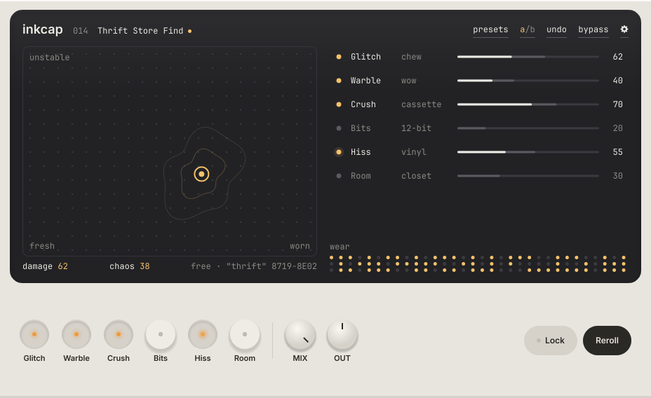

# Inkcap

A colour-and-damage effect by **Myzel Audio**: six modules that make a sound older, worse and
more interesting (malfunctions, wobble, saturation, digital decay, noise and small spaces),
behind two controls, **Damage** (how much) and **Chaos** (how unpredictable).

Every random thing comes from one **seed** and the song position: the same seed gives the same
glitches at the same bars on every play, and a seed is text you can copy, paste or type as a word.

**Status: M5 (v1.0 candidate).** All six modules are built, voiced by measurement and gated; the
glass face, 54 factory presets and the manual are done. Not yet: a listening pass by ear, a CPU
run on a quiet machine, the name's trademark check and a public release (PLAN.md, *Open*).

**How to use it:** see the [manual](docs/MANUAL.md).



Formats: VST3, CLAP, LV2, Standalone (Linux first; Windows/macOS build unsigned in CI).
Licence: AGPLv3. The first plugin of Myzel Audio's second lane, beside [Umber](../umber),
[Cerulean](../cerulean), [Mulberry](../mulberry) and [Viridian](../viridian).

## The modules

In signal order:

| | Module | Types | Own controls |
|---|---|---|---|
| 1 | **Glitch** | Skip, Chew, Stall, Bend, Any | Rate (1/4D … 1/32T), Length, Groove |
| 2 | **Warble** | Wow, Flutter, Drift | Rate (free or synced), Sync, Spread |
| 3 | **Crush** (2x) | Tape, Cassette, Valve, Fuzz | Drive, Tone |
| 4 | **Bits** | Sampler 12, Sampler 8, Phone | Rate, Depth, Jitter |
| 5 | **Hiss** | Vinyl, Tape, Hum | Tone, Follow |
| 6 | **Room** | Closet, Room, Spring, Hall | Size, Duck |

Each module has an On key, an Amount and a Type. Damage scales every module from clean (0) to
its Amount (100); Chaos turns steady, periodic wear into unpredictable wear. Mix, Output, Bypass,
Match (level matching) and a fallback BPM complete the set. Each module's `NOTES.md` under
`src/dsp/modules/` records what it is built from and what its gates check.

## Controls

The XY pad (**Damage** →, **Chaos** ↑) · six module rows (On, Amount, the type, what Damage makes
of it) and a page per module (type tabs, its own controls with typed entry in their units,
Glitch's next four bars) · the wear grid · the seed line (copy, paste a code or a word, Reroll,
Lock, the last 8 seeds) · header: presets (54 factory, browser with search), A/B, undo/redo,
Bypass and ⚙ (Match, the tempo without a host, mix lock, seed lock, window size 75–200 %) · the
strip: six module keys, **MIX**, **OUT**, **Lock**, **Reroll**. One view: the display's pages
do what a studio view does in the family.

## How it's built

- **Seeded and position-addressed.** Every random value is a counter-based hash of (seed,
  stream, position): Glitch's decisions from the grid slot, every wander from value noise of the
  song time. A render from bar 17 has bar 17's events, a host loop repeats its glitches, offline
  equals real time, and every block size renders the same to the bit. Words hash to seeds by a
  frozen FNV-1a over our own Unicode 15.0 fold (`src/dsp/common/NOTES.md`).
- **Damage 0 is clean, to the bit,** with every module on at any Amount, Type, Chaos and Mix:
  each module's clean path is exact, and the latency (9 samples: Crush's 2x pair and Warble's
  rest) never changes.
- **The family's blocks where they fit,** moved to `common/dsp/` bit-identically for their first
  owners: Mulberry's tape core, tape losses, clocked domain and interpolators; Cerulean's early
  reflections, FDN, reverb blocks and dispersion cascade; Umber's triode stage. Crush runs at 2x
  behind a band split and stays under −80 dBc of aliasing at every Drive; Bits samples at its own
  clock with its filters (Holters–Parker), so it aliases as a sampler does.
- **Mix without combs.** Mix's dry takes an identical 2x pair, a worn head's delay and Bits'
  converter delay, so a partial Mix stays within 0.4 dB of the in-phase sum up to 0.4 fs.
- **Measured, not guessed.** Damage curves voiced so equal steps sound even, Match calibrated
  from pink noise through the real chain (`tools/calibrate`), and the plan's gates (Damage-0 null,
  determinism, bar 17, Chaos 0 periodic, clicks, aliasing, Match, Mix, silence, tempo, CPU)
  printed by `tools/measure` and tested in the suites. Golden renders for every module × type and
  for the chain.

## Presets

54 factory presets in the plan's categories: **Utility** (Init, Clean Through, Seed Explorer,
Every Module), **Tape & Cassette**, **Vinyl**, **Lo-fi beats**, **Broken** (Glitch-led),
**Spaces**, and by source **Drums**, **Keys**, **Vocals** and **Guitar**. Each preset's seed is a
word (Pocket Cassette's is `pocket`), so its glitches and wander have a name; the seed Lock keeps yours
while you browse, as the mix lock keeps Mix. The set lives in `src/plugin/FactoryPresets.cpp`,
written in the controls' own units (`"+14 dB"`, `"1/8"`, `"22 kHz"`, `"3.2 m"`). User presets
are XML files in the user's application data (`Myzel Audio/Inkcap/Presets`).

## Seeds

Every random thing comes from one 32-bit **seed** and the song position, so the same seed gives
the same glitches at the same bars on every play, every bounce and every machine. A seed reads
as a code, `3F2A-91C7`: copy it, paste it into another session, or type a word (`thrift`
becomes `8719-8E02`, the same in every version). **Lock** keeps the seed while presets load,
the last 8 seeds stay in the session's history, and every seed change is an undo step. The
frozen hash and word rules: `src/dsp/common/NOTES.md`.

## Building

From the repository root (`../..`), see the root README for dependencies.
`-DMYZEL_PLUGINS=inkcap` builds only Inkcap:

```sh
cmake -S . -B build -G Ninja -DCMAKE_BUILD_TYPE=Release -DMYZEL_PLUGINS=inkcap
cmake --build build
```

Plugins land in `build/plugins/inkcap/Inkcap_artefacts/Release/{VST3,CLAP,LV2,Standalone}`.
`tools/package.sh inkcap build` builds a release tarball in `dist/` with an `install.sh`.

## Testing

```sh
ctest --test-dir build/plugins/inkcap --output-on-failure      # every Inkcap suite
build/plugins/inkcap/tests/InkcapTests                         # parameters, processor, state, undo, seeds, presets
build/plugins/inkcap/tests/InkcapTests "[seeds]"               # the seed in the processor: paste, reroll, history, lock, presets
build/plugins/inkcap/tests/InkcapTests "[presets]"             # the factory set, Init, every preset playing, host programs
build/plugins/inkcap/tests/InkcapTests_common                  # SeedRng, SeedCode (golden values), GridClock, CaptureBuffer
build/plugins/inkcap/tests/InkcapTests_chain                   # the chain: Damage-0 null, determinism, bar 17, loops, clicks, Mix, automation, Match, telemetry
build/plugins/inkcap/tests/InkcapTests_chain "[mix]"           # a partial Mix against the in-phase sum (Crush's pair, Bits' converter)
build/plugins/inkcap/tests/InkcapTests_chain "[.perf]"         # CPU at 48 kHz (reports)
build/plugins/inkcap/tests/InkcapTests_glitch                  # one module alone (glitch, warble, crush, bits, hiss, room)
build/plugins/inkcap/tests/InkcapTests_crush "[.quality]"      # Crush's aliasing at 1, 3 and 7 kHz (reports); "[.perf]": CPU per type
INKCAP_UPDATE_GOLDEN=1 build/plugins/inkcap/tests/InkcapTests_room "[golden]"   # re-record a module's golden renders (an intended sound change only)
build/plugins/inkcap/tools/InkcapMeasure                       # every quality gate, through the real chain (--quick: the fast ones)
build/plugins/inkcap/tools/InkcapCalibrate --voicing           # each module at Damage 25 / 50 / 100 %, in the unit it is heard in
build/plugins/inkcap/tools/InkcapCalibrate --report            # Match's gate: loudness over the Damage range, every type
(cd plugins/inkcap && ../../build/plugins/inkcap/tools/InkcapCalibrate)   # re-measure Match's tables after a sound change
xvfb-run -a tools/pluginval.sh inkcap build                    # pluginval, strictness 10
xvfb-run -a build/plugins/inkcap/tools/InkcapUiSnapshot_artefacts/Release/InkcapUiSnapshot docs/screenshots
xvfb-run -a build/plugins/inkcap/tools/InkcapUiSnapshot_artefacts/Release/InkcapUiSnapshot /tmp/snap --selftest
```

The snapshot tool renders every page of the face (at Damage 0, 62 and 100) and the states in
`src/ui/DESIGN.md`; `--selftest` drives the editor through its soft keys, pad, rows, keys and
menus.

The suites other than `InkcapTests` are JUCE-free. A module's own tests go in
`tests/modules/<m>/` and build as `InkcapTests_<m>`, with that module's sources alone; the
interface every module shares and how to work on one: `src/dsp/chain/NOTES.md`.
`python3 tests/common/validation/seed_reference.py` prints the golden seed values from an
independent implementation.

## References

Every module is our own implementation, built on published research and on the family's blocks.
Each module's `NOTES.md` says which parts come from where.

- M. Holters, J. D. Parker, *A Combined Model for a Bucket Brigade Device and its Input and Output
  Filters* (DAFx 2018): the clocked domain in Bits.
- D. C. Jiles, D. L. Atherton, *Theory of ferromagnetic hysteresis* (J. Magn. Magn. Mater. 61,
  1986): the tape coating in Crush.
- J. Chowdhury, *Real-time physical modelling for analog tape machines* (DAFx 2019): the
  Jiles–Atherton solver form of the shared tape core.
- H. N. Bertram, *Theory of Magnetic Recording* (Cambridge University Press, 1994): the gap,
  spacing and thickness losses of Crush's tape heads.
- N. Koren, *Improved vacuum tube models for SPICE simulations* (Glass Audio 8(5), 1996): the
  triode in Crush's Valve (Umber's stage).
- J. Parker, V. Zavalishin, E. Le Bihan, *Reducing the Aliasing of Nonlinear Waveshaping Using
  Continuous-Time Convolution* (DAFx 2016): Fuzz's first-order antiderivative antialiasing.
- J.-M. Jot, A. Chaigne, *Digital delay networks for designing artificial reverberators*
  (AES 1991): the feedback delay network in Room and Hall.
- J. B. Allen, D. A. Berkley, *Image method for efficiently simulating small-room acoustics*
  (JASA 1979): the early reflections.
- V. Välimäki, J. Parker, J. S. Abel, *Parametric Spring Reverberation Effect* (JAES 2010) and
  J. Parker, *Efficient Dispersion Generation Structures for Spring Reverb Emulation* (EURASIP
  2011): Room's Spring.
- RIAA / IEC 60098 playback equalisation (3180, 318 and 75 µs): Hiss's phono stage.
- G. L. Steele, D. Lea, C. H. Flood, *Fast Splittable Pseudorandom Number Generators* (OOPSLA
  2014): SplitMix64's finaliser in the seed hash. J. K. Salmon et al., *Parallel Random Numbers:
  As Easy as 1, 2, 3* (SC 2011): counter-based random numbers.
- G. Fowler, L. C. Noll, K.-P. Vo, the FNV hash (FNV-1a 32): words as seeds. The Unicode
  Consortium, *The Unicode Standard 15.0*: the simple lowercase mapping of the word fold.
- ITU-R BS.1770, *Algorithms to measure audio programme loudness*: the K-weighting of Match's
  calibration.
- V. Zavalishin, *The Art of VA Filter Design* (Native Instruments, 2012) and A. Simper, *Linear
  trapezoidal integrated SVF* (Cytomic, 2013): the filters.

## Licence

AGPLv3. See [LICENSE](../../LICENSE). Built with [JUCE](https://juce.com) under its AGPLv3 option.
The display's typeface is JetBrains Mono (SIL Open Font License 1.1, `src/ui/assets/fonts/OFL.txt`);
Inter comes with the shared kit. The repository's NOTICE lists both.
