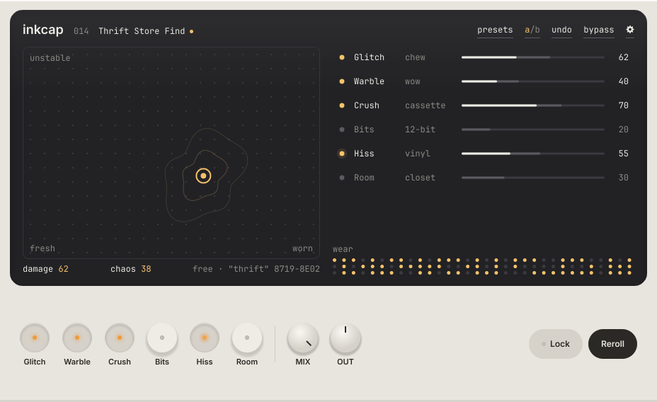
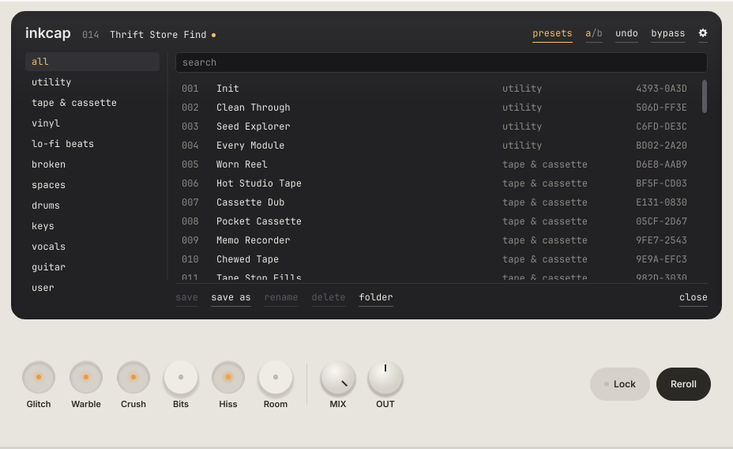

# Inkcap manual

Inkcap makes a sound older, worse and more interesting. Six modules (a malfunction, a wobble,
saturation, digital decay, a noise floor and a small space) sit behind two controls on one XY
pad: **Damage**, how much, and **Chaos**, how unpredictable. At Damage 0 Inkcap is clean, to the
bit; in the middle of the pad it is already a worn tape or a dusty sampler; at the top right it
falls apart.

Every random thing Inkcap does comes from one **seed** and the song position. The same seed
gives the same glitches at the same bars on every play, every bounce and every computer, and you
can copy a seed, send it to someone, or type a word as a seed.



## Quick start

1. Insert Inkcap on a track or a bus (mono or stereo in; the output is stereo, or mono on a mono
   track).
2. Drag the amber **puck** to the right for more Damage, up for more Chaos. A fresh instance is a
   worn tape: Warble, Crush and Hiss on, Damage 50 %, Chaos 25 %.
3. Press the round **module keys** below the display to switch modules on and off. Click a
   module's row in the display to open its page: its type, its own controls, and for Glitch the
   events of the next four bars.
4. Open **presets** at the top of the display for 54 starting points in ten categories.
5. Found a chaos you like? Press **Lock** so presets keep it, or click the seed at the bottom of
   the display and **Copy** it.

## The face

The warm grey body holds one dark glass display and a strip of keys and knobs below it.

**The display, main page:**

- **The XY pad** (left): Damage to the right, Chaos up. The corners say what you get: *fresh*,
  *worn*, *unstable*. The two rings around the puck show how far the wear wanders: tight at
  Chaos 0 or Damage 0, wide at the top right. Their outline is the seed's own, so each seed looks
  a little different.
- **The module rows** (right): a dot (the module's On switch; it glows with what the module is
  doing right now), the name, the type, a bar and the Amount. The bar's faint part is the
  Amount; its bright part is where Damage takes the module now.
- **The wear grid** (bottom right): lights up with Damage, in an order drawn from the seed.
- **The status line** (bottom): Damage and Chaos, *sync* (Inkcap follows your host's song
  position) or *free* (no position: the transport is stopped, or the Standalone), and the seed.

**The header:** the preset number and name (an amber dot when you have changed it), and the
soft keys *presets*, *a/b*, *undo*, *bypass* and ⚙.

**The strip:** six round module keys (pressed means on; the LED breathes with the module's
activity), **MIX** and **OUT**, and the **Lock** and **Reroll** pills for the seed.

## Damage and Chaos

**Damage** (0–100 %) takes every module from clean to its Amount. Each module has its own
Damage curve, so equal steps of Damage sound like equal steps: Crush's saturation is warm from
the first touch, Glitch's events grow from rare to constant. At 0 every module is exactly off and
Inkcap passes your sound untouched (delayed by its 9 samples of latency).

**Chaos** (0–100 %) turns steady wear into unpredictable wear:

- at 0 everything is periodic: the wow is a pure wobble, the glitches fall in a fixed pattern
  (every Nth slot), the crackle comes round with the record;
- going up, the glitches land, last and pick their type at random, the wobble drifts, Crush's
  drive wanders by up to ±4 dB, Bits' clock jitters more, the crackle comes in bursts and the
  room's tail moves.

Drag the puck (Shift for fine moves), or press anywhere on the pad to move it there and keep
dragging. Double-click puts it at 0 / 0. With the pad focused the arrow keys move it by 1 %
(Shift 0.2 %) and Home goes to 0 / 0; the mouse wheel moves Chaos, a horizontal wheel Damage. To
your host and to screen readers the pad is two controls, Damage and Chaos.

## The modules

The signal runs through them in this order, which is fixed:

```
in ─► Glitch ─► Warble ─► Crush ─► Bits ─► (+ Hiss) ─► Room ─► Mix ─► Output ─► out
```

The malfunction happens to the source first; everything after it is the medium playing it back.
Hiss joins after Bits, so the noise floor itself is not bit-crushed, and before Room, so it sits
in the same space.

Every module has an **On** switch (its key or its dot; it fades in and out over 20 ms), an
**Amount** (0–100 %, how much of it full Damage brings) and a **Type**. A type change re-reads
the module's own controls in the new type's units; it never moves them.

### Glitch: the medium fails

Events on your song's grid, each a medium failing. They hit both channels together.

| Type | What happens |
|---|---|
| **Skip** | A CD player's buffer sticks: the piece just before the slot repeats 2–8 times, then playback jumps back |
| **Chew** | The tape loses the head: the highs drop away (6–30 dB at 10 kHz), the level dips, the pitch slurs, then it recovers |
| **Stall** | The transport stops and restarts: the pitch falls to nothing, then comes back and catches up |
| **Bend** | The sampler's clock sags: the pitch drops by 1–12 semitones and glides back |
| **Any** | Each event picks one of the four (at Chaos 0 in a fixed order of the seed's) |

| Control | What it does |
|---|---|
| **Rate** | The grid: 1/4 dotted down to 1/32 triplet (straight, dotted and triplet values), slow to fast |
| **Length** | How long an event is, in milliseconds, in the type's own range: Skip's repeated piece 20–120 ms, Chew 60–600 ms, Stall's stop 50–700 ms, Bend 80–800 ms |
| **Groove** | Swing for the grid: *Straight* (50 %) to 75 % |

Amount × Damage sets how many slots fire (at full, every second slot); Chaos sets how irregular
they are and how much each event varies. Glitch's page shows the **next four bars** of events,
one lane per type, the event playing highlighted and the playhead moving through them: exactly
what you will hear, because the display works it out the same way the audio does. A new seed
takes effect at the next slot, so changing it never cuts into an event.

### Warble: wow and flutter

A wobble of the playback speed.

| Type | What it is | Rate |
|---|---|---|
| **Wow** | A warped record: slow and deep (up to ±34 cents) | 0.55 Hz, or 8 bars … 1/4 dotted synced |
| **Flutter** | A capstan past saving: fast and fine | 7 Hz, or 1/16 dotted … 1/32 |
| **Drift** | A motor that cannot hold its speed: a slow, wandering detune | 0.12 Hz, or 16 bars … 1 bar |

| Control | What it does |
|---|---|
| **Rate** | Free: in Hz, two octaves either side of the type's own rate. **Sync** on: a note value at the host's tempo (or the fallback BPM) |
| **Sync** | Rate follows the tempo |
| **Spread** | The right channel gets its own phase and wander: width, and seasickness at 100 % |

Chaos makes the wobble wander (Drift turns random soonest). The wobble's phase comes from the
song position, so it sits in the same place on every play.

### Crush: saturation

Four saturating stages, run at twice the sample rate so they stay clean of aliasing. Each one
saturates the lows and mids and lets the top end pass beside it.

| Type | What it is | Drive |
|---|---|---|
| **Tape** | A studio tape machine: a magnetic coating and a playback head that wears in with Damage | +4 … +22 dB |
| **Cassette** | A cassette: less headroom, a duller head | +6 … +24 dB |
| **Valve** | One triode stage: warm second harmonic from the first touch | +6 … +30 dB |
| **Fuzz** | A biased transistor clipper that eats the highs | +12 … +36 dB |

| Control | What it does |
|---|---|
| **Drive** | How hard the stage is driven, in dB at full Damage. Crush makes up its own small-signal gain, so Drive changes the colour more than the level |
| **Tone** | A tilt around 1 kHz, *Dark* … *Neutral* … *Bright*, up to ±6 dB per side at full Damage |

### Bits: digital decay

A converter at its own clock with its own filters, so it aliases and steps as the real ones do.

| Type | What it is | Rate | Depth |
|---|---|---|---|
| **Sampler 12** | A 12-bit sampler at 26 kHz, filters just under its Nyquist | 3.3 … 26 … 52 kHz | 6 … 12 … 18 bits |
| **Sampler 8** | An 8-bit sampler at 16 kHz with cheap filters at its Nyquist: it aliases | 2 … 16 … 32 kHz | 2 … 8 … 14 bits |
| **Phone** | A telephone line: 300–3400 Hz and μ-law at 8 kHz | 1 … 8 … 16 kHz | 2 … 8 … 14 bits |

| Control | What it does |
|---|---|
| **Rate** | The converter's clock in kHz (its filters follow it) |
| **Depth** | The converter's resolution in bits (fractions are fine) |
| **Jitter** | The clock's instants wander: grit and a smeared top end. Chaos adds to it |

Damage takes the converter from where it is first heard (its filters at the top of your band,
16 bits) down to Rate and Depth. Bits' steps are its sound, so it is the one module that can
click on purpose.

### Hiss: the noise floor

Synthesised from the seed and the song position, never a recording: it never loops audibly, and
it is the same on every play.

| Type | What it is |
|---|---|
| **Vinyl** | Surface noise, a turning record's crackle (dust comes round for a few turns at low Chaos and in bursts at high Chaos, scratches tick once a turn) and rumble, through a phono stage |
| **Tape** | Tape hiss through a playback head |
| **Hum** | 50 Hz mains hum and a rectifier's buzz over an amplifier's hiss |

| Control | What it does |
|---|---|
| **Tone** | *Dark* closes the top, *Bright* lifts it; on Hum, dark is pure hum and bright adds buzz |
| **Follow** | *Follow* lets the noise ride on your signal (silent when it is, at +100), *Duck* tucks it under (up to −20 dB), *Steady* leaves it alone |

At Damage 0 Hiss adds exactly nothing.

### Room: a small space

| Type | What it is | Size |
|---|---|---|
| **Closet** | Reflections and a short smear, no tail | 0.8 … 1.4 … 2.5 m |
| **Room** | Reflections, diffusion and a tail | 2.5 … 5 … 10 m |
| **Spring** | Three springs in a tank | its decay, 0.8 … 1.55 … 3 s |
| **Hall** | A worn, dark hall | 10 … 20 … 40 m |

| Control | What it does |
|---|---|
| **Size** | The space's longest dimension in metres (Spring: its decay in seconds); the decay follows it |
| **Duck** | Tucks the room under your playing (up to 24 dB) so it blooms in the gaps |

Amount × Damage brings the room in while the dry steps back a little. The room's tail rings
out after you stop playing, up to 4.5 s for the largest Hall.

## Mix, Output, Bypass, Match and tempo

- **MIX** (0–100 %): the blend of Inkcap's sound with your dry signal, linear. The dry is aligned
  to the wet, phase included, so a partial Mix never combs against Crush or Bits. With the mix
  lock on (⚙), presets keep your Mix: handy on a send.
- **OUT** (±24 dB): the output level.
- **bypass** (soft key): fades to your dry signal over 20 ms, latency-aligned. It is a setting,
  not an undo step, and presets do not store it.
- **Match** (⚙, on by default): keeps the loudness about the same while you move Damage, so you
  judge the character, not the volume. It is calibrated per module, type and setting on pink
  noise; boosts stop at +12 dB. Presets never switch it off.
- **Tempo without a host** (⚙): the BPM Inkcap uses when the host gives none (the Standalone, or
  some hosts while stopped). With a stopped transport the grid runs free from the moment it
  stopped.

MIX and OUT: drag up and down (Shift for fine), use the wheel or the arrow keys, double-click for
the default, right-click or Alt-click to type a value. While you turn one, its value shows in the
seed line's place.

## Seeds

The **seed** is the code of the current chaos: 8 hexadecimal digits shown as `3F2A-91C7`. Every
random decision Inkcap makes is a function of the seed and the position in your song, so:

- the same seed, settings and song give the same glitches at the same bars on every play, every
  bounce, offline or in real time, on every computer;
- starting playback at bar 17 gives exactly the glitches bar 17 had when you played from bar 1,
  and a loop in your host repeats its glitches;
- changing the seed takes effect at the next glitch slot, so it never clicks.

Click the seed at the bottom of the display for the **seed menu**:

- **Copy** puts exactly the code on the clipboard (Ctrl/Cmd+C on the display does the same).
- **Paste** takes a code (`3F2A-91C7`, `3f2a91c7` or `0x3F2A91C7`) as that seed. **Any other
  text** becomes a seed by its word: `thrift` is always `8719-8E02`, in every version, and the
  status line then shows the word (`"thrift" 8719-8E02`). Ctrl/Cmd+V on the display pastes.
- **Type a word...** opens a field for one.
- **Reroll** draws a new random seed (the **Reroll** pill does too).
- **Lock** keeps the seed and its word while you load presets or switch A/B, as the mix lock keeps
  Mix (the **Lock** pill, lit while on). It belongs to the session, not to presets.
- The **last 8 seeds** of the session: a Reroll is never lost.

Every seed change (paste, a word, Reroll, a pick from the history) is one undo step. The seed is
not a host parameter: it lives in your session and in presets.

## Module pages

Click a module's row to open its page in the right half of the display; the pad stays visible.
Click the **‹** or press Escape to go back. A page has:

- the **type tabs** (the type in use is amber) and the **on** key;
- each control as a row: drag across it (the bar's width is the whole range; Shift for fine),
  use the wheel or the arrow keys, Alt-click for the default, and **double-click to type** a value
  in its own units (`190 ms`, `1/8D`, `0.55 Hz`, `+13 dB`, `26 kHz`, `12 bits`, `5 m`, `dark 40`).
  Text Inkcap does not understand changes nothing;
- a line saying what the current Damage makes of the module (*damage 62 brings it to 14 %*);
- for Glitch, the next four bars of events.

On the main page, a drag along a module's row sets its Amount, and a double-click on its number
types it.

## Presets



**presets** turns the display into the browser. 54 factory presets in ten categories:
**Utility** (Init, Clean Through, Seed Explorer, Every Module), **Tape & Cassette**, **Vinyl**,
**Lo-fi beats**, **Broken** (led by Glitch), **Spaces**, and by source **Drums**, **Keys**,
**Vocals** and **Guitar**. Every preset has its own seed, named by a word (Pocket Cassette's is
`pocket`), shown in the list.

- A click loads a preset and keeps the browser open, so you can compare by ear; the arrow keys
  audition through the list; Return or a double-click loads and closes; Escape closes.
- **Search** matches names, categories and seed codes.
- **save** (your changed preset), **save as**, **rename**, **delete** and **folder** work on your
  own presets, which are XML files in your user preset folder (`Myzel Audio/Inkcap/Presets` in
  your application data). A preset stores the sound and the seed, never Bypass, Match or the
  tempo.
- **a/b** keeps two settings to compare (right-click copies the one in use to the other);
  **undo** steps back (right-click redoes).

Presets are also your host's programs: the factory set in browser order, then your own ("User:
…"). A program change sets the sound and the seed together and respects both locks.

## The ⚙ menu

Match loudness, the tempo without a host, Lock Mix, Lock seed, Copy a to b, Redo, the seed
menu, the window size (75 % to 200 %) and the version.

## Keyboard and mouse

| Where | What |
|---|---|
| Anywhere on the display | Ctrl/Cmd+C copy the seed, Ctrl/Cmd+V paste one, Ctrl/Cmd+Z undo, Shift+Ctrl/Cmd+Z or Ctrl/Cmd+Y redo, Escape close a page or the browser, Tab move between the header, the pad, the rows and the strip |
| Pad | drag (Shift fine), double-click 0 / 0, arrows, Home, wheel |
| Module row | dot: on/off; click: open the page; drag: Amount; double-click the number: type it |
| Control row | drag, wheel, arrows, double-click or Return: type, Alt-click: default |
| Module key | click or Space: on/off |
| MIX, OUT | drag up/down, wheel, arrows, double-click: default, right-click or Alt-click: type |

## Latency, tail and CPU

- **Latency:** 9 samples at every sample rate, reported to your host, whether modules are on or
  off (Crush's oversampling and Warble's resting point). Inkcap never looks ahead.
- **Tail:** Inkcap tells your host it can ring for about 6.5 s after the input stops (the
  longest glitch and the largest Hall); in practice it falls silent, to the last bit, once the
  room has died away.
- **CPU** at 48 kHz, stereo, on one core: next to nothing with every module off; a few percent
  with every module at full Damage at its heaviest type (Room's Hall and Crush's Tape cost the
  most). Modules that are off cost nothing.
- **Channels:** mono → mono, mono → stereo, stereo → stereo. Any sample rate.
