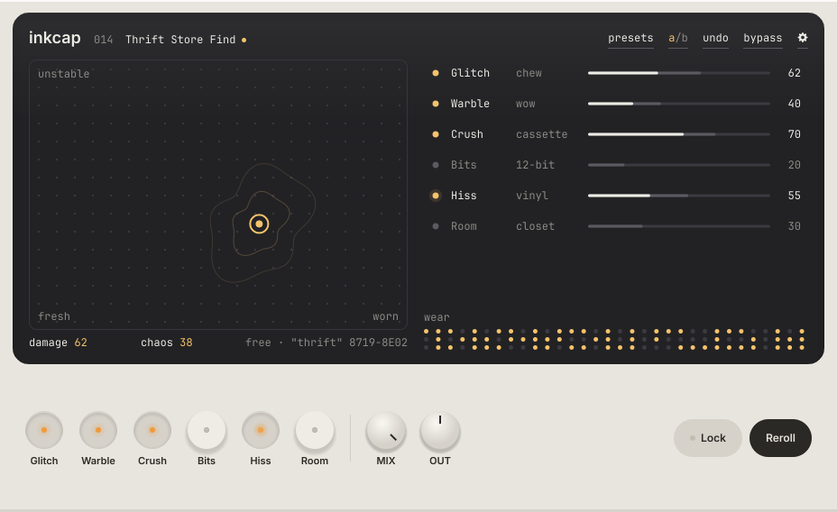

# Inkcap UI design: the glass face

Inkcap is the first plugin of the second lane, and its face is not the family's panel kit: a warm
grey appliance with one dark glass display and a thin strip of physical keys (PLAN.md, *UI: the
glass face*, *Settled* 3, 4 and 9). Everything is drawn in code in `src/ui`; the bundled assets
are JetBrains Mono (`assets/fonts`, SIL OFL 1.1, `OFL.txt`) and the kit's Inter. Read
`common/DESIGN.md` first: Inkcap borrows the kit's `EditorController`, `InlineDialog` and
`KitLookAndFeel` (menus, tooltips, text fields) and changes nothing in `common/ui/`.

The design follows the chosen mock (*M4 · Glass face*, 960 × 600 artboard; the face is its inner
928 × 568) to the pixel on the main page; the module page and the preset browser are designed
here in the same language. The lane kit (soft keys, display rows, the strip's keys and pills, the
editor) moves to `common/` when the second lane plugin needs it.

## Identity

- **Body:** warm grey (`body` #e8e5de), lit from above: a 2 px white edge on top, a 3 px shade at
  the bottom. The window is the appliance, edge to edge.
- **Display:** dark glass (`glass` #222225), 18 px corners, an inner shadow from above and a faint
  reflection over its top 120 px. Text is warm white (`text` #ecebe4), secondary `textDim`
  #8d8b84, inactive `textFaint` #5a5a60.
- **Accent:** one **amber** (`amber` #f5c26b), inside the glass only: the puck and its rings, the
  Damage and Chaos values, lit wear dots, module dots, the open page or type, the modified dot,
  typed entry, focus inside the display.
- **Caution:** coral (`caution` #ee7a5f), only for Bypass (the lit key, the pad's *bypassed*).
- **Body LEDs:** orange (`led` #ef9a3c) in the module keys and the Lock pill: a physical lamp, not
  the display's amber.
- **No big knob, no visual glitch effects.** The chaos is heard; the display stays readable.

### Contrast

On the glass: `text` 13.3:1, `amber` 9.7:1, `caution` 5.7:1, `textDim` 4.7:1 (3.7:1 on a
selected row); `textFaint` 2.3:1 only for what is inactive (an off module's bar, a disabled
key, unlit dots). On the body: `ink` 11.5:1, `inkDim` 4.2:1, the focus ring `focusOnBody` 3.7:1
(the 3:1 a focus indicator needs). The LED alone separates on from off by 1.5:1, so a key's state
is also its depth (pressed in, darker) and the display's row.

## Tokens

`Theme.h` / `Theme.cpp`: `Glass` (the face's own colours, `Theme::glass()`), `GlassFonts`, and
the kit's `Palette`, `PanelLook` and `StudioPalette` (Inkcap defines them because the kit
declares them; they style the dialog, menus and tooltips as pieces of the glass, and the studio
palette is never shown). Drawing code uses these only; no colour literals except neutral
black/white shading alphas.

| Token | Value | Use |
|---|---|---|
| `body`, `bodyEdgeLight`, `bodyEdgeShade` | #e8e5de, white .8, black .08 | the appliance and its edges |
| `ink`, `inkDim`, `seam` | #2b2925, #6f6b63, #d0ccc3 | strip labels, the padlock at MIX, the seam |
| `keyOff`, `keyOffLip`, `keyOn` | #efece6, #c9c5bc, #d6d2ca | round keys up (with a 3 px lip), pressed |
| `led`, `ledOff` | #ef9a3c, #c2bdb3 | key and pill LEDs |
| `knobLight`, `knobDark` | #faf8f3, #d6d2ca | the small knobs' radial light |
| `pill` / `pillText`, `pillDark` / `pillDarkText` | #d6d2ca / ink, #2b2925 / #e8e5de | Lock, Reroll |
| `focusOnBody` | #9a6c22 | keyboard focus on the body |
| `glass`, `glassEdge` | #222225, #36363b | the display |
| `text`, `textDim`, `textFaint` | #ecebe4, #8d8b84, #5a5a60 | display text |
| `line`, `track`, `gridDot` | #36363b, #3a3a40, #3a3a3f | pad border, bars, dots |
| `rowSelected`, `rowHover` | #323236, #2a2a2e | the open row, hover |
| `amber`, `caution` | #f5c26b, #ee7a5f | accent, Bypass |

**Type:** the display is JetBrains Mono Regular at 12 px (10.5 px for the event lanes); names on
the body are Inter SemiBold (the product name 18 px, strip labels 11 px, pills 12 px). Sizes are
CSS pixels: `GlassFonts` sets the em (`withPointHeight`), so the face matches the mock's metrics.
Display words are lower case; a parameter's read-out keeps its units ("0.55 Hz", "dark 40").

## Layout grid (base 928 × 568)

| Area | Rectangle | Contents |
|---|---|---|
| Display | 14, 14, 900 × 390 | padding 16 top and bottom, 18 at the sides |
| Header | display 18, 16, 864 × 24 | *inkcap* (Inter 18), the preset's number and name on its baseline; soft keys right to left with 16 px gaps: ⚙, bypass, undo, a/b, presets |
| Pad | display 18, 52, 420 × 300 | the XY pad; dots every 20 px |
| Status line | display 18, 358, 420 × 16 | damage, chaos (at x 124), the seed line from x 190 to the right edge |
| Right column | display 456, 52, 426 × 322 | six module rows (30 px, pitch 34) or a module's page; the wear matrix at its bottom (y 278, 44 px) |
| Strip | 14, 418, 900 × 136 | 14 px padding, 18 px gaps: six keys Ø42, the seam (1 × 52), MIX and OUT Ø42, labels 6 px under them; Lock and Reroll pills (42 high) at the right end, 8 px apart |

A module row's columns, as the mock's flex row: 8 · dot 12 · 10 · name 62 · 10 · type 70 · 10 ·
bar (flex) · 10 · amount 24 · 8.

The module page (right column): the title row (0, 30 px; the selected row's ground) with the
back chevron, the name and its tagline, and *on*/*off* at the right; the type tabs at y 38; the
control rows from y 72 (30 px, pitch 34: label 80, bar, read-out 104), the Amount row two-toned
as in the list; under the rows a caption in `textDim` says what Damage makes of the module now
("damage 62 brings it to 49 %", "damage 0: it does nothing yet", "off: ..."); Glitch's events
from y 216 to the bottom (they say it themselves), the wear matrix for the others.

The preset browser (the display below the header, 864 × 322): categories in the left 170 px, a
hairline at 180, then the search field (26 px), the list (24 px rows: number, name, category,
seed) and the file keys on a hairline at y 298.

## Pages

- **Main:** the pad, the status line, the module rows, the wear matrix.
- **Module page:** a click on a row (not on its dot or number) turns the right column into that
  module's page; the pad stays. The page is stored in the session (`modulePage`).
- **Presets:** the *presets* key or a click on the preset's name; the whole display becomes the
  browser. Not stored: a session opens on its page, never in the browser.

## Controls and interaction rules

Every edit is a host gesture and one undo step; settings (Bypass, Match, the fallback BPM) are
gestures but never undo steps (PLAN.md, *Settled* 15). Shift is fine control everywhere (a
fifth). Every display value takes typed entry by double-click (Return when focused); the
parameter's own parser reads it, and text it does not understand changes nothing.

- **XY pad:** Damage →, Chaos ↑. Drag the puck from where it is (within 16 px), or press
  elsewhere to move it there and keep dragging; one gesture for each parameter and one undo
  step for both. Double-click: 0 / 0. Arrow keys: 1 % (Shift 0.2 %), Home: 0 / 0. The wheel moves
  Chaos (vertical) and Damage (horizontal), one undo step until it rests. The puck travels
  within 5 % of the border. The contour rings: two outlines around the puck, 5 % and 9 % of the
  pad's height when calm, growing with the wander (Chaos × the pad's wear, `padWear`: the six modules' Damage curves on average) to 26 % and 49 %;
  their shape bends with the 2nd and 5th harmonic at phases taken from the seed, so each seed
  has its outline. The pad's border cuts them near an edge.
- **Module rows:** the dot switches the module; a click on the row opens its page; a drag
  along the row sets Amount; double-click on the number types it (a single click there does
  nothing, so a double-click never opens the page first). The bar's faint part is Amount,
  its bright part where Damage takes it now (`moduleIntensity`, through the module's own Damage curve, so Crush's runs ahead of Glitch's); the dot glows with the
  module's activity (telemetry).
- **Control rows:** horizontal drag (the bar's width is the full range), wheel, arrows,
  double-click to type, Alt-click for the default. Bipolar rows (Tone, Follow) fill from the
  middle, stepped rows (Glitch Rate) snap and show their steps, switch rows (Warble Sync) toggle
  on a click.
- **Type tabs:** soft keys, the type in use amber.
- **Module keys:** click or Space switches the module; the LED breathes with its activity.
- **MIX, OUT:** vertical drag (200 px full range), wheel, arrows, double-click for the default,
  right-click or Alt-click to type. While hovered or turned, the read-out takes the seed line's
  place. A padlock follows MIX while the mix lock is on.
- **Lock** (latching, LED) keeps the seed through presets and A/B; **Reroll** draws a new seed.
- **Soft keys:** *presets* (lit while the browser is open), *a/b* (switches; the active letter is
  amber; right-click copies the slot in use to the other), *undo* (dimmed with nothing to undo;
  right-click redoes), *bypass* (caution while on), ⚙.
- **Seed line:** `sync · seed 3F2A-91C7`, or `sync · "thrift" 8719-8E02` for a word (the word
  gets the room the code leaves and ends in an ellipsis), *free* instead of *sync* when the host
  gives no song position, a padlock while locked. A click opens the seed menu: Copy, Paste, Type
  a word..., Reroll, Lock, and the last 8 seeds. Messages ("seed 8719-8E02 copied", amber) and
  the strip's read-outs (white) take its place for 2.4 s or while hovering.
- **⚙ menu:** Match loudness, the tempo without a host (a dialog), Lock Mix, Lock seed, Copy a to
  b, Redo, the seed menu, the window size (75 … 200 % in the shared steps), the version.
- **Keyboard on the display:** Ctrl/Cmd+C and +V copy and paste the seed, Ctrl/Cmd+Z undo,
  Shift+Ctrl/Cmd+Z or Ctrl/Cmd+Y redo, Escape closes a page or the browser. Tab order: the
  header, the pad, the rows or the page, then the strip.
- **Preset browser:** a click loads and keeps the browser open (compare by ear), the arrow keys
  audition through the list, Return or a double-click loads and closes, Escape closes (in the
  search field: clears it first). Save (a changed user preset), save as, rename, delete (the
  shared inline dialog), folder, close. The search matches name, category and seed code.

## States

| State | What the face shows |
|---|---|
| Damage 0 | no lit wear dots, module bars only faint (their Amounts), rings tight around the puck |
| Damage 100 | the wear matrix full, the bars at their Amounts |
| Every module off | the puck and lit wear dots go grey: the macros still move, nothing wears |
| Bypass | *bypass* in caution, the pad dimmed to 40 % with *bypassed* (caution) at its top right |
| Preset modified | a 5 px amber dot after its name; ` *` in the browser |
| Mix lock, seed Lock | padlock after MIX; Lock pressed with its LED; padlock on the seed line |
| Hover | rows and control rows on `rowHover`; soft key hairline brightens |
| Keyboard focus | amber ring (1 px) or hairline (2 px) in the display; `focusOnBody` ring on the body |
| Disabled | soft keys in `textFaint` with a `line` hairline |
| Glitch's events | amber blocks per lane; played ones at 35 %; the one playing with a halo; the playhead in white; *glitch is off*, *damage 0: nothing fails* when there are none |

## What the display reads

Parameters through the controller (message thread); the audio thread only through the
telemetry atomics (`src/dsp/chain/Telemetry.h`): module activity (dots, LEDs), the song position,
tempo and time signature, whether the host's position is followed, Glitch's seed in use and the
event playing. Glitch's next 4 bars are computed in the editor with the audio thread's own pure
`glitch::patternFor` / `eventAt` (`EventView`), for the bar the song is in and the three after
it; before any audio, at position 0 with the current seed. Bars count from the host's last bar
start when it gives one (`barStartPpq`), so a time-signature change keeps the bar lines on the
host's bars; without it, from position 0 in the current signature.

## Rendering and caching

The glass (fill, inner shadow, reflection, the name) and the pad's ground (dots, border, corner
words) are cached layers (`drawing::CachedLayer`) at the physical scale. Everything else is
small and repaints only when its value changed: each part's `update()` compares what it shows
with the parameters and telemetry on every frame of the editor's frame clock (vblank). The
event view repaints when the playhead moves half a pixel. Timings (`InkcapUiSnapshot`, a shared
machine, the range from quiet to busy): a warm full repaint 2.1–3.9 ms at 1x and 5.7–11.5 ms at
2x, cold 4.0–6.9 and 10.2–18.0 ms; a frame of `animateFrame` 0.03–0.04 ms.

## UI state keys

In the session's UI state (frozen, never renamed): the shared `scale`, `presetName`,
`presetIsUser`, `abActive`, `SlotA` / `SlotB` and `mixLock` (`common/plugin/UiState.h`); the
seed's `seedLock` and `SeedHistory` (`plugin/SeedState.h`); and Inkcap's own `modulePage` (int,
the open module page, -1 for the module list; `UiState.h`). The browser being open is not stored.

## Accessibility

The pad is a group with two sliders, *Damage* and *Chaos*. Module rows are buttons (press: the
page; toggle: On) whose description reads "glitch, skip, amount 62 %, on". Control rows and the
knobs are sliders with the parameter's read-out; switch rows, type tabs, the on key, module keys
and Lock are toggle buttons that report their state. The seed line and the preset name are
buttons; the browser's list is a `ListBox`.

## Snapshot tool and self-test

`InkcapUiSnapshot <dir>` plays two seconds of a drum-like signal through the processor (real
telemetry), then renders: each page at Damage 0, 62 and 100 (`01-main`, `02-glitch-page`,
`03-presets`), the default, the other five module pages, Bypass, the locks, every module off,
the save dialog, typed entry, a read-out and a message on the seed line, and 75 % and 200 %.
The browser lists the factory set; the scenes save a few user presets in the scratch session
after it. The scenes' sound is the mock's setting (worn tape with a chewing malfunction) on the
factory preset Thrift Store Find, so the header names a preset that ships, marked as changed.

`--selftest` (`tools/ui_snapshot/SelfTest.cpp`) checks, through the soft keys, keys and menus as
a user reaches them: the window size (menu, limits, stored and restored); the pad (drag and its
gestures, one undo step, Shift, double-click, click to move, the edges, keys, the rings,
the two accessible sliders); presets, A/B, undo, Bypass outside the undo history, the mix lock
and Match from the ⚙ menu, the tempo dialog; the seed (copy, paste a code and a word, empty
text, undo and redo, Ctrl/Cmd+C and +V, a typed word, Reroll, the history, Lock across preset
loads); module rows, pages, tabs, typed and dragged rows, the stepped rate, the switch row, the
event view against `eventAt`; the strip's keys and knobs; the wear matrix; the browser (save
as, the user category, search, save, rename, a click that loads, delete, Escape); a restored
session's page. It replaces the shared `runEditorChecks`, which assume the shared header
(PLAN.md, *Shared infrastructure*).

## Files

| File | Contents |
|---|---|
| `Theme.{h,cpp}` | `Glass`, `GlassFonts`, metrics and the layout grid; the kit's palette for dialogs and menus |
| `GlassWidgets.{h,cpp}` | `SoftKey`, `TypedEntry`, glyphs (padlock, gear, chevron), fitted text, focus ring |
| `InkcapController.{h,cpp}` | the model the pages share: values in display terms, edits, seed actions, pages, messages |
| `InkcapEditor.{h,cpp}` | the editor: the face, scale, frame clock, session listener, dialog, look-and-feel |
| `Display.{h,cpp}` | the glass: header, status and seed line, pages, the seed and ⚙ menus, shortcuts |
| `XyPad.{h,cpp}` | the pad |
| `ModuleList.{h,cpp}` | module rows, the wear matrix |
| `ModulePage.{h,cpp}` | control rows, the module page |
| `EventView.{h,cpp}` | Glitch's next 4 bars |
| `PresetsPage.{h,cpp}` | the preset browser |
| `Strip.{h,cpp}` | module keys, the small knobs, the pills |
| `UiState.h` | Inkcap's UI state key |
