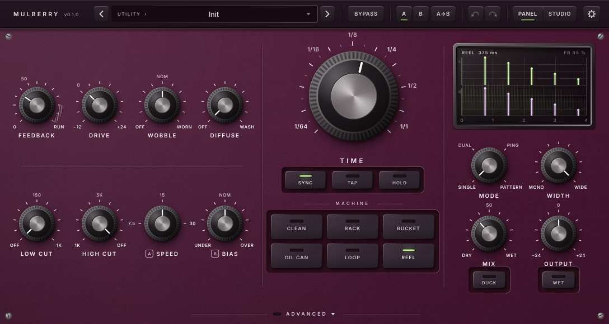
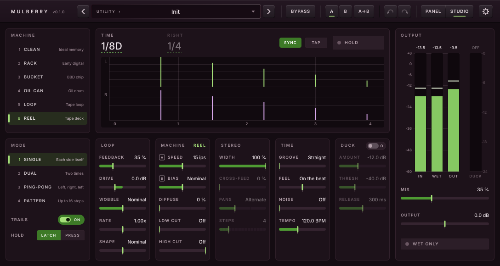

# Mulberry

An echo plugin by **Myzel Audio**: six delay machines, each modelled from how it works, an ideal
digital memory, an early rack unit, a bucket-brigade chip, an oil-can drum, a tape loop and a
studio tape deck. Each one repeats, darkens, wobbles, changes time and runs away in its own way.



Formats: VST3, CLAP, LV2, Standalone (Linux first; Windows/macOS build unsigned in CI).
Licence: AGPLv3. Sibling of [Umber](../umber) and [Cerulean](../cerulean).

**How to use it:** see the [manual](docs/MANUAL.md).

## The machines

| | Machine | What it models | Param A | Param B | Time change |
|---|---|---|---|---|---|
| 1 | **Clean** | Ideal memory | Glide | Shift (±12 st per repeat) | crossfade … glide |
| 2 | **Rack** | Early rack digital delay, gain-ranging converter | Bits (8–16) | Rate (6–20 kHz) | jump, 10 ms crossfade |
| 3 | **Bucket** | Bucket-brigade chip, filters, NE570 compander | Chip (1024–8192 stages) | Compander | the clock glides |
| 4 | **Oil Can** | Electrostatic drum in oil | Brushes (1–5) | Oil (new … old) | the belt slips |
| 5 | **Loop** | Tape loop with three playback heads | Heads | Wear | the motor bends every echo |
| 6 | **Reel** | Studio tape deck, sliding head | Speed (7.5 / 15 / 30 ips) | Bias | the head slides |

## Controls

**Time** (ms, or a note value with **Sync**) with **Tap** and **Hold** · machine keys ·
**Feedback** (0–120 %: above 100 % the hatched RUN zone, where the machine runs away into its own
saturation) · **Drive** · **Wobble** · **Diffuse** · **Low Cut / High Cut** (in the loop) ·
**Param A / B** (relabelled per machine) · **Mode** (Single, Dual, Ping-Pong, Pattern) with
its own knob (Width, Right time or Steps) · **Mix** (pedal law) · **Output** · **Duck** · **Wet**
· the echo map (the repeats of a click, a beat grid, the Pattern step editor) · **ADVANCED**:
Groove, Feel, Width, Cross-feed, Pan rule, Wobble rate and shape, Noise, Trails, Duck settings,
BPM, Hold mode. Header: presets (42 factory), Bypass (with trails), A/B, undo/redo, the view
switch and ⚙ (mix lock, window size). A studio view shows every control at once with exact
typed values and meters.



## How it's built

- **Zero latency, always.** Mono → mono, mono → stereo and stereo → stereo.
- **Machines model their medium.** Tape heads are tracked by position on the tape (exact
  Doppler), with a Jiles–Atherton core at 8× in the loop and Bertram's gap, spacing and
  thickness losses at the instantaneous speed. Every saturating stage is oversampled so its
  aliases stay below −80 dBc even at +24 dB of Drive; Clean adds its limiting after the fact, on
  a linear-phase path, so its repeats stay exact. The bucket chip is a Holters–Parker clocked
  model with its filters, image aliasing and an NE570-style compander. The rack unit converts
  at its own clock with a gain-ranging converter. See each machine's `NOTES.md` under
  `src/dsp/machines/`.
- **One tap plan for four modes** (`src/dsp/TapPlan.h`): reads with fractions, offsets and
  weights into feedback and output buses; routing changes crossfade, weight changes ramp.
- **Trails everywhere.** Two slots, each with all six machines: a machine or preset change moves
  the input to the fresh slot while the old one rings out (never running away).
- **Measured, not guessed.** Every machine runs the same gates (`tests/support/MachineGates.h`):
  echo time, per-repeat loss against the prediction, level, AES6 flutter, glide clicks, THD,
  aliasing, square-wave stress, trail decay at ≤ 100 %, the runaway above, Hold drift, silence,
  sample-rate invariance and CPU. Python references validate the tape Doppler, the tape losses
  and the bucket chip. `tools/measure` prints the numbers; `PLAN.md` keeps the status.
- **Golden-file regression tests** for every machine × mode.

## Building

From the repository root (`../..`), see the root README for dependencies.
`-DMYZEL_PLUGINS=mulberry` builds only Mulberry:

```sh
cmake -S . -B build -G Ninja -DCMAKE_BUILD_TYPE=Release -DMYZEL_PLUGINS=mulberry
cmake --build build
```

Plugins land in `build/plugins/mulberry/Mulberry_artefacts/Release/{VST3,CLAP,LV2,Standalone}`.
`tools/package.sh mulberry build` builds a release tarball in `dist/` with an `install.sh`.

## Testing

```sh
ctest --test-dir build/plugins/mulberry --output-on-failure        # every Mulberry suite
build/plugins/mulberry/tests/MulberryTests                         # tap plan, chain, processor, parameters, presets, blocks, golden files
build/plugins/mulberry/tests/MulberryTests_reel                    # one machine's gates (likewise _clean, _rack, _bucket, _oilcan, _loop)
build/plugins/mulberry/tools/MulberryMeasure                       # every gate of every machine, with CPU
build/plugins/mulberry/tools/MulberryMeasure loop --quick          # one machine, without the long gates
xvfb-run -a build/plugins/mulberry/tools/MulberryUiSnapshot_artefacts/Release/MulberryUiSnapshot docs/screenshots
xvfb-run -a build/plugins/mulberry/tools/MulberryUiSnapshot_artefacts/Release/MulberryUiSnapshot /tmp/snap --selftest
xvfb-run -a tools/pluginval.sh mulberry build                      # pluginval, strictness 10
MULBERRY_UPDATE_GOLDEN=1 build/plugins/mulberry/tests/MulberryTests "[golden]"   # re-record after an intended sound change
```

Python references (numpy, scipy): `tests/machines/loop/validation/` (tape losses, shelf and gap
fits, Doppler) and `tests/machines/bucket/validation/hp_reference.py` (an independent
Holters–Parker BBD).

## Licence

AGPLv3. See [LICENSE](../../LICENSE). Built with [JUCE](https://juce.com) under its AGPLv3 option. The
bundled Inter font is under the SIL Open Font License (see `common/ui/assets/fonts/`).
