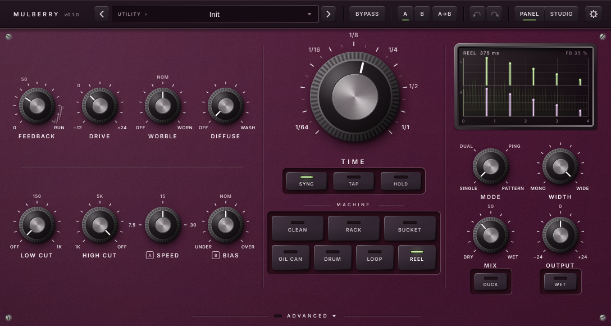
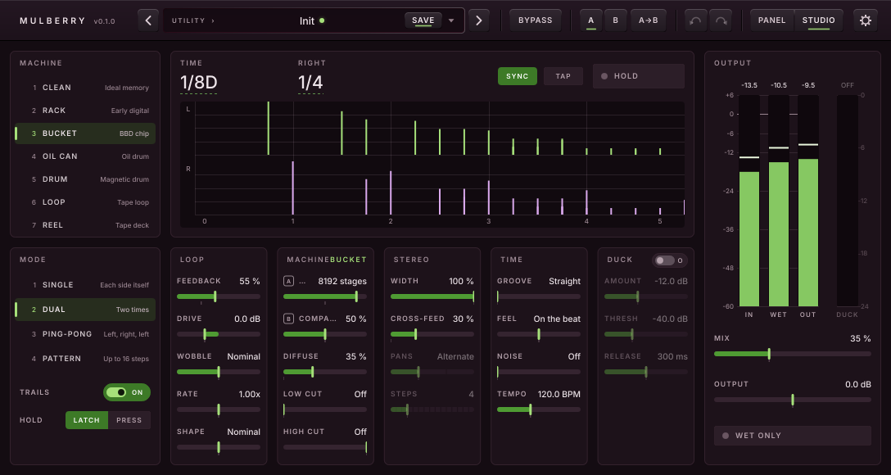

# Mulberry manual

Mulberry is an echo with seven delay machines inside: an ideal digital memory, an early rack
unit, a bucket-brigade chip, an oil-can drum, a magnetic drum, a tape loop and a studio tape
deck. Each one is
modelled from how it works, so each one repeats, darkens, wobbles, changes time and runs away
in its own way. Nothing clicks while you move a control, and when you change machine or preset
the old echoes ring out.

## Quick start

1. Insert Mulberry on a track (mono or stereo in; the output is stereo, or mono on a mono
   track).
2. Pick a **machine** with the seven keys in the middle: the electronic ones on top, the
   spinning and running media below.
3. Set **Time**. With **SYNC** lit (the default) the big knob picks a note value at the host's
   tempo; turn SYNC off for milliseconds, or tap **TAP** twice or more in time.
4. Set **Feedback** for how many repeats you hear, and **Mix** for how loud they are. Up to
   50 % only the echoes get louder and your dry sound stays at full level.
5. Press **HOLD** to freeze the loop you hear and play over it.

On a send/return bus, press **WET**: Mulberry then outputs only the echoes, whatever Mix says.

## The machines

| Machine | What it is | Param A | Param B | Changing Time |
|---|---|---|---|---|
| **Clean** | Ideal memory: every repeat exact | **Glide**: Time changes crossfade (left) … glide like tape (right) | **Shift**: each repeat climbs or falls by an interval, −12 … +12 semitones | crossfades or glides, by Glide |
| **Rack** | An early rack digital delay: a gain-ranging converter at the unit's own clock | **Bits**: 8 … 16 bits of grain | **Rate**: bandwidth 6 … 20 kHz | jumps, with a short crossfade |
| **Bucket** | A bucket-brigade chip with its filters and compander | **Chip**: 1024, 2048, 4096 or 8192 stages. Long times on a short chip clock low: darker, grittier | **Compander**: off … full. Full breathes and pumps a little, as the real ones do | the clock moves: a pitch glide |
| **Oil Can** | An electrostatic drum spinning in oil | **Brushes**: one pickup (1) … a smeared cluster of five (5) | **Oil**: new … old: softer, leakier, more belt slip | the belt slips the drum to speed |
| **Drum** | A magnetic drum with four playback heads, at a quarter, half, three quarters and all of Time | **Heads**: which heads play, from one (1, 2, 3, 4) to all four (ALL), 15 combinations | **Swell**: off … full. Off: the playing heads feed the echoes back. Full: all four do, so the repeats pile up into a dense, swelling sustain | the heavy drum slowly changes speed: every echo bends |
| **Loop** | A tape loop with three playback heads | **Heads**: which heads play (1, 2, 3, 1·2, 2·3, 1·3, 1·2·3) at Time, 2× and 3× Time | **Wear**: new … worn tape: dropouts, ghosts of old passes, more wow | the motor changes speed: every echo bends |
| **Reel** | A studio tape deck with a movable head | **Speed**: 7.5, 15 or 30 ips (darker and fatter … brighter and cleaner) | **Bias**: under (brighter, distorts early) … nominal … over (duller, cleaner) | the head slides: the tone stays put while the pitch bends |

With SYNC, the Drum's heads fall on the note's subdivisions: at Time 1/2 they play eighth notes,
so Heads picks a rhythm (1+3+4 gallops). Its tone darkens as Time gets longer: the drum turns
slower under heads that never touch it.

Each machine's own instability (wow, flutter, drift, clock wobble) is set by **Wobble**, its own
floor (hiss, clock noise) by **Noise** in the Advanced deck. Both default to the machine's spec
(Wobble) and silence (Noise 0).

## Controls

### Time (centre)

**Time** is 1 ms to 4 s, or with **SYNC** a note value from 1/64 triplet to a dotted whole note.
The read-out shows the note and its length ("1/8D  375 ms"). A note longer than 4 s at a slow
tempo plays an octave shorter (twice as fast) and says "folded".

**TAP**: tap twice or more; Time becomes the average of your last four taps, in milliseconds,
and SYNC turns off. A pause of more than 2 s starts over.

**HOLD**: the loop you hear plays on, without losing anything, while new input passes dry. Release
it and the held loop fades out by the Feedback amount per repeat while the machine takes over
again. **Hold Mode** in the Advanced deck makes the key momentary (held while you press it).

### The loop (left, top row)

| Control | What it does |
|---|---|
| **Feedback** (0 – 120 %) | How much of each echo comes round again. Up to 100 % every trail fades out. Above 100 %, on the hatched **RUN** zone, the loop gains on each pass and runs away into the machine's own saturation: tape squashes, the bucket chip grits up, the rack converter clips. Pull it back below 100 % and it dies away |
| **Drive** (−12 … +24 dB) | Record level into the machine. Its playback makes up for it, so Drive changes the colour, not the echo level |
| **Wobble** | The machine's instability. 0 is perfect, the middle (it sticks there) is the machine's spec, the top is worn out |
| **Diffuse** | A smear inside the loop: each repeat blurs more than the last, until the trail is a wash. It never moves the echo time |

### The colour (left, bottom row)

| Control | What it does |
|---|---|
| **Low Cut** (Off, 20 Hz … 1 kHz) | Inside the loop: every repeat gets thinner. Far left is off |
| **High Cut** (1 kHz … 20 kHz, Off) | Inside the loop: every repeat gets darker. Far right is off |
| **A**, **B** | The machine's two character controls (table above). Their names change with the machine |

### Mode and output (right)

**Mode** chooses how the echoes are laid out. The knob next to it (Ⓜ) changes with the mode:

| Mode | What it does | Ⓜ |
|---|---|---|
| **Single** | Each side echoes itself | **Width**: 0 is a mono echo |
| **Dual** | Two delays, left at Time and right at its own time, with Cross-feed between them (Advanced) | **Right time** (or right note with SYNC) |
| **Ping-Pong** | The input bounces left, right, left at Time | **Width**: how far it bounces |
| **Pattern** | Up to 16 steps spread evenly over Time, each with its own level and place in the stereo field | **Steps** (1 – 16) |

In Pattern mode, drag the steps' bars in the echo map up or down to set their levels;
double-click one to reset it to full. **Pan rule** and **Groove** (Advanced) place and swing
them. With the Loop or Drum machine in Pattern mode, the pattern replaces the heads (the Drum's
Swell still works).

**Mix**: pedal law. Up to 50 % the dry stays at full level while the echoes come up; past 50 %
the dry fades out. **Output**: −24 … +24 dB after the mix. **DUCK**: the echoes dip while you
play and bloom back when you stop. **WET**: no dry signal at all.

### Echo map

The window top right draws the echoes of a single click from your settings: the left output on
top, the right below, each repeat at its time and level, over a beat grid when synced. The
header names the machine, the time and the feedback ("RUN" above 100 %). Behind it, the live
echo level scrolls by. It shows **HOLD** while Hold is on and **BYPASSED** when bypassed.

### Header

Presets (‹ › step through them; the field shows the category, and a green dot after the name
when you have changed the sound), **SAVE**, **Bypass** (lights amber), **A/B** compare (A→B
copies the current setting to the other slot), undo and redo, the view switch (**PANEL** |
**STUDIO**) and ⚙ for the mix lock and the window size (75–200 %).

Loading a preset or switching A/B behaves like changing machine: the old echoes ring out.

**Lock Mix and Wet** (⚙ menu): loading a preset or switching A/B then leaves Mix and Wet where
they are. A small padlock next to MIX shows it.

### Advanced deck

Click **ADVANCED** on the bottom edge to open a lower deck; the window grows and nothing is
covered.

| Control | What it does |
|---|---|
| **Groove** (50 – 75 %) | Swing. 50 % is straight; above it the odd echoes (Single, Ping-Pong) or the even steps (Pattern) land late. On Loop and Drum only with one head at Time (and the Drum's Swell off): otherwise the heads are the rhythm |
| **Feel** (−30 … +30 ms) | Pushes every echo early or drags it late. When synced, its range is a 1/64 note. Sticks at the beat |
| **Width** | The stereo spread of the echoes (also on Ⓜ in Single and Ping-Pong) |
| **X-Feed** (Dual) | How much of each side's feedback goes into the other |
| **Pan rule** (Pattern) | Where the steps sit: centre, alternate, sweep or scatter, times Width |
| **Rate** (0.25× – 4×) | The machine's own wobble rates. Sticks at 1× |
| **Shape** | Periodic (capstan, drum, LFO) … random (drift, scrape). 50 % is the machine's own mix |
| **Noise** | The machine's constant floor. 50 % is its spec; 0 (the default) is silent |
| **Trails** | On (default): Bypass, machine and preset changes let the old echoes ring out. Off: they stop within 30 ms |
| **Duck Amount / Threshold / Release** | How deep the duck goes, from which level it starts, how fast the echoes bloom back |
| **BPM** | The tempo used when the host gives none (e.g. Standalone) |
| **Hold Mode** | Latch or momentary |

## Studio view

Click **STUDIO** in the header for a flat, software-style view with every control on one
screen, its exact value printed. Same parameters, presets, A/B slots and undo history; switch at
any time.

- **Machine** and **Mode** lists on the left (click, or arrow keys). Under the modes: **Trails**
  and Hold's mode (**Latch** / **Press**).
- **Time** and **Right** as large values over the echo graph (Right is used in Dual), with
  **SYNC**, **TAP** and **HOLD**. A synced time shows the note, with its length under it. In
  Pattern mode, drag the steps in the graph.
- **Loop**, **Machine**, **Stereo**, **Time** and **Duck** cards with the remaining controls.
  The Machine card names the machine; A and B show what they do on it.
- **Output**: input, wet and output meters and the ducker's gain reduction, then Mix, Output
  and Wet only.

| Gesture | Does |
|---|---|
| Drag | Up or right raises the value; Shift for fine control |
| Click the value, or Return | Type a value: `375 ms`, `0.25 s`, `1/8D`, `+7 st`, `12 bits`, `4096`, `1+3`, `15 ips`, `-6 dB` |
| Double-click, or Delete | Back to the default |
| Wheel, arrow keys | Small steps (one position on stepped controls) |

## Presets

47 factory presets in eight categories: Utility, Slapback, Tape Echoes, Analog, Digital &
Lo-Fi, Rhythmic, Dub & Runaway, Ambient & Diffuse. Every machine and every mode is in several
of them. The Dub & Runaway presets above 100 % Feedback are silent until you play into them;
then they take off. Your own presets are saved as files in your user preset folder.

## Trails and bypass

With **Trails** on, Mulberry's own **Bypass** stops new sound entering the echo but lets the
repeats ring out, so switching the effect off mid-song sounds natural. A machine or preset
change does the same: the old machine rings out (never running away, even if it was above
100 %) while the new one starts. If your host's bypass stops calling the plugin entirely, the
sound is cut; map your footswitch to the **Bypass** parameter instead.

## Footswitches and automation

Presets are also host programs: the factory presets in menu order (program 0 is Init), then
your own presets alphabetically ("User: …"). Send a MIDI program change to switch. Every
control, including **Hold**, **Bypass**, the machine and the mode, is an automatable parameter
(Tap is not: it is a button in the editor). Mulberry has no MIDI input of its own.

## CPU

Mulberry runs at your project's sample rate with zero latency. One instance at 48 kHz, stereo,
Single mode, uses about 1 % (Rack) to 4 % (Loop, Drum) of one core; Pattern mode with 16 steps adds
up to about 1.5 %. The saturating stages of Clean, Oil Can, Drum, Loop and Reel run oversampled (8×),
so even at full Drive they add no audible aliasing; Bucket and Rack alias as the real devices
did, at their own clocks. While an old machine rings out after a change, both run; when
everything has died away Mulberry goes idle.
