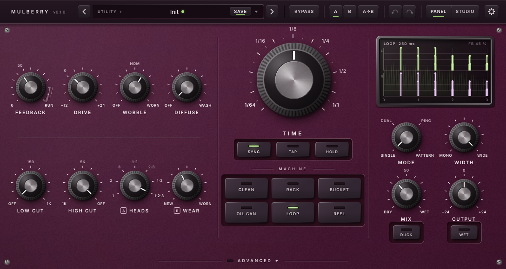

# Mulberry UI design

Everything on screen is drawn in code (`src/ui`), with the family's shared kit in `common/ui`
(knobs, keys, header, two-view editor, studio controls, meters). The only bundled asset is the
Inter typeface. Read `common/DESIGN.md` first: this file only records what is Mulberry's own.

## Identity: same family, a darker fruit

Mulberry is Umber's and Cerulean's sibling: one hardware screen, three columns, a hero knob in
the centre, a glass window top right, the same knobs, keys, header rail, type and lighting.

- **Ground:** deep mulberry powder coat (`panelTop` #4e1a37 → `panelBottom` #41152e) with the
  family grain and top-left falloff.
- **Silkscreen:** pale rose-white caps (`legend` #f7eef3), secondary legends `legendDim` #d6b9c9.
- **Accent:** one **leaf green** (`accent` #a6e07a), only for things that are *on*: key LEDs, the
  A/B slot, the ADVANCED LED, the unsaved dot, focus, the echo spikes and the Pattern steps.
- **Caution:** **amber** (`caution` #f0b45a), only for Bypass (the lit key and the BYPASSED stamp).
  The Feedback RUN zone is **not** caution: it is engraved and hatched in `runHatch` (the
  legend ink), so self-oscillation reads as a range of the control, not as an alarm.
- **Echo map:** smoked glass over a near-black plum screen, the darkest window on the panel.
  Left-output spikes are a pale leaf (`spike`), right-output a pale mauve (`spikeRight`).

### Contrast

Against the panel (both gradient ends): `legend` 12.1–13.5:1, `legendDim` 7.6–8.5:1, `focus`
10.1–11.3:1, `accent` 8.9–9.9:1, `caution` 7.5–8.3:1. Screen text on the echo map 12.2:1.
Studio text 14.8:1, dim studio text 7.5:1.

## Tokens

`Theme.h` / `Theme.cpp`: `Palette` (the shared panel tokens), `Extras` (bezel, screen, grid, beat
grid, spike colours, live fill, step fill and edge, `runHatch`, drawer values), `StudioPalette`
and `StudioExtras` (`lineLeft`, `lineRight`, `step`). Drawing code uses these only; no colour
literals except neutral black/white shading alphas.

## Layout grid (base 1088 × 580)

Three columns separated by vertical grooves at x 468 and 792 (y 80–512).

| Area | Contents |
|---|---|
| Left, x 20–456 | 4 × 2 knobs of Ø64, columns at 66 / 178 / 290 / 402, rows at y 188 and 400. Top row: the loop (Feedback, Drive, Wobble, Diffuse). Bottom row: its colour (Low Cut, High Cut, Param A, Param B). A horizontal groove at y 296 between them |
| Centre, x 476–784 | Time, Ø160 hero at (630, 170); SYNC / TAP / HOLD keys (72 × 32, gap 12) at y 306 in one well; the six machine keys (92 × 44, gap 8, 2 × 3) from y 384 under a MACHINE legend |
| Right, x 800–1068 | The echo map (808, 76, 256 × 156); Mode and Ⓜ knobs (Ø64) at (874, 296) and (998, 296); Mix and Output at y 418; DUCK and WET keys (58 × 30) at y 486 under them |

**The 4 × 2 grid (PLAN.md "Open" 1), decided:** kept. Diffuse stays on the panel, since it is a
sound control people ride. At the first draft's 100 px column pitch the end labels of
neighbours met ("WORNOFF"); the left column grew to 112 px pitch by narrowing the centre
(machine keys 96 → 92 px) and the hero to Ø160, and end labels were kept short (Oil Can's
Brushes reads 1 … 5, Oil NEW … OLD).

### Advanced deck

A 132 px lower section under the panel; the window grows by it, nothing is covered. One row of
Ø36 knobs (cell 70 px) in labelled groups, each value printed underneath:

TIME: Groove, Feel · STEREO: Width, X-Feed, Pan rule · MOTION: Rate, Shape · MACHINE: Noise,
Trails (key) · DUCK: Amount, Threshold, Release · TEMPO: BPM · HOLD: Mode.

X-Feed dims outside Dual, Pan rule outside Pattern, BPM while the host gives the tempo.

## Controls and interaction rules

The family's rules (`common/DESIGN.md`): vertical drag, Shift fine, double-click default,
Alt/Ctrl/right-click to type, wheel, arrows; every edit one host gesture and one undo step.
Mulberry's additions:

- **Controls that change meaning** re-bind or re-style and crossfade their printed scale
  (`KnobScale`, sized per knob):
  - Param A / B relabel per machine (GLIDE / SHIFT, BITS / RATE, CHIP / COMPANDER, BRUSHES /
    OIL, HEADS / WEAR, SPEED / BIAS). Stepped A's (Bits 9, Chip 4, Heads 7, Speed 3) step one
    position per wheel notch or arrow; dragging stays continuous. Clean's Shift and Reel's Bias
    have a centre detent.
  - Time is ms (log scale, 1 ms – 4 s) or, with SYNC, the 21-position note switch whose
    read-out names the note and its length ("1/8D  375 ms", "· folded" when folded under 4 s).
  - Ⓜ (right of Mode) is Width in Single and Ping-Pong, Right time (ms or note) in Dual, Steps in
    Pattern. Each meaning is its own parameter and automation lane (PLAN.md Deviations 1).
  - With Loop in Pattern mode, Heads dims: the pattern replaces the heads.
- **Feedback** prints 0, 50 and RUN at its end; 100–120 % is an engraved, hatched band on the
  scale.
- **TAP** is a UI action, not a parameter: two or more taps set Time in ms (the mean of the
  last four intervals) and turn SYNC off; a 2 s pause starts over. The key flashes on each tap.
- **HOLD** latches, or with Hold Mode Momentary is held while pressed (the shared LampButton
  momentary mode). Hold is a performance switch: not undoable, not in presets.
- **Machine keys** are a radio group; a change is one undo step.
- **Pattern steps** are edited in the echo map: drag a step's bar up or down (one gesture per
  drag), double-click resets it to 100 %.

## Echo map

`EchoMap` draws, from the parameters alone (`EchoModel.h`, pure), the repeats of a click through
the tap plan: two lanes (left output above, right below), level in dB (−48 to 0) per spike, a
beat grid when synced (bars brighter, labels every beat or every bar) or round milliseconds when
free. The span shows the first few repeats (4.4 × the longest time, 2.2 × in Pattern), a whole
number of beats when synced. The loop gain per pass is Feedback × the machine's nominal loss at
1 kHz (`nominalPassDb`): the picture is a guide, the measured responses are in the NOTES.

The header line names the machine, the time(s) and "· folded"; on the right "FB nn %", with
"RUN" above 100 %. Behind the spikes, the live wet level scrolls (history 16 s at 60 Hz), as
Cerulean's tail display. Stamps: HOLD (accent), BYPASSED (caution; spikes dim to 28 %).

Layers: bezel, screen (grid and labels), echoes and glass are cached (`drawing::CachedLayer`);
only the live fill is drawn per frame, and the map repaints only when the newest column moves a
pixel.

## Two views

The panel (`MainPanel`) and the studio view (`StudioPanel`) share `PanelController` (presets,
A/B, meanings, value texts, the echo shape, Tap). Same parameters in both.

### Studio view (base 1088 × 580)

| Area | Contents |
|---|---|
| Machine card (12, 62, 184 × 228) | the six machines with taglines (keyboard: Up/Down) |
| Mode card (12, 302, 184 × 266) | the four modes; TRAILS switch; HOLD LATCH / PRESS |
| Echo card (208, 62, 640 × 228) | Time and Right as headline values (typed: "375 ms", "0.25 s", "1/8D"); SYNC, TAP chips; HOLD block; the echo graph, flat, with draggable Pattern steps |
| Five cards (208…, 302, 118 × 266) | LOOP: Feedback, Drive, Wobble, Rate, Shape · MACHINE: A, B, Diffuse, Low Cut, High Cut · STEREO: Width, Cross-feed, Pans, Steps · TIME: Groove, Feel, Noise, Tempo · DUCK (switch in the title): Amount, Thresh, Release |
| Output card (860, 62, 216 × 506) | IN / WET / OUT meters and DUCK reduction; Mix, Output, WET ONLY |

Synced times show the note with its length under the bar. Controls that do nothing in the
current mode dim (Right outside Dual, Cross-feed outside Dual, Pans and Steps outside Pattern,
Duck controls with Duck off, Tempo with host tempo).

## Rendering and caching

Panel artwork (grain, grooves, wells, the static knob scales, the RUN hatch) is one cached
layer per physical scale. Knob scales that change meaning are their own cached layers
(`KnobScale`, two during a crossfade). Repaint timings (`MulberryUiSnapshot --time`): about 2.3
ms per warm full repaint at 1x, 4.5 ms at 2x; `animateFrame` 0.002 ms.

## UI state keys

Shared keys (`common/plugin/UiState.h`: scale, view) plus `advancedOpen` (`UiState.h`). Frozen.

## Snapshot tool

`MulberryUiSnapshot <dir>` renders the scenes into `docs/screenshots/` (panel 01–15, studio
20–28); `--selftest` runs the interaction checks (`tools/ui_snapshot/SelfTest.cpp`: knobs,
detent, machine keys and legends, Sync binding, the Ⓜ knob per mode, Tap, Hold latch and
momentary, Pattern step drags, the deck, Bypass, undo, presets and A/B, scale, typed character
values, the studio view) and the shared editor checks.

## Files

| File | Contents |
|---|---|
| `Theme.{h,cpp}`, `StudioTheme.h` | palette, extras, panel and studio layout |
| `EchoModel.h` | the echo shape and events (pure) |
| `EchoMap.{h,cpp}` | the panel's echo map and Pattern editor |
| `KnobScale.{h,cpp}` | printed scales that crossfade with a control's meaning |
| `PanelController.{h,cpp}` | the model shared by both views: meanings, texts, Tap |
| `MainPanel.{h,cpp}` | the panel view |
| `AdvancedDrawer.{h,cpp}` | the Advanced deck and its tab |
| `StudioPanel.{h,cpp}` | the studio view and its echo graph |
| `MulberryEditor.{h,cpp}`, `Header.{h,cpp}` | the editor and its header configuration |
| `FactoryPresets.{h,cpp}` | the 42 factory presets |
| `UiState.h` | Mulberry's UI state keys |
