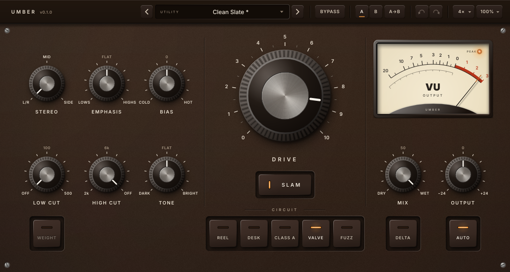

# Umber

An analog-modelled saturation plugin by **Myzel Audio**. Five circuit-level models on one
screen.



Formats: VST3, CLAP, LV2, Standalone (Linux first; Windows/macOS planned). Licence: AGPLv3.

**How to use it:** see the [manual](docs/MANUAL.md).

## The circuits

Each model is a real circuit, solved sample by sample at the oversampled rate, and validated
against an independent Python simulation of the same netlist (see each model's `NOTES.md`).

| Model | Circuit | Character |
|---|---|---|
| **Reel** | 12AX7 record amp, NAB pre-emphasis, Jiles–Atherton tape hysteresis, playback EQ with head bump | Gentlest. Soft, rounded; highs soften as you push |
| **Desk** | Input transformer, discrete line amp with soft rails and slew, output transformer (both cores hysteretic) | Bright and forward; lows saturate the iron first |
| **Class A** | Common-emitter BJT stage into a class-A emitter follower and a saturating output transformer | Fat low mids; asymmetric, punchy |
| **Valve** | 12AX7 common-cathode stage with grid conduction, Miller capacitance, cathode bias and supply sag | Warm, dense, 2nd-harmonic rich; squashes on hits |
| **Fuzz** | 12AX7 driver into an overdriven EL84 pentode and output transformer | Aggressive and odd-harmonic; sputters when slammed |

## Controls

**Drive** (with **Slam**, +20 dB) · **Circuit** selector · **Bias** (each circuit's operating
point: cold ↔ hot) · **Emphasis** (tilts the signal into the circuit and back out, so you choose
whether lows or highs saturate first without changing the tone) · **Stereo** (L/R, Mid only or
Side only) · **Tone** (tilt) · **Low Cut** with **Weight** (resonant bump) · **High Cut** ·
**Mix** · **Output** · **Auto** (loudness-matched output) · **Delta** (hear only what the circuit
adds) · VU meter (Output or Drive level). Header: presets (38 factory + user), Bypass, A/B,
undo/redo, quality (Eco 2x / Standard 4x / High 8x, plus a separate offline-render setting up to
16x), and UI scale (75–200 %).

## How it's built

- **Mixing inside the oversampled domain.** Dry and wet go through identical resampling
  filters, so any Mix setting blends without phase smearing.
- **One pre-allocated engine per quality setting.** Quality changes and offline bounces
  crossfade between engines: no clicks, no audio-thread allocation, constant latency.
- **Calibrated Auto gain.** `tools/calibrate` measures every circuit through the real chain
  (K-weighted loudness, ITU-R BS.1770) over drive, Bias and Emphasis and generates the
  compensation tables: loudness stays within ±0.7 dB from Drive 0 to Drive 10 + Slam, at any
  Bias and Emphasis setting.
- **Golden-file regression tests** for every model, so refactors can't change the sound silently.

## Building (Linux)

Dependencies (Ubuntu/Debian):

```sh
sudo apt install build-essential cmake ninja-build git pkg-config \
    libasound2-dev libjack-jackd2-dev libfreetype-dev libfontconfig1-dev \
    libx11-dev libxcomposite-dev libxcursor-dev libxext-dev libxi-dev \
    libxinerama-dev libxrandr-dev libxrender-dev
```

JUCE, the CLAP extensions, chowdsp_wdf, melatonin_blur and Catch2 are fetched by CPM. Build from the
repository root (`../..`); `-DMYZEL_PLUGINS=umber` builds only Umber, leave it out to build every plugin:

```sh
export CPM_SOURCE_CACHE=~/.cache/CPM   # optional: share downloads between build dirs
cmake -S . -B build -G Ninja -DCMAKE_BUILD_TYPE=Release -DMYZEL_PLUGINS=umber
cmake --build build
```

Plugins land in `build/plugins/umber/Umber_artefacts/Release/{VST3,CLAP,LV2,Standalone}`. Add
`-DMYZEL_COPY_PLUGINS=ON` to install them into `~/.vst3`, `~/.lv2` and `~/.clap` after each
build. For faster development builds add `-DMYZEL_ENABLE_LTO=OFF`.

## Testing

```sh
ctest --test-dir build --output-on-failure                           # all suites (chain + one per model)
xvfb-run -a tools/pluginval.sh umber build                       # pluginval, strictness 10
build/plugins/umber/tests/UmberTests "[.perf]"                # CPU report
build/plugins/umber/tests/UmberTests "[.quality]"             # aliasing report
UMBER_UPDATE_GOLDEN=1 build/plugins/umber/tests/UmberTests "[golden]"   # re-record after an intended sound change
build/plugins/umber/tools/UmberCalibrate_artefacts/Release/UmberCalibrate   # regenerate Auto gain tables
```

## Licence

AGPLv3. See [LICENSE](../../LICENSE). Built with [JUCE](https://juce.com) under its AGPLv3 option. The
bundled Inter font is under the SIL Open Font License (see `src/ui/assets/`).
