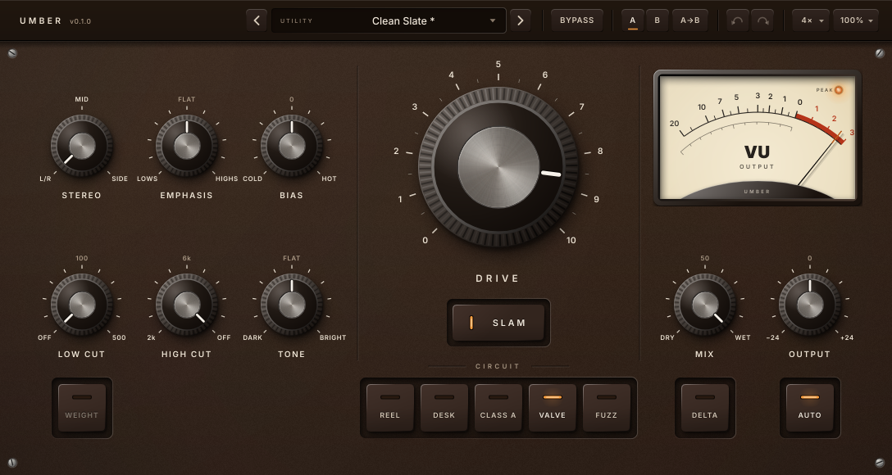

# Umber manual

Umber is a saturator. Five real circuits are simulated at component level. Pick one, push
it with Drive, then shape what goes in and what comes out. Auto gain keeps the loudness steady,
so you hear the colour, not just "louder".

## Quick start

1. Insert Umber. **Auto** is on, so the output stays as loud as the input.
2. Pick a **Circuit**, then turn **Drive** until you like the colour. Around 3 is subtle, 6 is
   obvious, and 10 is heavy. **Slam** adds another 20 dB for destruction.
3. Use **Mix** for parallel saturation and **Delta** to hear exactly what is being added.
4. Use **Bypass** (top right) to compare. Because of Auto gain, the comparison is fair.

## The circuits

| Circuit | Character | Good on |
|---|---|---|
| **Reel** | A tube record amp into magnetic tape. Gentlest: soft and rounded, the highs soften as you push. | Mix bus, drums, anything that should just sit better |
| **Desk** | A transformer console line amp. Bright and forward; the lows saturate the iron first. | Bass, drums, a whole mix |
| **Class A** | A discrete transistor stage with an output transformer. Fat low mids, asymmetric and punchy. | Snares, vocals, keys |
| **Valve** | A 12AX7 triode preamp. Warm and dense, rich in 2nd harmonic, squashes on hits. | Vocals, bass, guitars |
| **Fuzz** | A triode driving a power pentode. Aggressive and odd-harmonic; it gates and sputters when slammed. | Effects, leads, parallel crunch |

Switching circuits crossfades, so it never clicks.

## Controls

### Drive section (centre)

- **Drive** (0–10): how hard the circuit is pushed, from −6 dB to +36 dB into it.
- **Slam**: +20 dB more drive.
- **Circuit**: the five keys above.

### Into the circuit (top left)

- **Stereo**: what goes through the circuit.
  - **L/R**: left and right, each through its own circuit (normal stereo).
  - **Mid**: only the centre (L+R) is saturated. The sides stay clean, which keeps the stereo
    image steady.
  - **Side**: only the sides (L−R) are saturated. The sides get denser and the image wider;
    the centre (kick, bass, lead vocal) stays clean.
  - With mono input, this switch has no effect.
- **Emphasis** (Lows ↔ Flat ↔ Highs): tilts the signal by up to 6 dB per side around 1 kHz
  before the circuit, and applies exactly the opposite tilt after it. The tone stays the same;
  what changes is which frequencies saturate first.
  - **Highs**: crunch and bite without muddy low end.
  - **Lows**: thick, warm bottom while the top stays clean.
- **Bias** (Cold ↔ 0 ↔ Hot): moves the circuit's operating point, like the bias trim on real
  hardware. Each circuit answers differently (see below). At 0 it is the circuit as designed.

### EQ (bottom left)

- **Low Cut** (Off–500 Hz, 12 dB/oct): removes lows *before* the circuit, so they do not drive
  it. **Weight** adds a resonant bump at the cutoff (it only works while Low Cut is on).
- **High Cut** (2 kHz–Off, 12 dB/oct): removes highs *after* the circuit, which tames fizz.
- **Tone** (Dark ↔ Flat ↔ Bright): a gentle tilt after the circuit, around 800 Hz.

### Output (right)

- **Mix**: dry to wet. The dry signal is latency-aligned and goes through the same resampling,
  so any blend is phase-coherent (no comb filtering).
- **Output** (±24 dB): final level trim.
- **Auto**: keeps the perceived loudness constant whatever Drive, Bias, Emphasis and circuit you
  choose (calibrated per circuit; typically within ±0.7 dB on full-range material). Turn it off
  if you want the level to rise as you drive.
- **Delta**: plays only what the circuit adds (processed minus dry). Use it to set Drive and
  Bias by ear, or to hear how the circuits differ. It is a listening switch: it is not saved in
  presets and is not undoable.
- **VU meter**: click it to switch between **Output** level (0 VU = −18 dBFS) and **Drive**
  level, the signal hitting the circuit (0 VU = −12 dBFS). The peak lamp lights at −0.1 dBFS.

### Header

Presets (the ‹ › arrows step through them), **Bypass**, **A/B** compare (A→B copies the current
setting to the other slot), undo and redo, oversampling quality, and window size (75–200 %; you
can also resize the plugin window in your host, which keeps the proportions).

## What Bias does on each circuit

Measured with a 1 kHz tone at 0 dBFS, Drive at 0 dB. H2 is the second harmonic (even, "warm");
H3 is the third (odd, "edgy").

| Circuit | What the knob adjusts | Cold | Hot |
|---|---|---|---|
| **Reel** | Record amp grid bias | Strongly even (H2 +12 dB) | Near-symmetric, odd-dominant (H2 −12 dB) |
| **Desk** | Line-amp offset trim | Asymmetric clipping, strongly even | The same, mirrored (both sides add H2) |
| **Class A** | Emitter-current trim | Cleaner, softer | Much more H2, clips earlier and harder |
| **Valve** | Grid bias supply | More H2, towards cutoff | Less H2, the peaks clamp (more H3) |
| **Fuzz** | Power tube fixed bias | Starved: gates and sputters | Fuller, compresses earlier |

Bias moves smoothly while audio plays. You can automate it without thumps or clicks.

## Quality and CPU

The circuits run oversampled, which keeps their distortion from folding back as aliasing.

| Setting | Oversampling | CPU per stereo instance (48 kHz) |
|---|---|---|
| Eco | 2x | about 1.5–2.5 % of one core |
| Standard (default) | 4x | about 2.7–5 % |
| High | 8x | about 5–10 % |

**Offline render** (in the quality menu) sets the oversampling for offline bounces: the same as
realtime, 8x or 16x. Switching quality crossfades, and the plugin's latency stays the same in
every mode, so your timing never shifts.

## Presets

There are 38 factory presets in seven categories, plus your own. Use **Save as** in the preset
menu to save one. User presets are plain files in `~/.config/Myzel Audio/Umber/Presets` (Linux).

Presets store the sound only. Quality, Bypass and Delta belong to the session. A preset made
before a control existed loads with that control at its default.

## Mouse and keyboard

| Action | Knobs |
|---|---|
| Drag up/down | Adjust (Shift for fine) |
| Double-click | Reset to default |
| Right-click, Alt-, Ctrl- or Cmd-click | Type a value ("120 Hz", "Highs 4", "Cold 2.5", …) |
| Mouse wheel | Adjust (Shift for fine). Stereo moves one position per notch |
| Arrow keys, Page Up/Down, Home/End | Step, big step, minimum, maximum |

Hover over any control for a tooltip and its current value.

## Tips

- **Mix bus glue:** Reel or Desk, Drive 2–3, Auto on. Try **Mid** to keep the stereo image
  untouched.
- **Width without mud:** **Side** mode with Emphasis towards Highs.
- **Parallel crunch on drums:** Fuzz or Valve with Slam, Mix 25–40 %.
- **Bass that cuts through:** Emphasis to Highs, so only the top end gets grit while the
  fundamental stays clean.
- **Find the sweet spot fast:** turn on Delta, sweep Bias and Drive, then turn Delta off.
