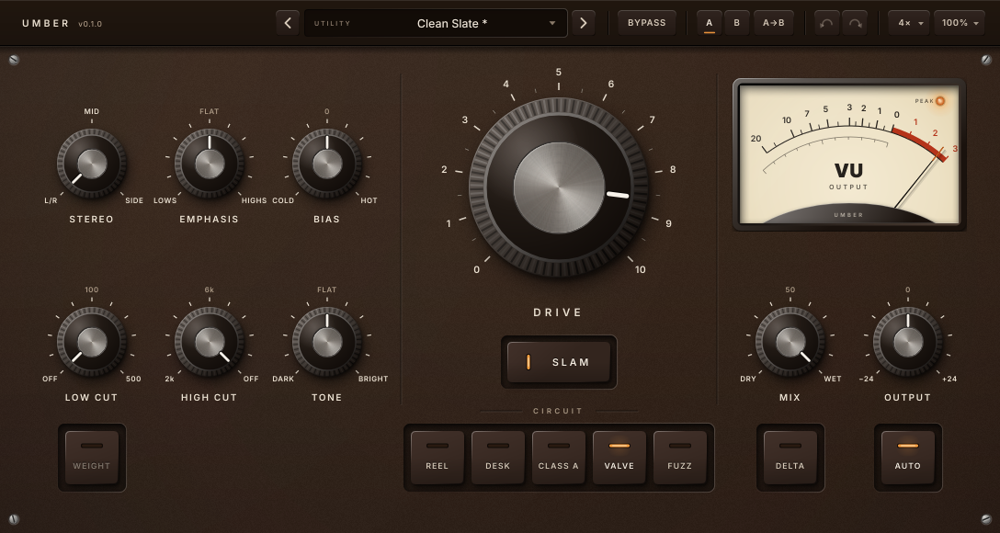

# Umber UI design

Everything on screen is drawn in code (`src/ui`). No bitmap art is used. The only bundled asset is
the Inter typeface (SIL OFL 1.1, `assets/fonts/OFL.txt`).



## Identity: studio hardware

The panel should read like a well-made piece of studio outboard: calm, legible, quietly analog.
Nothing on it is decorative. There is no logo, no emblem and no glow effect.

- **Ground:** matte dark umber (deep earth brown) powder coat with a fine grain and a very soft top-left falloff.
- **Silkscreen:** warm cream Inter SemiBold caps. Secondary text is a dim tan.
- **Knobs:** black knurled grips with turned aluminium caps and an off-white pointer inlay. Drive
  is the same knob, just larger.
- **Accent:** one amber, used only for things that are *on*: key LEDs, the selected A/B slot, the
  peak lamp, focus rings and text selection. Everything else is a shade of brown.
- **Keys:** console-style keys (model, Slam, Weight, Auto). Each has a thin LED bar set into
  the cap: horizontal above the label on square keys, vertical left of the label on Slam. Off, the
  bar is a dark slot; on, it lights amber with a little light on the cap around it.
- **Name:** "UMBER" set plainly in the header, small, tracked caps. No mark, no effects.
- **Meter:** a classic cream VU face, the one light surface on the dark brown panel.

The look is original. It does not copy the colours, artwork, layout or knob design of any
existing product.

## Lighting

There is one light source, at the **top-left**, and every element follows it:

- Contact shadows fall down and to the right (`metrics::shadowDx/Dy` × elevation, via melatonin_blur).
- Raised edges (knob rims, key bevels, bezel) are lit on the upper-left and dark on the lower-right.
- Recessed things (wells, the meter window, the pointer inlay, screw slots) are the reverse: their
  upper-left wall is in shadow.
- Knob knurling is shaded by each ridge's *current* angle to the light. When a knob turns, the
  ridges rotate but the highlight stays put. The knob's body, cap and specular highlight are
  cached and never rotate. Only the ridges and the pointer are drawn per frame.
- Glass (meter, preset window) always has its specular highlight on the upper-left.

## Tokens

All tokens live in `Theme.h`:

- `Palette`: every colour (panel, legend, header, knob, accent/LED, meter, feedback).
- `metrics`: the base size (1088 × 580), header height, scale limits, shadow direction, type sizes,
  knob sweep (±135°) and LED fade time (80 ms).
- `layout`: the position of every control (the grid below).
- `Fonts`: Inter Medium (values, menus), Inter SemiBold (name, legends, keys, numerals) and
  Inter Display Black (the VU legend only). They are shared through `SharedResourcePointer`.

Type: legends are SemiBold caps, 12 px, with +0.14 tracking. Scale numerals are 9.5 px (small
knobs) or 12.5 px (Drive). Key labels are 10.5 px. The Drive title is 14 px with +0.30 tracking.
The header name is 12.5 px with +0.26 tracking. Values and menus use Medium 12.5–15 px.

## Layout grid (base 1088 × 580)

```
 0 ┌───────────────────────────────────────────────────────────────────────────────────────┐
   │ UMBER          ‹ [CATEGORY  Preset name        ▾] ›  BYPASS │ A B A→B │ ↶ ↷ │ 4× │ 100% │
50 ├────────────────────────────────┬──────────────────────────┬───────────────────────────┤
   │ STEREO   EMPHASIS   BIAS       │      DRIVE (Ø196)        │   VU meter 256×168        │
   │ 100,178  228,178    356,178    │      centre 608,204      │   at 796,84               │
   │                                │                          │                           │
   │ LOW CUT  HIGH CUT   TONE       │        [ SLAM ]          │   MIX        OUTPUT       │
   │ 100,372  228,372    356,372    │      552,372 112×44      │   860,372    988,372      │
   │                                │ ───── CIRCUIT ─────      │                           │
   │ [WEIGHT]                       │ [REEL][DESK][CLASS A][VALVE][FUZZ]  [DELTA]   [AUTO]  │
   │                                │      keys 58×58, gap 8, rail centre y 498            │
580└───────────────────────────────────────────────────────────────────────────────────────┘
     left block 28–428                centre 444–772             right column 788–1060
```

- Three columns, separated by engraved grooves at x = 436 and 780 (`layout::leftGrooveX`,
  `rightGrooveX`). The left block is a 3 × 2 grid of Ø76 knobs: the top row shapes what the
  circuit sees (Stereo, Emphasis, Bias, ordered towards Drive), the bottom row is the EQ. The
  centre holds Drive, Slam and the circuit selector; the right holds the meter and output.
- Each toggle key sits directly under the knob it modifies: Weight under Low Cut, Delta under
  Mix, Auto under Output. All keys share one rail baseline.
- Stereo is a 3-position rotary switch (`KnobStyle::steps`): drag snaps, and the wheel and
  arrow keys move one position at a time.
- Component bounds are snapped to a 4-unit grid. At every menu scale (75/100/125/150/175/200 %)
  they then land on whole device pixels, so the cached layers are blitted 1:1 and stay sharp.

## Controls and interaction rules

| Gesture | Knobs | Keys / buttons |
|---|---|---|
| Drag | vertical. Full range is 260 px (Drive: 320 px). Unbounded: the cursor hides and returns. | — |
| Shift-drag / Shift-wheel / Shift-arrows | ×0.12 (fine) | — |
| Double-click / Delete | reset to the parameter default | — |
| Alt-, Ctrl-/Cmd- or right-click / Return | type a value (parsed by the parameter's own text function) | — |
| Wheel | ±6 % per notch. One host gesture per burst (closed after 350 ms). | — |
| Arrows / PgUp / PgDn / Home / End | step 2 % / 10 % / min / max | Space/Return toggles |
| Hover | shows the value in place of the legend, plus a faint off-white ring | brighter key face |

- Tone, Emphasis and Bias have a **centre detent**: dragging through 12 o'clock sticks at the
  centre for a short distance.
- Bypass (header) and Delta (rail) are listening switches: they are not stored in presets or A/B
  slots and do not enter the undo history.
- Every other edit is wrapped in a host gesture (begin/end) and starts a new undo transaction through
  `ParameterAttachment`. Pending wheel gestures are closed before any other edit, so gestures never nest.
- Keyboard focus shows an amber focus ring, but only when focus arrived by keyboard.
- Accessibility: knobs expose a slider role with a ranged value interface. Screen readers read the
  parameter's own text ("Bright 3.2", "120 Hz") and can type values. Keys are JUCE buttons
  (toggle or radio role) with titles. The meter is a button ("switch Output/Drive").
- Tooltips (0.9 s delay) explain each control and model.
- Weight's LED dims to 28 % when Low Cut is Off, because Weight has no effect then.

## Animation

A single `VBlankAttachment` in `MainPanel` is the frame clock. Each frame:

1. **Key LEDs** fade towards their state with τ = fade / 3 (about 95 % in 80 ms). They are
   steady: no flicker and no level-dependent brightness.
2. **VU meter**: a second-order needle model (ζ = 0.79, ωn = 13.2 rad/s). It reaches 99 % in about
   300 ms with about 1.2 % overshoot, and the scale is voltage-linear like a real VU. 0 VU =
   −18 dBFS for Output and −12 dBFS for Drive. The peak lamp lights when the output peak reaches
   −0.1 dBFS (held 0.6 s). Click the meter to switch modes. The mode is saved in the UI state.
3. Every 6 frames the header refreshes: preset modified flag, undo/redo availability and the
   effective oversampling factor.

Each element repaints only its own bounds, and only when its visible state changes by more than a
small threshold. The frame logic costs well under 1 µs and allocates nothing.

## Rendering and caching

`drawing::CachedLayer` renders static artwork into an image at the **physical** pixel scale
(editor scale × display scale). It re-renders only when that scale or the size changes. Cached:
the whole panel (ground and grain, scales, legends, wells, screws), knob bodies and caps,
key faces, the meter bezel, face and glass, the header rail and name, and the preset window. Images are drawn with an explicit opacity: JUCE otherwise uses the current
colour's alpha.

Measured with the snapshot tool (Release): a full warm repaint takes about 2.9 ms at 1× and
9.4 ms at 2×. A cold repaint, which builds all caches, takes about 30 ms at 1× and 105 ms at 2×.
A cold repaint happens only on open or resize.

## Scaling

The editor holds one `MainPanel` at the base size and applies `AffineTransform::scale`. The
window is resizable with a fixed aspect ratio, from 75 % to 200 %. The scale menu offers
75–200 % in 25 % steps. The scale is stored in `getUiState()` and restored on open.

## Presets, A/B, undo

- `FactoryPresets.cpp` has 38 factory presets compiled into the binary, in seven categories:
  Utility, Drums, Bass, Vocals, Guitar & Keys, Mix Bus, and Lo-Fi & Destruction.
- User presets are XML files (`<UmberPreset name=… drive=… …/>`) in
  `~/.config/Myzel Audio/Umber/Presets` (`userApplicationDataDirectory`). The menu can save, save
  as, rename, delete, show the folder and rescan. Dialogs are drawn inside the editor
  (`InlineDialog`), so no OS windows are opened.
- Presets cover the sound parameters only (including Stereo, Emphasis and Bias). Quality, Render,
  Bypass and Delta are session settings. A preset that predates a parameter loads it at its
  default, so nothing from the previous sound leaks through.
- Loading a preset is one undo transaction. Every parameter change is sent as a host gesture.
- A/B keeps two snapshots in the UI state. The active slot is always the live sound. Switching is
  undoable. "A→B" copies the live sound to the other slot.

UI state keys (`UiState.h`, never rename): `scale`, `meterMode`, `presetName`, `presetIsUser`,
`abActive`, and the `SlotA` / `SlotB` children.

## Files

| File | Role |
|---|---|
| `Theme` | palette, metrics, layout grid, fonts |
| `Drawing` | cached layers, legends, screws, recesses, shadows, grain, glow |
| `PanelArtwork` | the static front panel |
| `Knob` | rotary control and its accessibility |
| `LampButton` | LED keys (model, Slam, Weight, Auto) |
| `NeedleMeter`, `VuBallistics` | VU meter |
| `ValueBubble` | in-place value read-out |
| `HeaderBar`, `HeaderButton`, `PresetDisplay` | header rail |
| `PresetManager`, `FactoryPresets`, `AbCompare` | preset and compare logic |
| `InlineDialog` | in-editor save/rename/delete prompts |
| `UmberLookAndFeel` | popup menus, tooltips, text fields |
| `MainPanel` | composition, frame clock |
| `UmberEditor` | scaling host |

## Snapshot tool

```
cmake --build build-ui --target UmberUiSnapshot
xvfb-run -a -s "-screen 0 3000x2000x24" build-ui/plugins/umber/tools/UmberUiSnapshot_artefacts/Release/UmberUiSnapshot plugins/umber/docs/screenshots
… UmberUiSnapshot --selftest              # drag/fine/reset/wheel/detent/a11y/undo/presets/A-B/scale checks
… UmberUiSnapshot --leakcheck             # open/close the editor 8× (use a Debug build for the leak detector)
```

The xvfb screen must be larger than the editor. On the default 640 × 480 screen, JUCE constrains
the window and the snapshots come out at 75 %.
